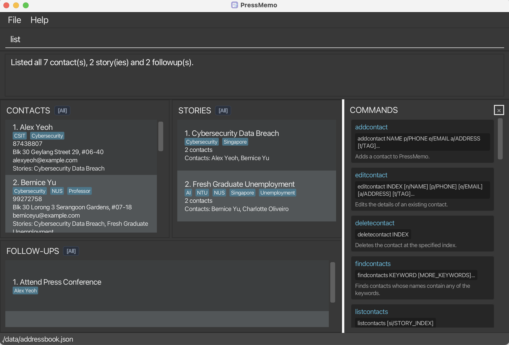

# PressMemo

## Problem Statement

Journalists manage many contacts across several stories, often while working under tight deadlines. It can be difficult to recall who to contact and why they are relevant. PressMemo is a command-line workspace for organizing contacts and managing stories.

## Target Audience

Journalists and reporters who manage multiple sources and stories, and prefer using a command-line interface (CLI).

## Key features
* Add contacts and stories
* Assign stories to a contact
* Add follow-ups for a contact
* Tag contacts and stories with additional information 
* List all contacts, stories and follow-ups in a single window 
* Find contacts, stories and follow-ups by keyword search
* Find contacts, stories and follow-ups linked to a particular contact or story
* Create shortcuts for commands

This project is based on the AddressBook-Level3 project created by the [SE-EDU initiative](https://se-education.org).
