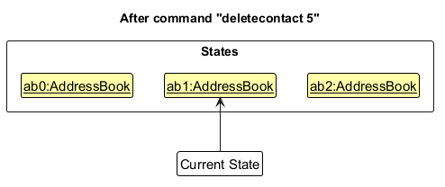
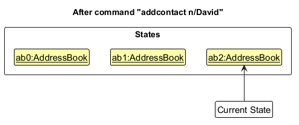

* Table of Contents
{:toc}

--------------------------------------------------------------------------------------------------------------------

## **Acknowledgements**

* _{List the sources of reused or adapted ideas, code, documentation, and third-party libraries here, with links to the originals.}_

--------------------------------------------------------------------------------------------------------------------

## **Setting up, getting started**

Refer to the guide [_Setting up and getting started_](SettingUp.md).

--------------------------------------------------------------------------------------------------------------------

## **Design**

:bulb: **Tip:** The `.puml` files used to create diagrams are in `docs/diagrams`. Refer to the [_PlantUML Tutorial_ at se-edu/guides](https://se-education.org/guides/tutorials/plantUml.html) to learn how to create and edit diagrams.

### Architecture

The ***Architecture Diagram*** given above explains the high-level design of the App.

The following provides a quick overview of the main components and their interactions.

**Main components of the architecture**

**`Main`** (consisting of classes [`Main`](https://github.com/AY2627S1-CS2103T-T13-3/tp/tree/master/src/main/java/seedu/address/Main.java) and [`MainApp`](https://github.com/AY2627S1-CS2103T-T13-3/tp/tree/master/src/main/java/seedu/address/MainApp.java)) is in charge of the app launch and shut down.
* At app launch, it initializes the other components in the correct sequence, and connects them up with each other.
* At shut down, it shuts down the other components and invokes cleanup methods where necessary.

The bulk of the app's work is done by the following four components:

* [**`UI`**](#ui-component): The UI of the App.
* [**`Logic`**](#logic-component): The command executor.
* [**`Model`**](#model-component): Holds the data of the App in memory.
* [**`Storage`**](#storage-component): Reads data from, and writes data to, the hard disk.

[**`Commons`**](#common-classes) represents a collection of classes used by multiple other components.

**How the architecture components interact with each other**

The *Sequence Diagram* below shows how the components interact with each other for the scenario where the user issues the command `deletecontact 1`.

Each of the four main components (also shown in the diagram above),

* defines its *API* in an `interface` with the same name as the Component.
* provides its functionality through a concrete `{Component Name}Manager` class that implements the corresponding API interface.

For example, the `Logic` component defines its API in `Logic.java` and implements it in `LogicManager.java`. Other components interact with a component through its interface rather than its concrete class, preventing them from coupling to that component's implementation, as illustrated in the following partial class diagram.

The sections below give more details of each component.

### UI component

The **API** of this component is specified in [`Ui.java`](https://github.com/AY2627S1-CS2103T-T13-3/tp/tree/master/src/main/java/seedu/address/ui/Ui.java).

The UI consists of a `MainWindow` and its parts, such as `CommandBox`, `ResultDisplay`, `ContactListPanel`, `HelpPanel`, and `StatusBarFooter`. All of these, including `MainWindow`, inherit from the abstract `UiPart` class, which captures common behavior among classes that represent visible GUI parts.
For example, [`MainWindow.fxml`](https://github.com/AY2627S1-CS2103T-T13-3/tp/tree/master/src/main/resources/view/MainWindow.fxml) specifies the layout of [`MainWindow`](https://github.com/AY2627S1-CS2103T-T13-3/tp/tree/master/src/main/java/seedu/address/ui/MainWindow.java).

The `UI` component uses the JavaFX UI framework. Its layouts are defined in `.fxml` files in `src/main/resources/view`. [`MainWindow.fxml`](https://github.com/AY2627S1-CS2103T-T13-3/tp/blob/64f6b41/src/main/resources/view/MainWindow.fxml) places **CONTACTS** and **STORIES** side by side, with **FOLLOW-UPS** beneath them, alongside an embedded, collapsible `HelpPanel` on the right. The command box and result display sit above the panels, and the status bar sits below them. [`MainWindow.fillInnerParts()`](https://github.com/AY2627S1-CS2103T-T13-3/tp/blob/64f6b41/src/main/java/seedu/address/ui/MainWindow.java) creates each part and inserts its root into the corresponding FXML placeholder.

There are three list panels and a collapsible help panel:

Panel | Card and layout | Displayed information
------|-----------------|----------------------
`ContactListPanel` | `ContactCard`, `ContactListCard.fxml` | Displayed index, name, contact details, tags, and assigned story names. Displays `Stories: (none)` when unassigned.
`StoryListPanel` | `StoryCard`, `StoryListCard.fxml` | Displayed index, story name, tags, assigned contact count, and contact names. Displays `Contacts: (none)` when unassigned.
`FollowupListPanel` | `FollowupCard`, `FollowupListCard.fxml` | Displayed index, follow-up description, and contact name. Followups for the same contact are shown together by default.
`HelpPanel` | `HelpPanel.fxml` | Available built-in commands with syntax and descriptions. Can be toggled open/closed via `help`.

The `UI` component,

* executes user commands using the `Logic` component.
* listens for changes to `Model` data so that the UI can be updated with the modified data.
* binds visual filter status indicators (`contactFilterIndicator`, `storyFilterIndicator`, `followupFilterIndicator`) directly to the observable filter status properties exposed by `Logic`, dynamically updating styled status badges (`[All]` vs `[Filtered: ...]`) across the panel headers.
* keeps a reference to the `Logic` component, because the `UI` relies on the `Logic` to execute commands.
* depends on some classes in the `Model` component because it displays `Contact`, `Story` and `Followup` objects from the model.

### Logic component

**API** : [`Logic.java`](https://github.com/AY2627S1-CS2103T-T13-3/tp/tree/master/src/main/java/seedu/address/logic/Logic.java)

Here's a (partial) class diagram of the `Logic` component:

The sequence diagram below illustrates the interactions within the `Logic` component, taking `execute("deletecontact 1")` API call as an example.

:information_source: **Note:** The lifeline for `DeleteCommandParser` should end at the destroy marker (X), but due to a limitation of PlantUML, it continues to the end of the diagram.

How the `Logic` component works:

1. When `Logic` is called upon to execute a command, the command is passed to an `AddressBookParser` object, which in turn creates a parser that matches the command (e.g., `DeleteCommandParser`) and uses it to parse the command.
1. This results in a `Command` object (more precisely, an object of one of its subclasses e.g., `DeleteCommand`) which is executed by the `LogicManager`.
1. The command can communicate with the `Model` when it is executed (e.g. to delete a contact). 
   Note that although this is shown as a single step in the diagram above for simplicity, the code can require several interactions between the command object and the `Model` to complete the operation.
1. The result of the command execution is encapsulated as a `CommandResult` object which is returned from `Logic`.

Here are the other classes in `Logic` (omitted from the class diagram above) that are used for parsing a user command:

How the parsing works:
* When called upon to parse a user command, the `AddressBookParser` class creates an `XYZCommandParser` (`XYZ` is a placeholder for the specific command name, e.g., `AddCommandParser`). The parser uses the other classes shown above to parse the user command and create an `XYZCommand` object (e.g., `AddCommand`). The `AddressBookParser` returns that object as a `Command` object.
* All `XYZCommandParser` classes, such as `AddCommandParser` and `DeleteCommandParser`, implement the `Parser` interface so they can be treated similarly where appropriate, for example during testing.

### Model component
**API** : [`Model.java`](https://github.com/AY2627S1-CS2103T-T13-3/tp/tree/master/src/main/java/seedu/address/model/Model.java)

The `Model` component,

* stores the PressMemo data:
  * all `Contact` objects (which are contained in a `UniqueContactList` object).
  * all `Story` objects (which are contained in a `UniqueStoryList` object).
  * all `Followup` objects (which are contained in a `UniqueFollowupList` object).
* stores the `Contact` objects selected by the current filter, such as search results, in a separate _filtered_ list.
  * It exposes this list as an unmodifiable `ObservableList<Contact>` that the UI can observe and bind to, so the UI updates when the list changes.
  * It does the same for `Story`, `Followup`
* maintains observable filter status properties (`getContactFilterStatusProperty()`, `getStoryFilterStatusProperty()`, `getFollowupFilterStatusProperty()`) that reflect whether each panel displays all entries (`"All"`) or active filter/search criteria (e.g. `"Filtered: \"keyword\""` or `"Filtered by story: \"Investigation\""`).
* stores a `UserPrefs` object that represents the user’s preferences (GUI settings and command shortcuts). This is exposed to the outside as a `ReadOnlyUserPrefs` object.
* does not depend on any of the other three components (as the `Model` represents data entities of the domain, they should make sense on their own without depending on other components)

### Storage component

**API** : [`Storage.java`](https://github.com/AY2627S1-CS2103T-T13-3/tp/blob/master/src/main/java/seedu/address/storage/Storage.java)

The `Storage` component,
* can save contact, story, and follow-up data together in one JSON file, while storing user preferences in a separate JSON file, and read the data back into corresponding objects.
* is implemented by `StorageManager`, which delegates the actual JSON file access to `JsonAddressBookStorage` and `JsonUserPrefsStorage`.
* uses JSON-adapted classes to serialize and deserialize contacts, stories, follow-ups, and their associations.
* depends on some classes in the `Model` component (because the `Storage` component's job is to save/retrieve objects that belong to the `Model`).

### Common classes

Classes used by multiple components are in the `seedu.address.commons` package.

--------------------------------------------------------------------------------------------------------------------

# **Implementation**

This section describes some noteworthy details on how certain features are implemented.

### Assign feature

- **Objective:** Assigns an existing contact to an existing story while maintaining consistent assignments in both records.

#### API

- **Command:** `assign ci/CONTACT_INDEX si/STORY_INDEX`
- **Parameters:** refer to [User Guide](UserGuide.md#assigning-a-contact-to-a-story-assign)
- **Description:**
    - Creates an assignment between the specified contact and story.
- **Preconditions:**
    - Both indices refer to existing entries in the Active Contact List and Active Story List, respectively.
    - The specified contact is not already assigned to the specified story.
- **Postconditions:**
    - The specified story is added to the contact's assigned stories.
    - The specified contact is added to the story's assigned contacts.
    - Other assignments remain unchanged.
    - The Active Contact Filter and Active Story Filter are not reset.
- **Exceptions:**
    - If the command arguments are invalid: displays an error message for `ParseException`.
    - If either index is outside the corresponding Active List: displays an error message for `CommandException`.
    - If the contact is already assigned to the story: displays an error message for `CommandException`.

#### Implementation details

The `assign` command maintains a bidirectional association between `Contact` and `Story`. Each `Contact` stores a list of assigned story names, while each `Story` stores a list of assigned contact names.

Since both classes are immutable, assigning a contact to a story creates updated `Contact` and `Story` objects. `AddressBook` replaces the original objects in their respective lists to ensure that both sides of the assignment remain consistent.

The following sequence diagram illustrates the interactions within the Model component during the execution of a valid `assign ci/1 si/1` command, after index and assignment validation.

##### Execution flow

1. The user enters the `assign` command as an input string.
2. `LogicManager` receives the input string and passes it to `AddressBookParser`.
3. `AddressBookParser` creates an `AssignCommandParser` to parse the command arguments.
4. `AssignCommandParser` uses `AssignmentParserUtil` to parse the contact and story indices and creates an `AssignCommand` object.
5. `LogicManager` executes the `AssignCommand` object.
6. `AssignCommand` retrieves the specified contact and story from the Active Contact List and Active Story List and checks that both indices are valid.
7. `AssignCommand` checks whether the contact is already assigned to the story. If so, it throws a `CommandException`.
8. Otherwise, `AssignCommand` calls `Model.assignStory(contact, story)`.
9. `ModelManager` delegates the operation to `AddressBook.assignStory()`.
10. `AddressBook` calls `Contact.assign(story)` and `Story.assign(contact)` to create updated `Contact` and `Story` objects.
11. `AddressBook` replaces the original objects using `UniqueContactList.setContact()` and `UniqueStoryList.setStory()`.
12. `AssignCommand` returns a `CommandResult` containing a success message. `LogicManager` saves the updated data, and the UI reflects the new assignment.

#### Design Considerations

- **Aspect:** Maintaining assignments between contacts and stories.

| | Chosen: Store assignments in both Contact and Story | Alternative: Maintain a separate association collection |
| --- | --- | --- |
| **Pros** | Allows contacts and stories to retrieve their assignments directly without additional relationship lookups. | Stores each association in one central location, avoiding duplicated relationship information. |
| **Cons** | Requires updating both records to maintain consistency whenever an assignment changes. | Requires additional lookups to retrieve assignments and management of a separate association collection. |
## `addstory`

- **Objective:** Adds a story to PressMemo

### API

* **Command:** `addstory STORY_NAME [t/TAG]…`
* **Parameters**: refer to [user guide](UserGuide.md#adding-a-story-addstory)
* **Description:**
	* Adds a story with the specified name and (optionally) tags to ArchiveStoryList
* **Preconditions:** 
	* `STORY_NAME` is not the name of any existing story in ArchiveStoryList
* **Postconditions:** 
	* A story with the specified name and tags is added to the ArchiveStoryList
	* ActiveStoryList is refreshed for the updated ArchiveStoryList.
* **Exceptions:** 
	* if `STORY_NAME` is the name of some existing story in ArchiveStoryList: console displays error message

### Implementation details

Each `Story` contains a story name and a set of tags. Upon creation, the `Story` has no assigned contacts (list of assigned contact names is empty).

The `addstory` command creates the new `Story` object and `AddressBook`	adds it to the end of the ArchiveStoryList.

The following sequence diagram illustrates the interactions within the `Logic` component during the execution of a valid `addstory Investigation t/urgent` command where the ArchiveStoryList does not contain a story with the same name.

#### Execution flow
1. The user enters the `addstory` command as an input string.
2. `LogicManager` receives the input string and passes it to `AddressBookParser`.
3. `AddressBookParser` creates an `AddStoryCommandParser` to parse the command arguments.
4. `AddStoryCommandParser` parses the story name and tags and creates an `AddStoryCommand` object.
5. `LogicManager` executes the `AddStoryCommand` object.
6. `AddStoryCommand` verifies that the specified story name is not the name of any existing story in ArchiveStoryList.
7. `AddStoryCommand` requests `Model` to add a new `Story` object with no assigned contacts and with the specified name and tags to PressMemo.
8. `Model` adds the `Story` to ActiveStoryList if it matches the ActiveStoryFilter.
9. `UI` updates the story panel accordingly. 

## `findstories`

- **Objective:** Finds stories whose names contain any of the given keywords (case-insensitive).

### API

* **Command:** `findstories STORY_NAME [MORE_KEYWORDS]...`
* **Parameters**: refer to [user guide](UserGuide.md#locating-stories-by-name-findstories)
* **Description:**
	* Set the ActiveStoryFilter to match exactly the stories from the ArchiveStoryList whose names contain at least one of the specified keywords.
* **Preconditions:** 
	* At least one keyword is provided in the command arguments.
* **Postconditions:** 
	* ActiveStoryFilter is updated to match exactly the stories from  whose names match at least one keyword in a case-insensitive, full-word comparison.
	* ActiveStoryList is refreshed for the updated ActiveStoryFilter.
	* ArchiveStoryList is unchanged.
* **Exceptions:** 
	* if no keywords are provided: console displays error message

### Implementation details

<!-- Note: FindStorySequenceDiagram.puml is located in docs/diagrams/FindStorySequenceDiagram.puml -->

#### Execution flow
1. The user enters the `findstories` command as an input string.
2. `LogicManager` receives the input string and passes it to `AddressBookParser`.
3. `AddressBookParser` creates a `FindStoryCommandParser` to parse the command arguments.
4. `FindStoryCommandParser` parses the arguments into keywords and creates a `FindStoryCommand` object.
5. `LogicManager` executes the `FindStoryCommand` object.
6. `FindStoryCommand` requests `Model` to update the ActiveStoryFilter to match exactly the stories from whose names match at least one keyword in a case-insensitive, full-word comparison.
7. `Model` updates the `ActiveStoryList`.
8. `FindStoryCommand` returns a `CommandResult` containing the number of matching stories.
9. `UI` updates the story panel accordingly. 

### Design Considerations

- **Aspect: Matching mechanism for story names**

|          | Chosen                                                                                                                                                         | Alternative                                                                     |
| -------- | -------------------------------------------------------------------------------------------------------------------------------------------------------------- | ------------------------------------------------------------------------------- |
| **Pros** | **Whole-word matching** avoids false positives on accidental substring matches (e.g., searching for "ad" will not match "broadcast"), ensuring high precision. | **Substring matching** allows partial matches without requiring complete words. |
| **Cons** | Users must type full words; partial terms will not return results.                                                                                             | May return many irrelevant stories containing common character sequences.       |

- **Aspect: Multiple keywords combination logic**

|          | Chosen                                                                                                      | Alternative                                                                                                             |
| -------- | ----------------------------------------------------------------------------------------------------------- | ----------------------------------------------------------------------------------------------------------------------- |
| **Pros** | **Disjunctive / OR search** allows flexible exploratory queries across multiple topics in a single command. | **Conjunctive / AND search** returns strictly targeted results matching every keyword.                                  |
| **Cons** | Results may be broader than intended if common words are included.                                          | Less flexible when looking for possible matches across multiple topics; yields zero results if even one keyword misses. |

## `listfollowups`

- **Objective:** Lists all follow-ups in PressMemo, or filters the follow-ups assigned to a specified contact in the Active Contact List.

### API

* **Command:** `listfollowups [ci/CONTACT_INDEX]`
* **Parameters:** Refer to the [User Guide](UserGuide.md#listing-follow-ups-listfollowups).
* **Description:**
	* Updates the ActiveFollowupList to display either all follow-ups from the ArchiveFollowupList or only those linked to the contact identified by `CONTACT_INDEX`.
* **Preconditions:** 
	* If `ci/CONTACT_INDEX` is specified, `CONTACT_INDEX` must be a valid index in the ActiveContactList.
* **Postconditions:** 
	* If no `ci/CONTACT_INDEX` is provided, ActiveFollowupFilter matches all follow-ups.
	* If `CONTACT_INDEX` is provided, ActiveFollowupFilter matches only follow-ups linked to the contact identified by `CONTACT_INDEX`.
	* ActiveFollowupList is refreshed for the updated ActiveFollowupFilter.
	* ArchiveFollowupList is unchanged.

### Implementation details

#### Execution flow

1. The user enters the `listfollowups` command as an input string.
2. `LogicManager` receives the input string and passes it to `AddressBookParser`.
3. `AddressBookParser` creates an `ListFollowupsCommandParser` to parse the command arguments.
4. `ListFollowupsCommandParser` parses the optional `CONTACT_INDEX` and creates a `ListFollowupsCommand` object.
5. `LogicManager` executes the `ListFollowupsCommand` object.
7. If `CONTACT_INDEX` is specified, `ListFollowupsCommand` retrieves the ActiveContactList from `Model`, validates the index, and obtains the corresponding Contact. 
8. If `CONTACT_INDEX` is specified, `ListFollowupsCommand` requests `Model` to update the ActiveFollowupFilter to match follow-ups linked to the specified Contact. Otherwise, it requests `Model` to update the ActiveFollowupFilter to match all follow-ups.
9. `Model` refreshes the ActiveFollowupList for the updated ActiveFollowupFilter.
10. `UI` updates the follow-up panel accordingly.

The activity diagram below shows the branching logic depending on whether `CONTACT_INDEX` is specified:

## `editcontact`

- **Objective:** Edits the details of an existing contact in PressMemo.

### API

* **Command:** `editcontact INDEX [n/NAME] [p/PHONE] [e/EMAIL] [a/ADDRESS] [t/TAG]…​`
* **Parameters**: refer to [user guide](UserGuide.md#editing-a-contact-editcontact)
* **Description:**
	* Replaces specified field values of the contact identified by `INDEX` in the displayed contact list and synchronizes linked story assignments and follow-up references.
* **Preconditions:** 
	* `INDEX` must be a valid positive 1-based integer within the range of the displayed contact list.
	* At least one field to edit (`n/`, `p/`, `e/`, `a/`, `t/`) must be provided.
	* If `n/NAME` is provided, the new name must not be identical to another existing contact in PressMemo.
* **Postconditions:** 
	* The target contact in ArchiveContactList is updated with the specified field values.
	* If the contact name changed, all assigned `Story` records in ArchiveStoryList and all linked `Followup` records in ArchiveFollowupList are updated with the new name.
	* ActiveContactList filter is preserved so the contact remains displayed if it satisfies the active filter.
* **Exceptions:** 
	* if no field prefixes are provided: displays error message for ParseException (`At least one field to edit must be provided.`)
	* if `INDEX` is not a positive integer: displays error message for ParseException (`Index must be a positive integer.`)
	* if `INDEX` is greater than the displayed list size: displays error message for CommandException (`The contact index %1$d is invalid for the displayed list of %2$d contact(s).`)
	* if the edited name duplicates another existing contact: displays error message for CommandException (`Error: there is already a contact named "%1$s"!`)
	* if field constraints are violated: displays error message for ParseException (e.g. `Phone numbers should not be blank or start with whitespace`)

### Implementation details

The sequence diagram below illustrates the interactions within the Logic and Model components when executing `editcontact 1 n/Betsy`:

#### Execution flow

1. The user enters `editcontact 1 n/Betsy` into the command bar.
2. `LogicManager` receives the input string and passes it to `AddressBookParser`.
3. `AddressBookParser` creates an `EditContactCommandParser` to parse the arguments.
4. `EditContactCommandParser` tokenizes prefixes, parses index `1`, creates an `EditContactDescriptor` with the new name, and returns an `EditContactCommand` object.
5. `LogicManager` executes the `EditContactCommand` with `model`.
6. `EditContactCommand` retrieves the displayed contact list from `Model#getFilteredContactList()` and obtains the contact at index `1`.
7. `EditContactCommand` creates `editedContact` using `EditContactDescriptor#createEditedContact(contactToEdit)`.
8. `EditContactCommand` verifies that `model.hasContact(editedContact)` is false (ensuring the new name is unique).
9. `EditContactCommand` calls `Model#setContact(contactToEdit, editedContact)`.
10. `ModelManager` notifies `activeStoryFilter` and `activeFollowupFilter` of the contact update, then delegates to `AddressBook#setContact(contactToEdit, editedContact)`.
11. `AddressBook` updates the contact in `UniqueContactList`, updates assigned contacts in `UniqueStoryList`, and updates contact names on all associated `Followup` items in `UniqueFollowupList`.
12. `EditContactCommand` returns a `CommandResult` containing the edited contact details to `LogicManager`.

### Design Considerations

- **Aspect: Tag replacement vs incremental modification**

|          | Chosen                                                                                                                                                                             | Alternative                                                                                           |
| -------- | ---------------------------------------------------------------------------------------------------------------------------------------------------------------------------------- | ----------------------------------------------------------------------------------------------------- |
| **Pros** | **Atomic replacement** (`t/TAG` replaces all existing tags, `t/` clears all tags) provides predictable, stateless behavior and mirrors standard CLI parameter replacement semantics. | **Incremental tag modification** preserves existing tags effortlessly when adding single tags.        |
| **Cons** | Users must re-enter existing tags alongside new tags when adding tags to a contact with many existing classifications.                                                             | Increases parsing complexity (requiring distinct `+t/` vs `-t/` syntax or separate tagging commands). |

## `listcontacts`

- **Objective:** Lists all contacts in PressMemo, or filters contacts assigned to a specified story in the Active Story List.

### API

* **Command:** `listcontacts [si/STORY_INDEX]`
* **Parameters**: refer to [user guide](UserGuide.md#listing-contacts-listcontacts)
* **Description:**
	* Updates the ActiveContactList to display either all contacts from the ArchiveContactList or only those associated with the story identified by `STORY_INDEX`.
* **Preconditions:** 
	* If `si/STORY_INDEX` is specified, `STORY_INDEX` must be a valid positive 1-based index within the bounds of the displayed story list.
* **Postconditions:** 
	* If no `si/STORY_INDEX` is provided, ActiveContactFilter matches all contacts.
	* If `STORY_INDEX` is provided, ActiveContactFilter matches only contacts assigned to the story identified by `STORY_INDEX`.
	* ActiveContactList is refreshed for the updated ActiveContactFilter.
	* The contact panel header filter badge updates dynamically (e.g. `[All]` vs `[Filtered by story: "..."]`).
	* ArchiveContactList, ActiveStoryList, and ActiveFollowupList are unchanged.
* **Exceptions:** 
	* if `STORY_INDEX` is not a positive integer: displays error message for ParseException (`Index must be a positive integer.`)
	* if `STORY_INDEX` is greater than the displayed story count: displays error message for CommandException (`The story index %1$d is invalid for the displayed list of %2$d story(ies).`)
	* if duplicate `si/` prefixes are entered: displays error message for ParseException (`The following prefix(es) should not be duplicated: si/`)

### Implementation details

#### Execution flow

1. The user enters the `listcontacts` command as an input string.
2. `LogicManager` receives the input string and passes it to `AddressBookParser`.
3. `AddressBookParser` creates a `ListContactsCommandParser` to parse the command arguments.
4. `ListContactsCommandParser` parses the optional `si/` prefix. If present, it extracts the story index and creates a `ListContactsCommand(Index)` object; otherwise, it creates `ListContactsCommand()`.
5. `LogicManager` executes the `ListContactsCommand` object.
6. If a story index is specified:
   a. `ListContactsCommand` retrieves the target story from `Model#getFilteredStoryList()`.
   b. It creates a `ContactAssignedToStoryPredicate` initialized with the target story.
   c. It calls `Model#updateFilteredContactList(predicate)`.
7. If no story index is specified:
   a. `ListContactsCommand` calls `Model#updateFilteredContactList(PREDICATE_SHOW_ALL_CONTACTS)`.
8. `Model` updates `contactFilterStatusProperty`, causing the UI badge in `MainWindow` to reactively update its label and CSS styling.
9. `UI` displays the updated contact list and returns the command feedback in the message panel.

### Design Considerations

- **Aspect: Filter persistence when contacts or stories are edited**

|          | Chosen                                                                                                                                                                          | Alternative                                                                                             |
| -------- | ------------------------------------------------------------------------------------------------------------------------------------------------------------------------------- | ------------------------------------------------------------------------------------------------------- |
| **Pros** | **Updating predicate targets** dynamically when contacts/stories are edited keeps the user's filtered view intact without unexpectedly resetting to all contacts.             | **Resetting filter to All** on any edit is simpler to implement.                                        |
| **Cons** | Requires model logic to detect whether an active predicate targets an entity undergoing modification and refresh the predicate reference.                                      | Disrupts the user's workflow by closing the filtered view whenever a minor update (e.g. phone) is made. |

## `shortcut`

- **Objective:** Lists all user-defined command shortcuts, or creates/updates a 1-to-1 shortcut alias for a PressMemo command word.

### API

* **Command:** `shortcut` (to list shortcuts) or `shortcut s/SHORTCUT c/COMMAND` (to assign a shortcut)
* **Parameters**: refer to [user guide](UserGuide.md#listing-shortcuts-shortcut)
* **Description:**
	* When invoked without parameters, lists all assigned shortcuts sorted alphabetically by shortcut name.
	* When invoked with `s/` and `c/`, creates or reassigns a 1-to-1 alias mapping between a shortcut token and a built-in command word.
* **Preconditions:** 
	* For assignment: `SHORTCUT` must not be blank, contain whitespace, or contain forward slashes (`/`), and cannot match a built-in command word. `COMMAND` must be an assignable PressMemo command word.
* **Postconditions:** 
	* For listing: User preferences and model data are unchanged. The sorted list of shortcuts is output to the message panel.
	* For assignment: The new shortcut mapping is saved to `UserPrefs` immediately, and any existing shortcut mapped to the same command is replaced.
* **Exceptions:** 
	* if extraneous arguments or invalid prefix format: displays error message for ParseException (`Invalid command format.`)
	* if `SHORTCUT` matches a built-in command word: displays error message for CommandException (`The shortcut "%1$s" is a built-in command and cannot be reassigned.`)
	* if `SHORTCUT` contains whitespace or forward slashes: displays error message for CommandException (`The shortcut "%1$s" cannot contain whitespace or forward slashes.`)
	* if `COMMAND` is not an assignable command: displays error message for CommandException (`Unknown command: %s.`)

### Implementation details

The sequence diagram below illustrates the interactions when the user executes the `shortcut` command in listing mode:

#### Execution flow (Listing mode)

1. The user enters `shortcut` into the command bar without arguments.
2. `LogicManager` passes the input string to `AddressBookParser`.
3. `AddressBookParser` invokes `ShortcutCommandParser#parse("")`.
4. `ShortcutCommandParser` detects no arguments (or only whitespace) and returns `new ShortcutCommand()`.
5. `LogicManager` executes the `ShortcutCommand`.
6. `ShortcutCommand` queries `Model#getShortcuts()`, which returns the current shortcut mappings stored in `UserPrefs`.
7. If the shortcut map is empty, `ShortcutCommand` returns a `CommandResult` with `MESSAGE_NO_SHORTCUTS`.
8. If shortcuts are present, `ShortcutCommand` sorts the entries alphabetically by shortcut name, formats each entry as `shortcut -> commandWord`, and constructs the output message.
9. `UI` displays the formatted list in the message panel.

### Design Considerations

- **Aspect: Shortcut-to-command mapping relationship (One-to-one vs. Many-to-one)**

|          | Chosen                                                                                                                                                   | Alternative                                         |
| -------- | ------------------------------------------------------------------------------------------------------------------------------------------------------------------------------------- | ------------------------------------------------------------------------------------ |
| **Pros** | **One-to-one mapping** ensures predictable, unambiguous alias lookups: each command has at most one shortcut alias, enabling clean bidirectional lookups in UI panels and help views without stale or conflicting aliases. | **Many-to-one mapping** allows users to define multiple alias variations for the same command word based on personal typing habits (e.g., both `c` and `cls` for `clear`). |
| **Cons** | Users cannot assign multiple aliases to the same command (reassigning a command automatically overrides its previous shortcut).                                                       | Increases chance of alias collisions, user confusion, and bloats the shortcut list in small interfaces. |

### \[Proposed\] Undo/redo feature

#### Proposed Implementation

The proposed undo/redo mechanism is facilitated by `VersionedAddressBook`. It extends `AddressBook` with an undo/redo history, stored internally as an `addressBookStateList` and `currentStatePointer`. Additionally, it implements the following operations:

* `VersionedAddressBook#commit()` — Saves the current address book state in its history.
* `VersionedAddressBook#undo()` — Restores the previous address book state from its history.
* `VersionedAddressBook#redo()` — Restores a previously undone address book state from its history.

These operations are exposed in the `Model` interface as `Model#commitAddressBook()`, `Model#undoAddressBook()` and `Model#redoAddressBook()` respectively.

Given below is an example usage scenario and how the undo/redo mechanism behaves at each step.

Step 1. The user launches the application for the first time. The `VersionedAddressBook` will be initialized with the initial address book state, and the `currentStatePointer` pointing to that single address book state.

Step 2. The user executes `deletecontact 5` command to delete the 5th contact in the address book. The `deletecontact` command calls `Model#commitAddressBook()`, causing the modified state of the address book after the `deletecontact 5` command executes to be saved in the `addressBookStateList`, and the `currentStatePointer` is shifted to the newly inserted address book state.

Step 3. The user executes `addcontact n/David …​` to add a new contact. The `addcontact` command also calls `Model#commitAddressBook()`, causing another modified address book state to be saved into the `addressBookStateList`.

:information_source: **Note:** If a command fails its execution, it will not call `Model#commitAddressBook()`, so the address book state will not be saved into the `addressBookStateList`.

Step 4. The user now decides that adding the contact was a mistake, and decides to undo that action by executing the `undo` command. The `undo` command will call `Model#undoAddressBook()`, which will shift the `currentStatePointer` once to the left, pointing it to the previous address book state, and restores the address book to that state.

:information_source: **Note:** If the `currentStatePointer` is at index 0, pointing to the initial AddressBook state, then there are no previous AddressBook states to restore. The `undo` command uses `Model#canUndoAddressBook()` to check if this is the case. If so, it will return an error to the user rather
than attempting to perform the undo.

The following sequence diagram shows how an undo operation goes through the `Logic` component:

:information_source: **Note:** The lifeline for `UndoCommand` should end at the destroy marker (X), but due to a limitation of PlantUML, it continues to the end of the diagram.

Similarly, how an undo operation goes through the `Model` component is shown below:

The `redo` command does the opposite — it calls `Model#redoAddressBook()`, which shifts the `currentStatePointer` once to the right, pointing to the previously undone state, and restores the address book to that state.

:information_source: **Note:** If the `currentStatePointer` is at index `addressBookStateList.size() - 1`, pointing to the latest address book state, then there are no undone AddressBook states to restore. The `redo` command uses `Model#canRedoAddressBook()` to check if this is the case. If so, it will return an error to the user rather than attempting to perform the redo.

Step 5. The user then decides to execute the command `list`. Commands that do not modify the address book, such as `list`, will usually not call `Model#commitAddressBook()`, `Model#undoAddressBook()` or `Model#redoAddressBook()`. Thus, the `addressBookStateList` remains unchanged.

Step 6. The user executes `clear`, which calls `Model#commitAddressBook()`. Since the `currentStatePointer` is not pointing at the end of the `addressBookStateList`, all address book states after the `currentStatePointer` will be purged. Reason: It no longer makes sense to redo the `addcontact n/David …​` command. This is the behavior that most modern desktop applications follow.

The following activity diagram summarizes what happens when a user executes a new command:

#### Design considerations:

**Aspect: How undo & redo execute:**

* **Alternative 1 (current choice):** Saves the entire address book.
  * Pros: Easy to implement.
  * Cons: May have performance issues in terms of memory usage.

* **Alternative 2:** Individual command knows how to undo/redo by
  itself.
  * Pros: Will use less memory (e.g. for `deletecontact`, just save the contact being deleted).
  * Cons: We must ensure that the implementation of each individual command is correct.

_{more aspects and alternatives to be added}_

### \[Proposed\] Data archiving

_{Explain here how the data archiving feature will be implemented}_

--------------------------------------------------------------------------------------------------------------------

## **Documentation, logging, testing, dev-ops**

* [Documentation guide](Documentation.md)
* [Testing guide](Testing.md)
* [Logging guide](Logging.md)
* [DevOps guide](DevOps.md)

--------------------------------------------------------------------------------------------------------------------

## **Appendix: Requirements**

### Product scope

**Target user profile**: Breaking news journalist who is constantly chasing and contacting/contacted by sources for information under deadline pressure.
* has to manage multiple correspondences and stories simultaneously
* has a need to manage a significant number of contacts
* prefers desktop apps over other types of applications
* can type fast
* prefers typing to mouse interactions
* is reasonably comfortable using CLI apps

**Value proposition**: Centralised deadline-aware contact manager that helps journalists organize sources, track conversations, and never miss a follow-up.
* PressMemo will manage correspondent contacts and track follow-up actions for journalists.
* PressMemo simplifies the simultaneous management of multiple correspondences at different stages.
* PressMemo serves as a contact command centre:
  * Storage of contact contextual information (E.g. Why do I have the contact?, What story are they related to?)
  * Storage of entity relations: Links between a story and contacts are stored (Role of contact)
  * Task List with Contact: PressMemo stores crucial followup information.

### User stories

Priorities: High (must have) - `* * *`, Medium (nice to have) - `* *`, Low (unlikely to have) - `*`

| Priority | As a …​                                                        | I want to …​                                                 | So that I can…​                                                                          |
| -------- | -------------------------------------------------------------- | ------------------------------------------------------------ | ---------------------------------------------------------------------------------------- |
| `* * *`  | investigative journalist                                       | add a new contact with basic details                         | build a database of sources                                                              |
| `* * *`  | investigative journalist                                       | view all active contacts                                     | quickly browse my source network                                                         |
| `* * *`  | investigative journalist                                       | edit a contact's details                                     | keep my database accurate without recreating contacts                                    |
| `* * *`  | investigative journalist                                       | delete a contact                                             | remove obsolete contacts from my database                                                |
| `* * *`  | journalist with frequent story assignments                     | add a story                                                  | record a new story                                                                       |
| `* * *`  | journalist working on different types of stories               | add tags to stories                                          | categorise different types of stories                                                    |
| `* * *`  | journalist working on several assignments                      | view all stories                                             | keep track of stories I have worked on                                                   |
| `* * *`  | journalist covering a developing story                         | edit a story's name                                          | keep the story title current and relevant                                                |
| `* * *`  | journalist with obsolete assignments                           | delete a story                                               | remove cancelled, shelved, or irrelevant stories without deleting their contacts         |
| `* * *`  | journalist working on many stories simultaneously              | find stories by keywords in their names                      | quickly locate relevant stories among a huge list                                        |
| `* * *`  | journalist liaising with several contacts for a story          | assign a contact to a story                                  | record the sources involved in that story                                                |
| `* * *`  | journalist correcting a source assignment                      | unassign a contact from a story                              | remove an irrelevant or incorrect association while retaining the contact                |
| `* * *`  | journalist managing a story                                    | list contacts assigned to a story                            | know which sources are needed for that story                                             |
| `* * *`  | journalist reviewing a source                                  | view the stories associated with a contact                   | track the history of stories for which I have liaised with that source                   |
| `* *`    | investigative journalist covering a breaking story             | search contacts using multiple keywords, locations, and tags | retrieve relevant witnesses and sources quickly                                          |
| `* *`    | journalist seeking a particular source                         | search contacts by role                                      | find relevant witnesses, experts, officials, or other source types                       |
| `* *`    | journalist managing international correspondence               | search contacts by location or region                        | find people who are directly connected to the relevant area                              |
| `* *`    | journalist seeking different perspectives                      | search contacts by profession                                | find sources with relevant expertise                                                     |
| `* *`    | journalist covering stories in various sectors                 | search contacts by industry                                  | find people with direct knowledge of the relevant industry                               |
| `* *`    | journalist covering stories involving stakeholders             | search contacts by organisation                              | find people who directly represent the relevant organisation                             |
| `* *`    | journalist receiving a call                                    | search contacts by phone number                              | identify whether the caller is an existing contact                                       |
| `* *`    | journalist receiving an email                                  | search contacts by email address                             | identify whether the sender is an existing contact                                       |
| `* *`    | journalist communicating across regions                        | search contacts by language                                  | identify people I can communicate with in the required language                          |
| `* *`    | senior journalist                                              | assign a role to a contact                                   | record the type of liaison or source relationship involved                               |
| `* *`    | journalist communicating with different contacts               | record a contact's preferred contact method                  | know the best way to reach each source                                                   |
| `* *`    | journalist managing sources known by different names           | record a contact's alias                                     | identify the same contact when a different name is used                                  |
| `* *`    | journalist managing contacts with evolving classifications     | add new tags to a contact without replacing existing tags    | maintain and expand a contact's classifications incrementally without re-entering all current tags |
| `* *`    | journalist adding a new source                                 | receive a duplicate-contact warning                          | avoid creating records with an existing phone number or email address                    |
| `* *`    | journalist who often contacts certain sources                  | mark a contact as a favourite                                | access frequently used contacts more easily                                              |
| `* *`    | journalist with inactive sources                               | archive and restore contacts                                 | keep inactive records available without cluttering the active list                       |
| `* *`    | journalist managing multiple stories                           | assign and update a story priority                           | identify work that requires attention first                                              |
| `* *`    | reporter speaking to a source                                  | append a timestamped note to a contact                       | keep a chronological record of statements and interactions                               |
| `* *`    | busy reporter managing several leads                           | schedule a follow-up or deadline                             | avoid missing promised callbacks, interviews, or verification work                       |
| `* *`    | busy reporter                                                  | view pending follow-ups and deadlines                        | see upcoming work in chronological order and recognise overdue items                     |
| `* *`    | reporter with multiple to-dos                                  | view all follow-ups                                          | keep track of all my pending follow-up actions                                           |
| `* *`    | busy reporter liaising with multiple contacts                  | view the follow-ups for a particular contact                 | track upcoming tasks involving that specific person                                      |
| `* *`    | busy reporter managing multiple tasks                          | find follow-ups by keywords in their descriptions            | quickly locate specific tasks and reminders without browsing all follow-ups              |
| `*`      | time-pressured reporter using the terminal                     | use command aliases and tab completion                       | query and record information without typing full commands or memorising IDs              |
| `*`      | investigative journalist sharing a screen or working in public | use a redacted display mode                                  | protect confidential identities and contact details from shoulder-surfing                |
| `*`      | journalist handing a story to desk editors                     | export filtered source dossiers as Markdown or plain text    | let editors and fact-checkers verify attribution without access to my command-line setup |

### Use cases

(For all use cases below, the **System** is `PressMemo` and the **Actor** is the `user`, unless specified otherwise)

#### Use Case: UC1 - Add Contact

Actor: User

##### Guarantees:

- At the end of MSS, the contact is added to the ArchiveContactList

##### MSS:

1. User enters contact's details
2. User adds the contact
3. System informs the user in the console that the contact has been added successfully

Use case ends.

##### Extensions:

1a. Crucial details are missing

- System will inform the user in the console that details are missing

1b.  Another contact with the same name already existis

- System will inform the user in the console that an invalid name was used
- Use case ends

#### Use Case: UC2 - List contacts (all or assigned to a story)

Actor: User

##### Guarantees:

- At the end of MSS, the ActiveContactList is updated to show either all contacts from ArchiveContactList (if no story index is specified) or only the contacts assigned to the specified story in the ActiveStoryList.
- The ActiveStoryList and ActiveFollowupList remain unchanged.

##### MSS:

1. User requests to list contacts, optionally specifying a story index (`si/STORY_INDEX`).
2. If a story index was specified, System updates ActiveContactFilter to match only contacts assigned to that story. Otherwise, System updates ActiveContactFilter to match all contacts.
3. System refreshes ActiveContactList and updates the contact panel.
4. System informs the user in the console that contacts have been listed.

Use case ends.

##### Extensions:

1a. User specifies an invalid story index (not a positive integer or larger than the number of stories displayed).

- 1a1. System informs the user in the console of the invalid index.
- Use case ends.

2a. There are no contacts assigned to the specified story.

- 2a1. System updates the contact panel to display an empty list.
- 2a2. System informs the user in the console that 0 contacts are listed (`0 contact(s) listed!`).
- Use case ends.

#### Use Case: UC3 - List stories matching a filter

Actor: User

##### Guarantees:

- At the end of MSS and Ext. 2a, the ActiveStoryList is updated to include exactly the stories that match the specified filter
- The ActiveContactList  and contact panel remain unchanged

##### MSS:

1. User specifies the filter
2. User requests to list all stories matching the filter
3. System updates the story panel to display the matching stories

Use case ends.

##### Extensions:

1a. User specifies an undefined filter

- System will inform the user in the console that the specified filter is invalid.
- Use case ends.

2a. There are no stories matching the filter.

- System will inform the user in the story panel that there are no matching stories
- Use case ends.

#### Use Case: UC4 - Assign contact to story

Actor: User

##### Guarantees:

- At the end of MSS, the specified contact is assigned to the specified story in both the ArchiveContactList and ArchiveStoryList.
- The assignment is reflected in the ActiveContactList and ActiveStoryList.
- Existing assignments remain unchanged.

##### MSS:

1. User identifies an existing contact and an existing story from their respective displayed lists.
2. User requests to assign the contact to the story using their displayed indices.
3. System verifies that both indices refer to existing entries in their respective Active Lists.
4. System checks that the contact is not already assigned to the story.
5. System updates both the contact and story records to reflect the assignment.
6. System saves the updated information to storage.
7. System informs the user that the contact has been successfully assigned to the story.

Use case ends.

##### Extensions:

2a. User provides an invalid command format.

- 2a1. System displays an error message indicating the invalid input.
- Use case ends.

3a. The specified contact index is outside the ActiveContactList.

- 3a1. System displays an error message indicating that the contact index is invalid.
- Use case ends.

3b. The specified story index is outside the ActiveStoryList.

- 3b1. System displays an error message indicating that the story index is invalid.
- Use case ends.

4a. The contact is already assigned to the story.

- 4a1. System informs the user that the contact is already assigned to the specified story.
- Use case ends.

#### Use Case: UC5 - Add Story

Actor: User

##### Guarantees:

- At the end of MSS, the new story is added to the ArchiveStoryList
- At the end of MSS, ActiveStoryList is updated for the new ArchiveStoryList
- ActiveContactList, ActiveFollowupList, and all other archive lists remain unchanged

##### MSS:

1. User requests to add a story by providing the story name and optional tags
2. System adds the story to the ArchiveStoryList
3. System updates the ActiveStoryList by applying the ActiveStoryFilter to the updates ArchiveStoryList
4. System informs the user in the console that the story has been added successfully

Use case ends.

##### Extensions:

1a. User does not provide a story name (empty command preamble).

- 1a1. System informs the user in the console of the invalid command format.
- Use case ends.

1b. User provides an invalid story name (e.g. blank or containing an unescaped forward slash `/`).

- 1b1. System informs the user in the console of the story name constraints.
- Use case ends.

1c. User provides an invalid tag (e.g. containing forward slash).

- 1c1. System informs the user in the console of the tag constraints.
- Use case ends.

1d. A story with the same name already exists in the ArchiveStoryList.

- 1d1. System informs the user in the console that a story with the specified name already exists.
- Use case ends.

#### Use Case: UC6 - Delete a contact

Actor: User

##### Guarantees:

- At the end of MSS, the specified contact is removed from the ArchiveContactList.
- The deleted contact's assignments are removed from all associated stories, without deleting the stories themselves.
- All follow-ups associated with the deleted contact are removed from the ArchiveFollowupList.
- The Active Lists reflect the updated data.

##### MSS:

1. User requests to list contacts.
2. System displays the contact list.
3. User requests to delete a specific contact using its displayed index.
4. System verifies that the specified index refers to an existing contact in the ActiveContactList.
5. System deletes the contact and removes its associated story assignments and follow-ups.
6. System saves the updated information to storage.
7. System displays a success message containing the deleted contact's details.

Use case ends.

##### Extensions:

2a. The displayed contact list is empty.

- 2a1. System displays an empty contact list.
- Use case ends.

3a. User provides an invalid index format.

- 3a1. System displays an error message indicating that the index must be a positive integer.
- Use case ends.

4a. The specified contact index is outside the ActiveContactList.

- 4a1. System displays an error message indicating that the contact index is invalid.
- Use case ends.

#### Use Case: UC7 - Edit a contact

Actor: User

##### Guarantees:

- At the end of MSS, the specified contact in the ArchiveContactList is updated with the new details.
- Any assigned stories and follow-ups associated with the contact are updated with the new contact name if the name is modified.
- Active filters on contacts, stories, or follow-ups referencing this contact are updated accordingly.

##### MSS:

1. User requests to list contacts.
2. System displays a list of contacts in the contact panel.
3. User requests to edit a specific contact by providing its displayed index and one or more field values to update.
4. System updates the contact in the ArchiveContactList and updates linked stories and follow-ups.
5. System refreshes the contact panel with the updated details.
6. System informs the user in the console that the contact has been successfully edited.

Use case ends.

##### Extensions:

1a. The contact list is empty.

- Use case ends.

3a. User provides an invalid contact index (not a positive integer or larger than the number of contacts displayed).

- 3a1. System informs the user in the console of the invalid index.
- Use case ends.

3b. User does not specify any fields to edit.

- 3b1. System informs the user in the console that at least one field to edit must be provided.
- Use case ends.

3c. User provides an invalid field value (e.g., invalid phone format, invalid email format, invalid tag name, unescaped forward slash).

- 3c1. System informs the user in the console of the specific field constraints.
- Use case ends.

3d. The edited contact's name duplicates another existing contact's name in the ArchiveContactList.

- 3d1. System informs the user in the console that a contact with this name already exists.
- Use case ends.

#### Use Case: UC8 - Find stories by keywords

Actor: User

##### Guarantees:

- At the end of MSS and Ext. 2a, the ActiveStoryList is updated to include exactly the stories from the ArchiveStoryList whose names contain at least one of the specified keywords (case-insensitive, whole-word match)
- The ActiveContactList, ActiveFollowupList, and ArchiveStoryList remain unchanged

##### MSS:

1. User requests to find stories by providing one or more search keywords
2. System updates ActiveStoryFilter to match stories whose names contain at least one of the specified keywords (case-insensitive, whole-word match)
3. System updates the ActiveStoryList and story panel to display the matching stories
4. System informs the user in the console of the number of matching stories listed

Use case ends.

##### Extensions:

1a. User does not provide any keywords (empty search query).

- 1a1. System informs the user in the console of the invalid command format.
- Use case ends.

2a. No stories match the specified keywords.

- 2a1. System updates the story panel to display an empty list.
- 2a2. System informs the user in the console that 0 stories are listed (`0 story(ies) listed!`).
- Use case ends.

#### Use Case: UC9 - List follow-ups

Actor: User

##### Guarantees:

- At the end of MSS and Ext. 2a, the ActiveFollowupList is updated to show either all follow-ups from the ArchiveFollowupList (if no contact index is specified) or only the follow-ups associated with the specified contact in the ActiveContactList
- ActiveContactList, ActiveStoryList, and all archive lists remain unchanged

##### MSS:

1. User requests to list follow-ups, optionally specifying a contact index.
2. If a contact index was specified, System updates ActiveFollowupFilter to match the follow-ups linked to the specified contact. Otherwise, System updates ActiveFollowupFilter to match all follow-ups.
3. System updates the ActiveFollowupList and followup panel to display the follow-ups.
4. System informs the user in the console that the follow-ups have been listed successfully.

Use case ends.

##### Extensions:

1a. User specifies an invalid contact index (not a positive integer or larger than the number of contacts displayed).

- 1a1. System informs the user in the console of the invalid index.
- Use case ends.

2a. There are no follow-ups associated with the specified contact.

- 2a1. System updates the followup panel to display an empty list.
- 2a2. System displays `Listed 0 followup(s) assigned to CONTACT_NAME` in the console.
- Use case ends.

#### Use Case: UC10 - Find follow-ups by keywords

Actor: User

##### Guarantees:

- At the end of MSS and Ext. 2a, the ActiveFollowupList is updated to include exactly the follow-ups from the ArchiveFollowupList whose descriptions contain at least one of the specified keywords (case-insensitive, whole-word match)
- The ActiveContactList, ActiveStoryList, and ArchiveFollowupList remain unchanged

##### MSS:

1. User requests to find follow-ups by providing one or more search keywords
2. System filters follow-ups whose descriptions contain at least one of the specified keywords (case-insensitive, whole-word match)
3. System updates the ActiveFollowupList and followup panel to display the matching follow-ups
4. System informs the user in the console of the number of matching follow-ups listed

Use case ends.

##### Extensions:

1a. User does not provide any keywords (empty search query).

- 1a1. System informs the user in the console of the invalid command format.
- Use case ends.

2a. No follow-ups match the specified keywords.

- 2a1. System updates the followup panel to display an empty list.
- 2a2. System informs the user in the console that 0 follow-ups are listed (`0 followup(s) listed!`).
- Use case ends.

#### Use Case: UC11 - List command shortcuts

Actor: User

##### Guarantees:

- Active shortcuts currently saved in User Preferences are retrieved and displayed in the message panel without modifying any contact, story, or follow-up data.

##### MSS:

1. User requests to list shortcuts by entering the `shortcut` command without parameters.
2. System retrieves the user's configured shortcuts from user preferences.
3. System displays the formatted list of shortcuts alphabetically in the message panel.

Use case ends.

##### Extensions:

2a. No shortcuts have been configured yet.

- 2a1. System informs the user in the message panel that no shortcuts are set (`No shortcuts have been set yet. Use 'shortcut s/SHORTCUT c/COMMAND' to assign one.`).
- Use case ends.

### Non-Functional Requirements

1. PressMemo should work on Windows, Linux, and macOS/OS-X on a computer with Java 25 installed.
2. PressMemo should be able to hold up to 1000 contacts and 100 stories without noticeable sluggishness in performance during typical usage.
3. A user with above-average typing speed for regular English text should be able to accomplish most tasks faster using commands than using the mouse.
4. PressMemo should take at most 5 seconds to launch when there are up to 1000 saved contacts and 100 saved stories.
5. PressMemo should support only one user and should not allow multiple users to share the same application data.
6. PressMemo should store application data locally in human-readable JSON files and should not use a database management system.
7. PressMemo should work without requiring an installer.
8. PressMemo should be packaged as a single JAR file.
9. PressMemo's GUI should work without resolution-related inconveniences at resolutions of 1920x1080 or higher with 100% or 125% display scaling, and all functions should remain usable at resolutions of 1280x720 or higher with 150% display scaling.
10. PressMemo should not depend on its own remote server for its operation.
11. The packaged PressMemo JAR/ZIP file should not exceed 100 MB.

### Glossary

#### UI Components

| Number | Component name | Definition                                                                     |
| ------ | -------------- | ------------------------------------------------------------------------------ |
| 0      | console        | interface for inputting `command`s and viewing `response`s                     |
| 1      | command bar    | widget for inputting `command`s                                                |
| 2      | message panel  | widget that displays the response to the most recently input `command`, if any |
| 3      | contact panel  | widget that displays the `Active Contact List`                                 |
| 4      | story panel    | widget that displays the `Active Story List`                                   |
| 5      | followup panel | widget that displays the `Active Followup List`                                |
| 6      | help panel     | toggle-able widget that displays the `help info` when active                   |

#### Input data types

| Input type       | Definition                                                                                                                                                                                                        | Format/s                                                                                                                                                                                                 | Examples                                         |
| ---------------- | ----------------------------------------------------------------------------------------------------------------------------------------------------------------------------------------------------------------- | -------------------------------------------------------------------------------------------------------------------------------------------------------------------------------------------------------- | ------------------------------------------------ |
| escape character | A character that escapes the next character if it is forward slash. An escape character used this way will not be part of a user string.  Otherwise, the escape character is treated as a normal character. | The escape character is backslash.                                                                                                                                                                       | \                                                |
| user string      | A typed unit of text input from the user.  Behaviour for invalid `user string`s is unspecified, and may result in unexpected behaviour such as error messages.                                              | A valid `user string` consists of one or more characters. It cannot start with a space.   Any forward slash must be escaped.  Any trailing spaces at the end of`user string`s are truncated. | wumpus  wumpus farts  birthday 3\/12 |
| word             | A `user string` that does not contain spaces or escaped forward slashes                                                                                                                                           | Does not contain spaces or escaped forward slashes.                                                                                                                                                      | wumpus  wumpus,farts!                      |
| Contact Index    | A `word` representing the 1-based position of a `Contact` in the `Active Contact List`, used to identify that Contact in `command`s                                                                               | Integer between and including 1 and the number of `Contact`s in the `Active Contact List`.  If the `Active Contact List` is empty, there is no valid `Contact Index`                               | 1                                                |
| Story Index      | A `word` representing the 1-based position of a `Story` in the `Active Story List`, used to identify that `Story` in `command`s                                                                                   | Integer between and including 1 and the number of `Story`s in the `Active Story List`  If the `Active Story List` is empty, there is no valid `Story Index`                                        | 2                                                |
| Followup Index   | A `word` representing the 1-based position of a `Followup` in the `Active Followup List`, used to identify that `Followup` in `command`s                                                                          | Integer between and including 1 and the number of `Followup`s in the `Active Followup List`  If the `Active Followup List` is empty, there is no valid `Followup Index`                            | 1                                                |

#### Command format

| Input type    | Definition                                                                                                                                       | Format/s                                                                                                                                                                                                          | Examples                          |
| ------------- | ------------------------------------------------------------------------------------------------------------------------------------------------ | ----------------------------------------------------------------------------------------------------------------------------------------------------------------------------------------------------------------- | --------------------------------- |
| command       | A single instruction from the user. A user inputs a `command` using the `command bar`.                                                     | A `command` comprises: a `command name` or `shortcut` followed by a `preamble`, and then a `argument list`.  `command name` is mandatory while the other parts may be optional (depending on the `command`) | editstory  1 n/ find wumpus |
| command name  | A `word` specifying the type/ class of a `command`.                                                                                              | Must be space-separated from the `preamble` (or `argument list` if there is no `preamble`)                                                                                                                     | editstory                         |
| shortcut      | A `word` alias for a `command name`, defined by the user.  Using a shortcut in a command is equivalent to using the aliased `command name` | Must be space-separated from the `preamble` (or `argument list` if there is no `preamble`)  A shortcut must be defined by the user (using the `shortcut` command) before it can be used                     | ls                                |
| preamble      | A `user string` specifying some behaviour of a command.                                                                                          | Must be space-separated from the `argument name` (and `argument list`, if any)                                                                                                                                    | 1  smelly wumpus            |
| argument list | A list of `argument`s that specifies the behaviour of a `command`.                                                                               | The order of `argument`s does not matter; every permutation of the same `argument`s produces the same outcome                                                                                                     | n/ find wumpus t/ smelly          |
| argument      | A specification of an aspect of a `command`                                                                                                      | Comprises a `prefix`, followed by a `field`.  `prefix` is mandatory while `field` may be optional (depending on the `command` and `argument`)                                                               | n/find wumpus  t/           |
| prefix        | Identifies the aspect of a `command` specified by an `argument`                                                                                  | Comprises a `word` followed by a forward slash.  Must be space-separated from any previous item.                                                                                                            | n/  ci/                     |
| field         | A `user string` that provides information for an `argument`                                                                                      | Must follow a `prefix`                                                                                                                                                                                            | find wumpus                       |

#### Domain terms

* **Contact**: A contact whose information is stored in PressMemo, including a name, phone number, and email address. A contact can optionally include any number of **tags**.
* **Story**: A news story or topic managed in PressMemo that may be linked to one or more Contacts. A Story can optionally include any number of **tags**.
* **Follow-up**: An action item, task or upcoming event related to a Contact. Each followup is described by a **description**. 
* **Assign**: To create a link between an existing Contact and an existing Story.
* **Assigned Contact**: A Contact that has been linked to a particular Story.
* **Assigned Story**: A Story that has been linked to a particular Contact.
* **Unassign**: To remove the link between a Contact and a Story without deleting either the Contact or the Story.

#### Solution-specific terms

* **Data Files**: The local JSON files used by PressMemo to store application data between sessions.
* **Active Contact List**: The list of contacts currently displayed in the Contact Panel. Contacts in this list can be referenced using their ContactIndex.
* **Active Story List**: The list of stories currently displayed in the Story Panel. Stories in this list can be referenced using their StoryIndex.
* **Active Followup List**: The list of follow-ups currently displayed in the Followup Panel. Follow-ups in this list can be referenced using their FollowupIndex.
* **Archive Contact List**: The list containing all contacts stored in PressMemo, including contacts that are not currently displayed in the Active Contact List.
* **Archive Story List**: The list containing all stories stored in PressMemo, including stories that are not currently displayed in the Active Story List.
* **Archive Followup List**: The list containing all follow-ups stored in PressMemo, including follow-ups that are not currently displayed in the Active Followup List.
* **Filter**: A condition used to select a subset of Contacts, Stories or Follow-ups displayed to the user.
* **Active Contact Filter**: The currently active filter over the Archive Contact List, which determines the Active Contact List.
* **Active Story Filter**: The currently active filter over the Archive Story List, which determines the Active Story List.
* **Active Followup Filter**: The currently active filter over the Archive Followup List, which determines the Active Followup List.
--------------------------------------------------------------------------------------------------------------------

## Appendix: Instructions for manual testing

Given below are instructions to test PressMemo manually.

> **Note:** These instructions only provide a starting point for testers to work on; testers are expected to do more *exploratory* testing.
>
> Unless otherwise specified, test cases assume the default sample data containing 7 contacts, 2 stories and 2 follow-ups. Run tests that modify or delete data independently, using a fresh test folder where necessary. All indices refer to the currently displayed lists.

### Launch and shutdown

1. Initial launch

    1. Download the JAR file and copy it into an empty folder.

    2. Open a terminal in that folder and run `java -jar pressmemo.jar`, replacing the filename if necessary.

       Expected: The GUI opens with sample contacts, stories and follow-ups. The initial window size may not be optimal.

2. Saving window preferences

    1. Resize the window and move it to a different location. Close PressMemo.

    2. Relaunch the JAR file from the same folder.

       Expected: The most recent window size and position are retained.

### Adding, editing and deleting contacts

1. Adding and editing a contact

    1. Prerequisites: Use the default sample data and run `list`.

    2. Test case: `addcontact Test User p/91234567 e/test@example.com a/Singapore`

       Expected: Test User is successfully added to PressMemo with the specified details.

    3. Test case: `findcontacts Test`, followed by `editcontact 1 p/98765432`

       Expected: Test User is displayed and their phone number is updated to 98765432.

2. Deleting a contact

    1. Prerequisites: Use the default sample data and run `list`.

    2. Test case: `deletecontact 2`

       Expected: Bernice Yu is deleted from PressMemo. Her story assignments and associated follow-ups are also removed.

    3. Test case: `deletecontact 0`

       Expected: No contact is deleted. An error message indicates that the index is invalid.

### Finding and listing contacts

1. Finding contacts by name

    1. Prerequisites: Use the default sample data.

    2. Test case: `findcontacts Alex`

       Expected: Only contacts with names matching Alex are displayed in the CONTACTS panel.

    3. Test case: `listcontacts`

       Expected: All contacts are displayed again.

2. Listing contacts assigned to a story

    1. Prerequisites: Use the default sample data and run `list`.

    2. Test case: `listcontacts si/1`

       Expected: Only contacts assigned to the first displayed story are shown in the CONTACTS panel.

    3. Test case: `list`

       Expected: All contacts, stories and follow-ups are displayed, clearing the active filters.

### Adding, editing and deleting stories

1. Adding and editing a story

    1. Prerequisites: Use the default sample data and run `list`.

    2. Test case: `addstory Test Investigation`

       Expected: A new story named Test Investigation is added to PressMemo.

    3. Test case: `findstories Investigation`, followed by `editstory 1 n/Updated Investigation`

       Expected: The newly added story is renamed to Updated Investigation.

2. Deleting a story

    1. Prerequisites: Use the default sample data and run `list`.

    2. Test case: `deletestory 2`

       Expected: The second displayed story is deleted. Its assignments are removed from associated contacts, but the contacts remain in PressMemo.

### Finding and listing stories

1. Finding stories by name

    1. Prerequisites: Use the default sample data.

    2. Test case: `findstories Cybersecurity`

       Expected: Only stories whose names match Cybersecurity are displayed.

    3. Test case: `liststories`

       Expected: All stories are displayed again.

2. Listing stories assigned to a contact

    1. Prerequisites: Use the default sample data and run `list`.

    2. Test case: `liststories ci/1`

       Expected: Only Cybersecurity Data Breach is displayed, as it is the story initially assigned to Alex Yeoh.

    3. Test case: `liststories`

       Expected: Both sample stories are displayed again.

### Assigning and unassigning contacts

1. Assigning a contact to a story

    1. Prerequisites: Use the default sample data and run `list`. Alex Yeoh is not initially assigned to Fresh Graduate Unemployment.

    2. Test case: `assign ci/1 si/2`

       Expected: Alex Yeoh is successfully assigned to Fresh Graduate Unemployment. The assignment is reflected in both records.

    3. Test case: `assign ci/1 si/2`

       Expected: An error message indicates that Alex Yeoh is already assigned to Fresh Graduate Unemployment. No duplicate assignment is created.

2. Unassigning a contact from a story

    1. Prerequisites: Use the default sample data and run `list`. Alex Yeoh is initially assigned to Cybersecurity Data Breach.

    2. Test case: `unassign ci/1 si/1`

       Expected: Alex Yeoh is unassigned from Cybersecurity Data Breach. Both records remain in PressMemo.

    3. Test case: `unassign ci/1 si/1`

       Expected: An error message indicates that the contact is not assigned to the story. No further changes are made.

### Adding, editing and deleting follow-ups

1. Adding and editing a follow-up

    1. Prerequisites: Use the default sample data and run `list`.

    2. Test case: `addfollowup Call editor ci/1`

       Expected: A new follow-up named Call editor is added and linked to Alex Yeoh.

    3. Test case: `findfollowups Call`, followed by `editfollowup 1 d/Call editor tomorrow`

       Expected: The follow-up's description is updated while remaining linked to Alex Yeoh.

2. Deleting a follow-up

    1. Prerequisites: Use the default sample data and run `listfollowups`.

    2. Test case: `deletefollowup 1`

       Expected: The first displayed follow-up is deleted without deleting its associated contact.

### Finding and listing follow-ups

1. Finding follow-ups by description

    1. Prerequisites: Use the default sample data.

    2. Test case: `findfollowups interview`

       Expected: Only follow-ups containing the word interview in their descriptions are displayed.

    3. Test case: `listfollowups`

       Expected: All follow-ups are displayed again.

2. Listing follow-ups associated with a contact

    1. Prerequisites: Use the default sample data and run `list`.

    2. Test case: `listfollowups ci/1`

       Expected: Only follow-ups associated with Alex Yeoh are displayed in the FOLLOW-UPS panel.

### Other commands

1. Viewing help

    1. Test case: `help`

       Expected: The help panel is displayed.

    2. Test case: `help`

       Expected: The help panel closes.

2. Creating and removing shortcuts

    1. Test case: `shortcut s/ls c/list`

       Expected: A new shortcut `ls` is created for the `list` command.

    2. Test case: `ls`

       Expected: The `list` command is executed successfully.

    3. Test case: `shortcut`

       Expected: The list of configured shortcuts is displayed.

    4. Test case: `unshortcut ls`

       Expected: The shortcut `ls` is removed.

3. Clearing all records

    1. Prerequisites: Use a separate test folder containing sample data.

    2. Test case: `clear`

       Expected: All contacts, stories and follow-ups are deleted from PressMemo.

4. Exiting PressMemo

    1. Test case: `exit`

       Expected: PressMemo closes successfully.

### Saving data

1. Saving changes between launches

    1. Prerequisites: Use the default sample data.

    2. Test case: `addstory Persistence Test`

       Expected: A new story named Persistence Test is added.

    3. Close PressMemo and relaunch the JAR file from the same folder.

       Expected: Persistence Test remains in the STORIES panel, confirming that the changes were saved.

2. Handling missing or corrupted data files

    1. Prerequisites: Close PressMemo and use a separate test folder.

    2. Rename `data/addressbook.json` to `data/addressbook-backup.json` and relaunch PressMemo.

       Expected: PressMemo starts with the default sample data because the data file is missing.

    3. Close PressMemo. Replace the contents of the newly created `data/addressbook.json` with invalid JSON, such as `not valid JSON`, then relaunch PressMemo.

       Expected: PressMemo reports that the data file could not be loaded and starts with empty lists instead of crashing.

    4. Close PressMemo and restore the original backup before using the application again.
