* Table of Contents
{:toc}

--------------------------------------------------------------------------------------------------------------------

## **Acknowledgements**

- PressMemo is based on [AddressBook Level 3](https://github.com/se-edu/addressbook-level3), made by [SE-EDU](https://se-edu.github.io/)
- PressMemo is extended to add functionality targeted at busy journalists who have to handle multiple stories, follow-ups and contacts simultaneously.
- The following components and resources were re-used or adapted from AddressBook-Level3:
	* **Architecture & Design**: The architecture (`Main`, `UI`, `Logic`, `Model`, `Storage`, and `Commons`) and facade design pattern (`*Manager` implementations).
	* **Logic & Parser Framework**: The command execution workflow, command patterns (`Command`, `CommandResult`), and prefix tokenization (`ArgumentTokenizer`, `CliSyntax`, `ParserUtil`).
	* **Model Component**: The base `Person` domain model and its attributes were adapted into `Contact` (along with `UniqueContactList`), the `Tag` system, and observable list bindings (`FilteredList`). Stories and follow-ups were implemented in a similar fashion.
	* **Storage Framework**: JSON serialization and file persistence infrastructure built on Jackson (`JsonAddressBookStorage`, `JsonSerializableAddressBook`, `JsonAdapted*`, `JsonUserPrefsStorage`).
	* **UI Component**: JavaFX and FXML GUI scaffolding (`UiPart`, `MainWindow`, `CommandBox`, `ResultDisplay`, `StatusBarFooter`).
	* **Documentation**: Developer Guide and User Guide layout and structure, PlantUML architecture and sequence diagrams.
	* **Testing Infrastructure**: Test utilities (`CommandTestUtil`, model stubs), Gradle build configuration, and GitHub Actions CI workflows.
- **Third-Party Libraries**:
	* [JavaFX](https://openjfx.io/) for the graphical user interface.
	* [Jackson](https://github.com/FasterXML/jackson) for JSON data storage serialization and deserialization.
	* [JUnit 5](https://junit.org/junit5/) for automated testing.

### AI use declaration

The following table declares the team's use of AI tools during the project:

| Name | AI tool used | Purpose | Scope (time) | Scope (repository) |
|------|--------------|---------|--------------|--------------------|
| Pu Yu | Codex (GPT-6 Astra) | Standardise terminology and formatting in line with the glossary | Weeks 11–12 | User Guide and Developer Guide |
| Pu Yu | Antigravity (Gemini Flash 3.8) | Update test cases for changed feature behaviours and command/message formats | Weeks 11–12 | Logic component unit tests |
| Pu Yu | Antigravity (Gemini Flash 3.8) | Adapt the basic CRUD model for persons from AB3 to create a working skeleton for follow-ups | Week 10 | Model component functional code |
| Krithic | Antigravity (Gemini Flash 3.8) | Perform preliminary checks for feature-specific alpha bugs | Week 10 | Functional code |
| Krithic | Antigravity (Gemini Flash 3.8) | Draft a preliminary plan for feature implementation | Week 9 | Model and Logic components |
| Krithic | Antigravity (Gemini Flash 3.8) | Rectify Javadoc comments | Week 10 | Functional code |
| Nithesh | ChatGPT (GPT-6) | Preliminarily identify potential alpha bugs in existing features | Week 11 | Functional code |
| Nithesh | ChatGPT (GPT-6) | Refine documentation for clarity, consistency, and completeness | Week 12 | User Guide and Developer Guide |
| Nithesh | ChatGPT (GPT-6) | Suggest relevant coding and testing best practices | Weeks 9–10 | Logic component and unit tests |
| Zheng Yong | ChatGPT (GPT-5.6 Sol) | Create initial versions of test cases for components as they were built | Weeks 10–12 | Unit tests |
| Zheng Yong | ChatGPT (GPT-5.6 Sol) | Identify potential documentation and functional code bugs | Weeks 11–12 | Functional code, Developer Guide, and User Guide |
| Zheng Yong | ChatGPT (GPT-5.6 Sol) | Develop preliminary ideas for the Shortcut Command implementation | Week 10 | Shortcut and Unshortcut Commands |
--------------------------------------------------------------------------------------------------------------------

## **Setting up, getting started**

Refer to the guide [_Setting up and getting started_](SettingUp.md).

--------------------------------------------------------------------------------------------------------------------

## **Design**

:bulb: **Tip:** The `.puml` files used to create diagrams are in `docs/diagrams`. Refer to the [_PlantUML Tutorial_ at se-edu/guides](https://se-education.org/guides/tutorials/plantUml.html) to learn how to create and edit diagrams.

### Architecture

The ***Architecture Diagram*** given above explains the high-level design of the App.

The following provides a quick overview of the main components and their interactions.

**Main components of the architecture**

**`Main`** (consisting of classes [`Main`](https://github.com/AY2627S1-CS2103T-T13-3/tp/tree/master/src/main/java/seedu/address/Main.java) and [`MainApp`](https://github.com/AY2627S1-CS2103T-T13-3/tp/tree/master/src/main/java/seedu/address/MainApp.java)) is in charge of the app launch and shut down.

* At app launch, it initializes the other components in the correct sequence, and connects them up with each other.
* At shut down, it shuts down the other components and invokes cleanup methods where necessary.

The bulk of the app's work is done by the following four components:

* [**`UI`**](#ui-component): The UI of the App.
* [**`Logic`**](#logic-component): The command executor.
* [**`Model`**](#model-component): Holds the data of the App in memory.
* [**`Storage`**](#storage-component): Reads data from, and writes data to, the hard disk.

[**`Commons`**](#common-classes) represents a collection of classes used by multiple other components.

**How the architecture components interact with each other**

The *Sequence Diagram* below shows how the components interact with each other for the scenario where the user issues the command `deletecontact 1`.

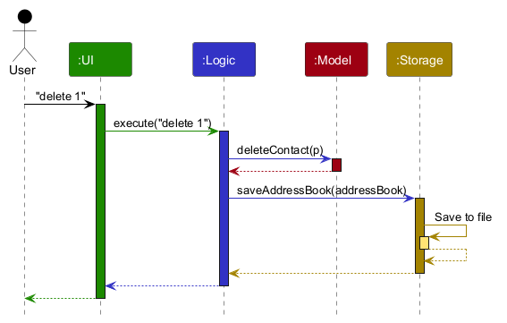

Each of the four main components (also shown in the diagram above),

* defines its *API* in an `interface` with the same name as the Component.
* provides its functionality through a concrete `{Component Name}Manager` class that implements the corresponding API interface.

For example, the `Logic` component defines its API in `Logic.java` and implements it in `LogicManager.java`. Other components interact with a component through its interface rather than its concrete class, preventing them from coupling to that component's implementation, as illustrated in the following partial class diagram.

The sections below give more details of each component.

### UI component

The **API** of this component is specified in [`Ui.java`](https://github.com/AY2627S1-CS2103T-T13-3/tp/tree/master/src/main/java/seedu/address/ui/Ui.java).

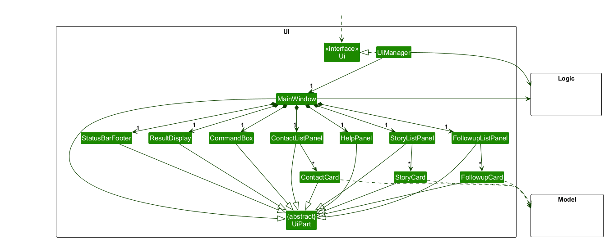

The UI consists of a `MainWindow` and its parts, such as `CommandBox`, `ResultDisplay`, `ContactListPanel`, `HelpPanel`, and `StatusBarFooter`. All of these, including `MainWindow`, inherit from the abstract `UiPart` class, which captures common behavior among classes that represent visible GUI parts.
For example, [`MainWindow.fxml`](https://github.com/AY2627S1-CS2103T-T13-3/tp/tree/master/src/main/resources/view/MainWindow.fxml) specifies the layout of [`MainWindow`](https://github.com/AY2627S1-CS2103T-T13-3/tp/tree/master/src/main/java/seedu/address/ui/MainWindow.java).

The `UI` component uses the JavaFX UI framework. Its layouts are defined in `.fxml` files in `src/main/resources/view`. [`MainWindow.fxml`](https://github.com/AY2627S1-CS2103T-T13-3/tp/blob/64f6b41/src/main/resources/view/MainWindow.fxml) places **`CONTACTS`** and **`STORIES`** side by side, with **`FOLLOW-UPS`** beneath them, alongside an embedded, collapsible `HelpPanel` on the right. The command box and result display sit above the panels, and the status bar sits below them. [`MainWindow.fillInnerParts()`](https://github.com/AY2627S1-CS2103T-T13-3/tp/blob/64f6b41/src/main/java/seedu/address/ui/MainWindow.java) creates each part and inserts its root into the corresponding FXML placeholder.

There are three list panels and a collapsible `help panel`:

Panel | Card and layout | Displayed information
------|-----------------|----------------------
`ContactListPanel` | `ContactCard`, `ContactListCard.fxml` | Displayed index, name, contact details, tags, and assigned story names. Displays `Stories: (none)` when unassigned.
`StoryListPanel` | `StoryCard`, `StoryListCard.fxml` | Displayed index, story name, tags, assigned contact count, and contact names. Displays `Contacts: (none)` when unassigned.
`FollowupListPanel` | `FollowupCard`, `FollowupListCard.fxml` | Displayed index, follow-up description, and contact name. Follow-ups for the same contact are shown together by default.
`HelpPanel` | `HelpPanel.fxml` | Available built-in commands with syntax and descriptions. Can be toggled open/closed via `help`.

The `UI` component,

* executes user commands using the `Logic` component.
* listens for changes to `Model` data so that the UI can be updated with the modified data.
* binds visual filter status indicators (`contactFilterIndicator`, `storyFilterIndicator`, `followupFilterIndicator`) directly to the observable filter status properties exposed by `Logic`, dynamically updating styled status badges (`[All]` vs `[Filtered: ...]`) across the panel headers.
* keeps a reference to the `Logic` component, because the `UI` relies on the `Logic` to execute commands.
* depends on some classes in the `Model` component because it displays `Contact`, `Story` and `Followup` objects from the model.

### Logic component

**API:** [`Logic.java`](https://github.com/AY2627S1-CS2103T-T13-3/tp/tree/master/src/main/java/seedu/address/logic/Logic.java)

Here's a (partial) class diagram of the `Logic` component:

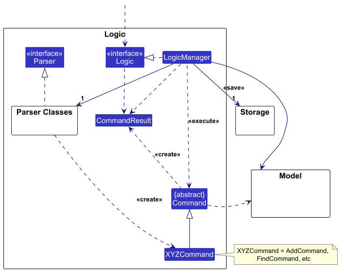

The sequence diagram below illustrates the interactions within the `Logic` component, taking `execute("deletecontact 1")` API call as an example.

How the `Logic` component works:

1. When `Logic` is called upon to execute a command, the command is passed to an `AddressBookParser` object, which retrieves the matching `CommandInfo` from `CommandWords` and calls `CommandInfo#parse`. This delegates to the parser already created by `CommandWords` (e.g., `DeleteContactCommandParser`).
2. This results in a `Command` object (more precisely, an object of one of its subclasses e.g., `DeleteContactCommand`) which is executed by the `LogicManager`.
3. The command can communicate with the `Model` when it is executed (e.g. to delete a contact). 
   Note that although this is shown as a single step in the diagram above for simplicity, the code can require several interactions between the command object and the `Model` to complete the operation.
4. The result of the command execution is encapsulated as a `CommandResult` object which is returned from `Logic`.

Here are the other classes in `Logic` (omitted from the class diagram above) that are used for parsing a user command:

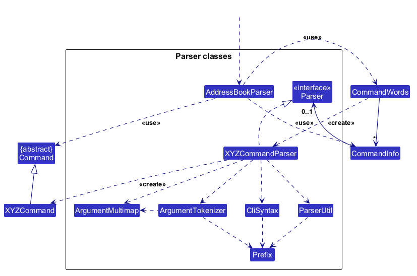

How the parsing works:

* `CommandWords` creates the command parsers when its registry is initialized and stores them in `CommandInfo` objects. When called upon to parse a user command, `AddressBookParser` retrieves the `CommandInfo` for the resolved `command word` and calls its `parse` method. `CommandInfo` delegates to its existing `XYZCommandParser` (`XYZ` is a placeholder, e.g., `AddContactCommandParser`). The parser uses the other classes shown above to parse the arguments and create an `XYZCommand` object (e.g., `AddContactCommand`). `AddressBookParser` returns that object as a `Command` object.
* All `XYZCommandParser` classes, such as `AddContactCommandParser` and `DeleteContactCommandParser`, implement the `Parser` interface so they can be treated similarly where appropriate, for example during testing.

### Model component

**API:** [`Model.java`](https://github.com/AY2627S1-CS2103T-T13-3/tp/tree/master/src/main/java/seedu/address/model/Model.java)

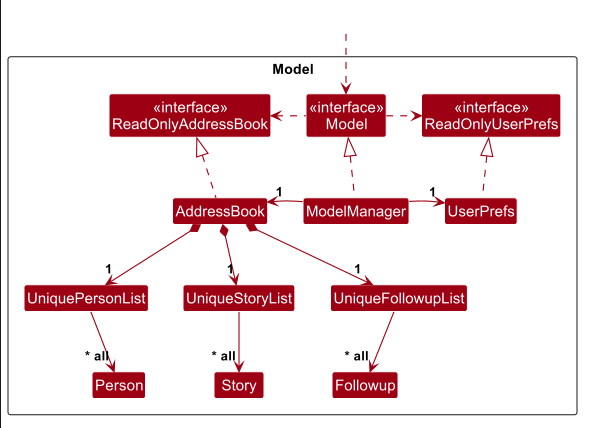

The `Model` component,

* stores the PressMemo data:
  * all `Contact` objects (which are contained in a `UniqueContactList` object).
  * all `Story` objects (which are contained in a `UniqueStoryList` object).
  * all `Followup` objects (which are contained in a `UniqueFollowupList` object).
* stores the `Contact` objects selected by the current filter, such as search results, in a separate _filtered_ list.
  * It exposes this list as an unmodifiable `ObservableList<Contact>` that the UI can observe and bind to, so the UI updates when the list changes.
  * It does the same for `Story`, `Followup`
* maintains observable filter status properties (`getContactFilterStatusProperty()`, `getStoryFilterStatusProperty()`, `getFollowupFilterStatusProperty()`) that reflect whether each panel displays all entries (`"All"`) or active filter/search criteria (e.g. `"Filtered: \"keyword\""` or `"Filtered by story: \"Investigation\""`).
* stores a `UserPrefs` object that represents the user’s preferences (GUI settings and command shortcuts). This is exposed to the outside as a `ReadOnlyUserPrefs` object.
* does not depend on any of the other three components (as the `Model` represents data entities of the domain, they should make sense on their own without depending on other components)

### Storage component

**API:** [`Storage.java`](https://github.com/AY2627S1-CS2103T-T13-3/tp/blob/master/src/main/java/seedu/address/storage/Storage.java)

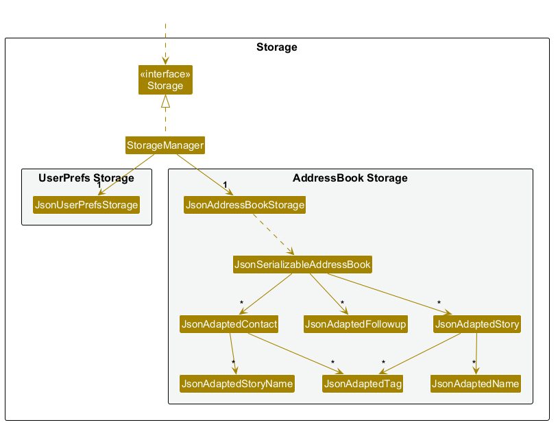

The `Storage` component,

* can save contact, story, and follow-up data together in one JSON file, while storing user preferences in a separate JSON file, and read the data back into corresponding objects.
* is implemented by `StorageManager`, which delegates the actual JSON file access to `JsonAddressBookStorage` and `JsonUserPrefsStorage`.
* uses JSON-adapted classes to serialize and deserialize contacts, stories, follow-ups, and their associations.
* depends on some classes in the `Model` component (because the `Storage` component's job is to save/retrieve objects that belong to the `Model`).

### Common classes

Classes used by multiple components are in the `seedu.address.commons` package.

--------------------------------------------------------------------------------------------------------------------

## **Implementation**

This section describes some noteworthy details on how certain features are implemented.

### `listcontacts`

- **Objective:** Lists all contacts in PressMemo, or filters contacts assigned to a specified story in the `ActiveStoryList`.

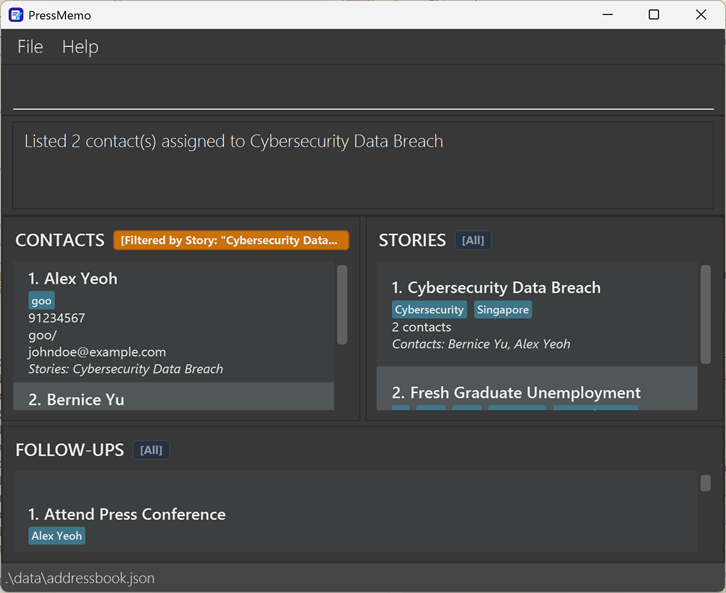

#### API

* **Command:** `listcontacts [si/STORY_INDEX]`
* **Parameters:** Refer to the [User Guide](UserGuide.md#listing-contacts-listcontacts).
* **Description:**
	* Updates the `ActiveContactList` to display either all contacts from the `ArchiveContactList` or only those associated with the story identified by `STORY_INDEX`.
* **Preconditions:**
	* If `si/STORY_INDEX` is specified, `STORY_INDEX` must be a valid positive 1-based index within the bounds of the displayed story list.
* **Postconditions:**
	* If no `si/STORY_INDEX` is provided, `ActiveContactFilter` matches all contacts.
	* If `STORY_INDEX` is provided, `ActiveContactFilter` matches only contacts assigned to the story identified by `STORY_INDEX`.
	* `ActiveContactList` is refreshed for the updated `ActiveContactFilter`.
	* The `CONTACTS panel` header filter badge updates dynamically (e.g. `[All]` vs `[Filtered by story: "..."]`).
	* `ArchiveContactList`, `ActiveStoryList`, and `ActiveFollowupList` are unchanged.
* **Exceptions:**
	* If `STORY_INDEX` is not a positive integer: displays error message for `ParseException` (`Index must be a positive integer.`)
	* If `STORY_INDEX` is greater than the displayed story count: displays error message for `CommandException` (`The story index %1$d is invalid for the displayed list of %2$d story(ies).`)
	* If duplicate `si/` prefixes are entered: displays error message for `ParseException` (`The following prefix(es) should not be duplicated: si/`)

#### Implementation details

##### Execution flow

1. The user enters the `listcontacts` command as an input string.
2. `LogicManager` receives the input string and passes it to `AddressBookParser`.
3. `AddressBookParser` retrieves the `CommandInfo` from `CommandWords` and calls its `parse` method, which delegates to the existing `ListContactsCommandParser`.
4. `ListContactsCommandParser` parses the optional `si/` prefix. If present, it extracts the `story-index` and creates a `ListContactsCommand(Index)` object; otherwise, it creates `ListContactsCommand()`.
5. `LogicManager` executes the `ListContactsCommand` object.
6. If a `story-index` is specified:
   - `ListContactsCommand` retrieves the target story from `Model#getFilteredStoryList()`.
   - It creates a `ContactAssignedToStoryPredicate` initialized with the target story.
   - It calls `Model#updateFilteredContactList(predicate)`.
7. If no `story-index` is specified:
   - `ListContactsCommand` calls `Model#updateFilteredContactList(PREDICATE_SHOW_ALL_CONTACTS)`.
8. `Model` updates `contactFilterStatusProperty`, causing the UI badge in `MainWindow` to reactively update its label and CSS styling.
9. `UI` displays the updated contact list and returns the command feedback in the `message panel`.

#### Design considerations

- **Aspect: Filter persistence when contacts or stories are edited**

|          | Chosen                                                                                                                                                                          | Alternative                                                                                             |
| -------- | ------------------------------------------------------------------------------------------------------------------------------------------------------------------------------- | ------------------------------------------------------------------------------------------------------- |
| **Pros** | **Updating predicate targets** dynamically when contacts/stories are edited keeps the user's filtered view intact without unexpectedly resetting to all contacts.             | **Resetting filter to All** on any edit is simpler to implement.                                        |
| **Cons** | Requires model logic to detect whether an active predicate targets an entity undergoing modification and refresh the predicate reference.                                      | Disrupts the user's workflow by closing the filtered view whenever a minor update (e.g. phone) is made. |

### `editcontact`

- **Objective:** Edits the details of an existing contact in PressMemo.

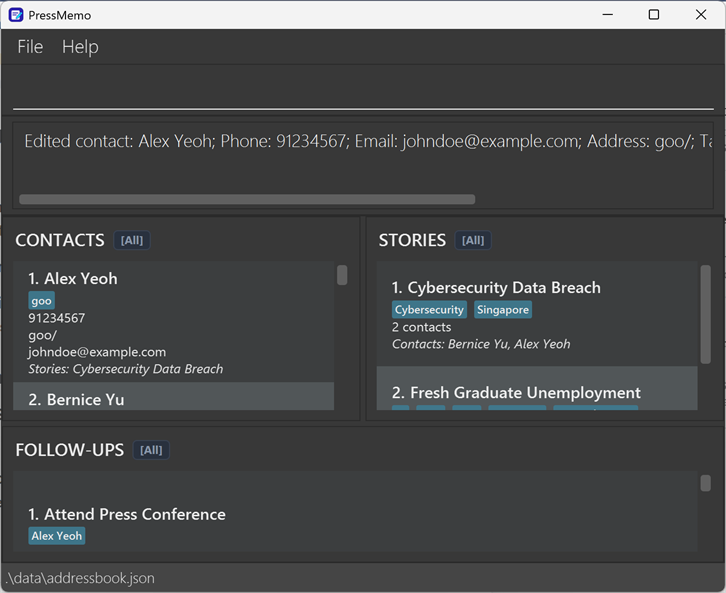

#### API

* **Command:** `editcontact INDEX [n/NAME] [p/PHONE] [e/EMAIL] [a/ADDRESS] [t/TAG]…`
* **Parameters:** Refer to the [User Guide](UserGuide.md#editing-a-contact-editcontact).
* **Description:**
	* Replaces specified field values of the contact identified by `INDEX` in the displayed contact list and synchronizes linked story assignments and follow-up references.
* **Preconditions:**
	* `INDEX` must be a valid positive 1-based integer within the range of the displayed contact list.
	* At least one field to edit (`n/`, `p/`, `e/`, `a/`, `t/`) must be provided.
	* If `n/NAME` is provided, the new name must not be identical to another existing contact in PressMemo.
* **Postconditions:**
	* The target contact in `ArchiveContactList` is updated with the specified field values.
	* If the contact name changed, all assigned `Story` records in `ArchiveStoryList` and all linked `Followup` records in `ArchiveFollowupList` are updated with the new name.
	* `ActiveContactFilter` is preserved so the contact remains displayed if it satisfies the active filter.
* **Exceptions:**
	* If no field prefixes are provided: displays error message for `ParseException` (`At least one field to edit must be provided.`)
	* If `INDEX` is not a positive integer: displays error message for `ParseException` (`Index must be a positive integer.`)
	* If `INDEX` is greater than the displayed list size: displays error message for `CommandException` (`The contact index %1$d is invalid for the displayed list of %2$d contact(s).`)
	* If the edited name duplicates another existing contact: displays error message for `CommandException` (`Error: there is already a contact named "%1$s"!`)
	* If field constraints are violated: displays error message for `ParseException` (e.g. `Phone numbers should not be blank or start with whitespace`)

#### Implementation details

The sequence diagram below illustrates the interactions within the Logic and Model components when executing `editcontact 1 n/Betsy`:

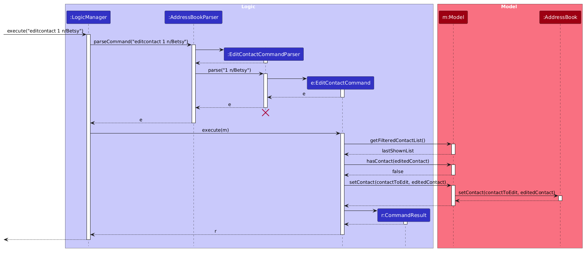

##### Execution flow

1. The user enters `editcontact 1 n/Betsy` into the `command bar`.
2. `LogicManager` receives the input string and passes it to `AddressBookParser`.
3. `AddressBookParser` retrieves the `CommandInfo` from `CommandWords` and calls its `parse` method, which delegates to the existing `EditContactCommandParser`.
4. `EditContactCommandParser` tokenizes prefixes, parses index `1`, creates an `EditContactDescriptor` with the new name, and returns an `EditContactCommand` object.
5. `LogicManager` executes the `EditContactCommand` with `model`.
6. `EditContactCommand` retrieves the displayed contact list from `Model#getFilteredContactList()` and obtains the contact at index `1`.
7. `EditContactCommand` creates `editedContact` using `EditContactDescriptor#createEditedContact(contactToEdit)`.
8. `EditContactCommand` verifies that `model.hasContact(editedContact)` is false (ensuring the new name is unique).
9. `EditContactCommand` calls `Model#setContact(contactToEdit, editedContact)`.
10. `ModelManager` notifies `activeStoryFilter` and `activeFollowupFilter` of the contact update, then delegates to `AddressBook#setContact(contactToEdit, editedContact)`.
11. `AddressBook` updates the contact in `UniqueContactList`, updates assigned contacts in `UniqueStoryList`, and updates contact names on all associated `Followup` items in `UniqueFollowupList`.
12. `EditContactCommand` returns a `CommandResult` containing the edited contact details to `LogicManager`.

#### Design considerations

- **Aspect: Tag replacement vs incremental modification**

|          | Chosen                                                                                                                                                                             | Alternative                                                                                           |
| -------- | ---------------------------------------------------------------------------------------------------------------------------------------------------------------------------------- | ----------------------------------------------------------------------------------------------------- |
| **Pros** | **Atomic replacement** (`t/TAG` replaces all existing tags, `t/` clears all tags) provides predictable, stateless behavior and mirrors standard CLI parameter replacement semantics. | **Incremental tag modification** preserves existing tags effortlessly when adding single tags.        |
| **Cons** | Users must re-enter existing tags alongside new tags when adding tags to a contact with many existing classifications.                                                             | Increases parsing complexity (requiring distinct `+t/` vs `-t/` syntax or separate tagging commands). |

### `addstory`

- **Objective:** Adds a story to PressMemo

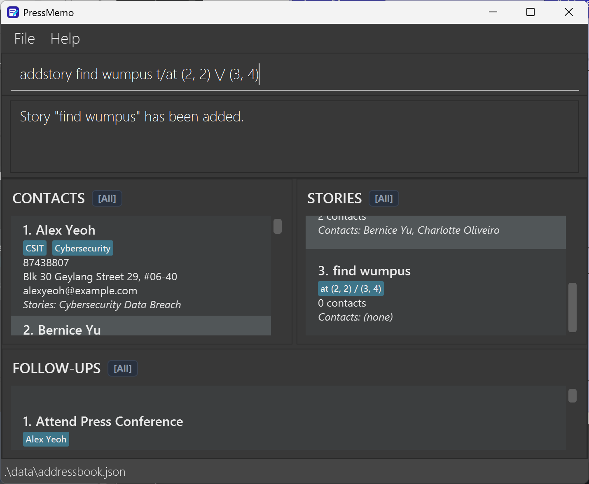

#### API

* **Command:** `addstory STORY_NAME [t/TAG]…`
* **Parameters:** Refer to the [User Guide](UserGuide.md#adding-a-story-addstory).
* **Description:**
	* Adds a story with the specified name and (optionally) tags to `ArchiveStoryList`
* **Preconditions:**
	* `STORY_NAME` is not the name of any existing story in `ArchiveStoryList`
* **Postconditions:**
	* A story with the specified name and tags is added to the `ArchiveStoryList`
	* `ActiveStoryList` is refreshed for the updated `ArchiveStoryList`.
* **Exceptions:**
	* If `STORY_NAME` is the name of some existing story in `ArchiveStoryList`: `console` displays error message

#### Implementation details

Each `Story` contains a story name and a set of tags. Upon creation, the `Story` has no assigned contacts (list of assigned contact names is empty).

The `addstory` command creates the new `Story` object and `AddressBook` adds it to the end of the `ArchiveStoryList`.

The following sequence diagram illustrates the interactions within the `Logic` component during the execution of a valid `addstory Investigation t/urgent` command where the `ArchiveStoryList` does not contain a story with the same name.

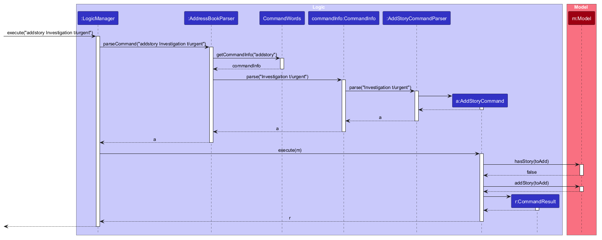

##### Execution flow

1. The user enters the `addstory` command as an input string.
2. `LogicManager` receives the input string and passes it to `AddressBookParser`.
3. `AddressBookParser` retrieves the `CommandInfo` from `CommandWords` and calls its `parse` method, which delegates to the existing `AddStoryCommandParser`.
4. `AddStoryCommandParser` parses the story name and tags and creates an `AddStoryCommand` object.
5. `LogicManager` executes the `AddStoryCommand` object.
6. `AddStoryCommand` verifies that the specified story name is not the name of any existing story in `ArchiveStoryList`.
7. `AddStoryCommand` requests `Model` to add a new `Story` object with no assigned contacts and with the specified name and tags to PressMemo.
8. `Model` adds the `Story` to `ActiveStoryList` if it matches the `ActiveStoryFilter`.
9. `UI` updates the `STORIES panel` accordingly.

### `findstories`

- **Objective:** Finds stories whose names contain any of the given keywords (case-insensitive).

#### API

* **Command:** `findstories STORY_NAME [MORE_KEYWORDS]...`
* **Parameters:** Refer to the [User Guide](UserGuide.md#finding-stories-by-name-findstories).
* **Description:**
	* Set the `ActiveStoryFilter` to match exactly the stories from the `ArchiveStoryList` whose names contain at least one of the specified keywords.
* **Preconditions:**
	* At least one keyword is provided in the command arguments.
* **Postconditions:**
	* `ActiveStoryFilter` is updated to match exactly the stories from `ArchiveStoryList` whose names match at least one keyword in a case-insensitive, full-word comparison.
	* `ActiveStoryList` is refreshed for the updated `ActiveStoryFilter`.
	* `ArchiveStoryList` is unchanged.
* **Exceptions:**
	* If no keywords are provided: `console` displays error message

#### Implementation details

The sequence diagram below illustrates the interactions within the Model component during the execution of `findstories keyword`:

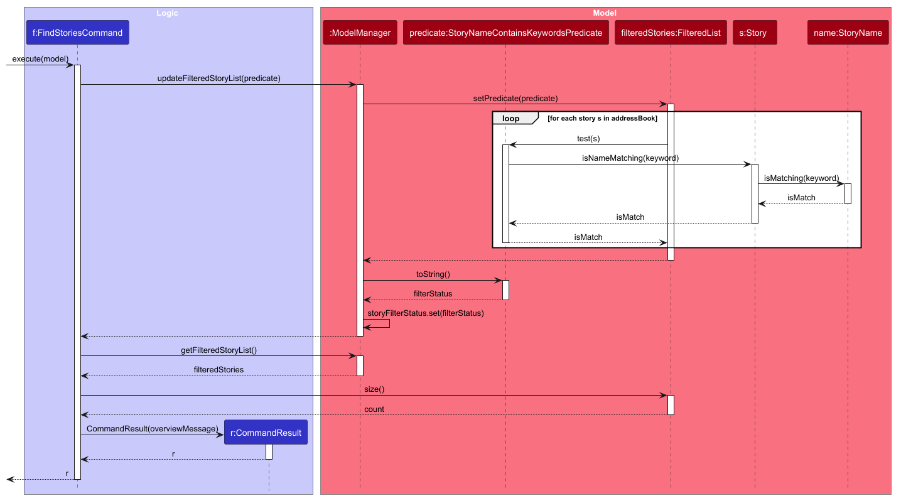

##### Execution flow

1. The user enters the `findstories` command as an input string.
2. `LogicManager` receives the input string and passes it to `AddressBookParser`.
3. `AddressBookParser` retrieves the `CommandInfo` from `CommandWords` and calls its `parse` method, which delegates to the existing `FindStoryCommandParser`.
4. `FindStoryCommandParser` parses the arguments into keywords and creates a `FindStoriesCommand` object.
5. `LogicManager` executes the `FindStoriesCommand` object.
6. `FindStoriesCommand` requests `Model` to update the `ActiveStoryFilter` to match exactly the stories whose names match at least one keyword in a case-insensitive, full-word comparison.
7. `Model` updates the `ActiveStoryList`.
8. `FindStoriesCommand` returns a `CommandResult` containing the number of matching stories.
9. `UI` updates the `STORIES panel` accordingly.

#### Design considerations

- **Aspect: Matching mechanism for story names**

|          | Chosen                                                                                                                                                         | Alternative                                                                     |
| -------- | -------------------------------------------------------------------------------------------------------------------------------------------------------------- | ------------------------------------------------------------------------------- |
| **Pros** | **Whole-word matching** avoids false positives on accidental substring matches (e.g., searching for "ad" will not match "broadcast"), ensuring high precision. | **Substring matching** allows partial matches without requiring complete words. |
| **Cons** | Users must type full words; partial terms will not return results.                                                                                             | May return many irrelevant stories containing common character sequences.       |

- **Aspect: Multiple keywords combination logic**

|          | Chosen                                                                                                      | Alternative                                                                                                             |
| -------- | ----------------------------------------------------------------------------------------------------------- | ----------------------------------------------------------------------------------------------------------------------- |
| **Pros** | **Disjunctive / OR search** allows flexible exploratory queries across multiple topics in a single command. | **Conjunctive / AND search** returns strictly targeted results matching every keyword.                                  |
| **Cons** | Results may be broader than intended if common words are included.                                          | Less flexible when looking for possible matches across multiple topics; yields zero results if even one keyword misses. |

### `assign`

- **Objective:** Assigns an existing contact to an existing story while maintaining consistent assignments in both records.

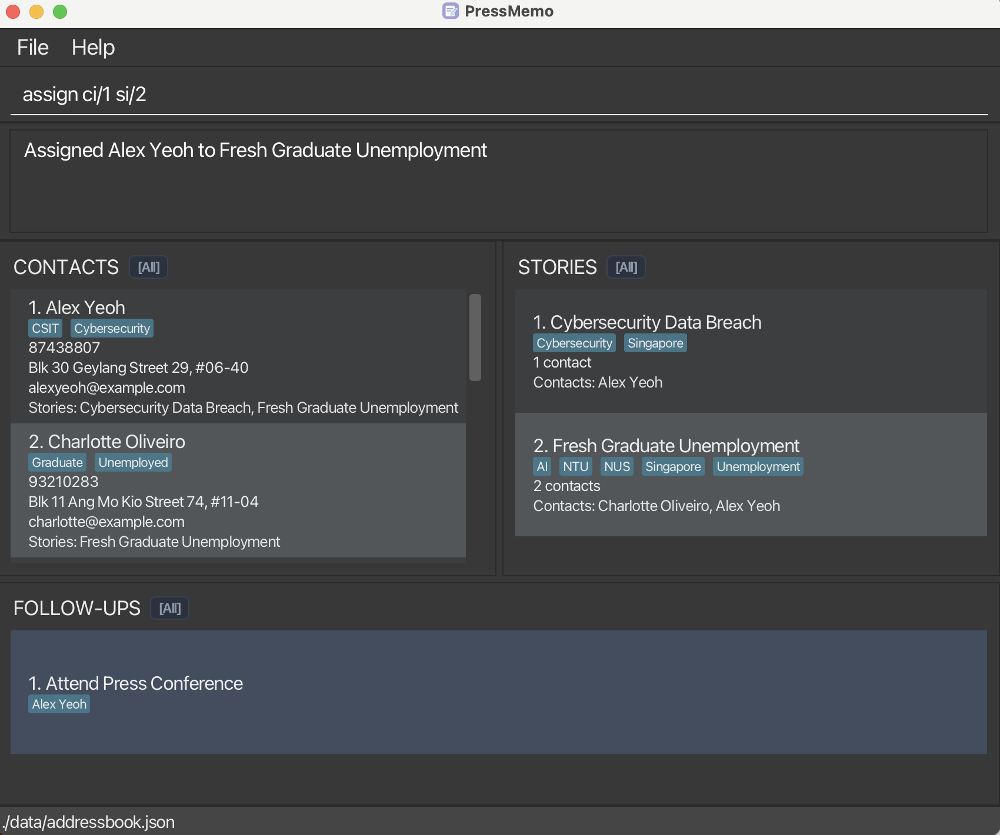

#### API

- **Command:** `assign ci/CONTACT_INDEX si/STORY_INDEX`
- **Parameters:** Refer to the [User Guide](UserGuide.md#assigning-a-contact-to-a-story-assign).
- **Description:**
    - Creates an assignment between the specified contact and story.
- **Preconditions:**
    - Both indices refer to existing entries in the `ActiveContactList` and `ActiveStoryList`, respectively.
    - The specified contact is not already assigned to the specified story.
- **Postconditions:**
    - The specified story is added to the contact's assigned stories.
    - The specified contact is added to the story's assigned contacts.
    - Other assignments remain unchanged.
    - The `ActiveContactFilter` and `ActiveStoryFilter` are not reset.
- **Exceptions:**
    - If the command arguments are invalid: displays an error message for `ParseException`.
    - If either index is outside the corresponding displayed list: displays an error message for `CommandException`.
    - If the contact is already assigned to the story: displays an error message for `CommandException`.

#### Implementation details

The `assign` command maintains a bidirectional association between `Contact` and `Story`. Each `Contact` stores a list of assigned story names, while each `Story` stores a list of assigned contact names.

Since both classes are immutable, assigning a contact to a story creates updated `Contact` and `Story` objects. `AddressBook` replaces the original objects in their respective lists to ensure that both sides of the assignment remain consistent.

The following sequence diagram illustrates the interactions within the Model component during the execution of a valid `assign ci/1 si/1` command, after index and assignment validation.

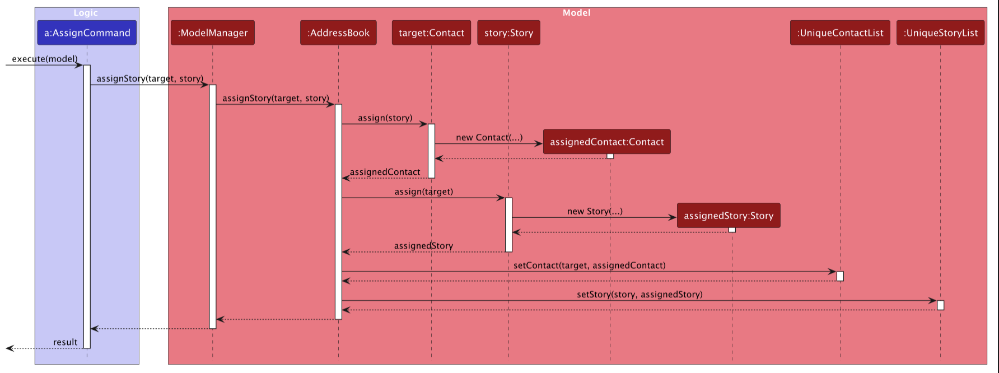

##### Execution flow

1. The user enters the `assign` command as an input string.
2. `LogicManager` receives the input string and passes it to `AddressBookParser`.
3. `AddressBookParser` retrieves the `CommandInfo` from `CommandWords` and calls its `parse` method, which delegates to the existing `AssignCommandParser`.
4. `AssignCommandParser` uses `AssignmentParserUtil` to parse the contact and story indices and creates an `AssignCommand` object.
5. `LogicManager` executes the `AssignCommand` object.
6. `AssignCommand` retrieves the specified contact and story from the `ActiveContactList` and `ActiveStoryList` and checks that both indices are valid.
7. `AssignCommand` checks whether the contact is already assigned to the story. If so, it throws a `CommandException`.
8. Otherwise, `AssignCommand` calls `Model.assignStory(contact, story)`.
9. `ModelManager` delegates the operation to `AddressBook.assignStory()`.
10. `AddressBook` calls `Contact.assign(story)` and `Story.assign(contact)` to create updated `Contact` and `Story` objects.
11. `AddressBook` replaces the original objects using `UniqueContactList.setContact()` and `UniqueStoryList.setStory()`.
12. `AssignCommand` returns a `CommandResult` containing a success message. `LogicManager` saves the updated data, and the UI reflects the new assignment.

#### Design considerations

- **Aspect:** Maintaining assignments between contacts and stories.

|          | Chosen: Store assignments in both `Contact` and `Story`                                                         | Alternative: Maintain a separate association collection                                                  |
|----------|-------------------------------------------------------------------------------------------------------------|----------------------------------------------------------------------------------------------------------|
| **Pros** | Allows contacts and stories to retrieve their assignments directly without additional relationship lookups. | Stores each association in one central location, avoiding duplicated relationship information.           |
| **Cons** | Requires updating both records to maintain consistency whenever an assignment changes.                      | Requires additional lookups to retrieve assignments and management of a separate association collection. |

### `listfollowups`

- **Objective:** Lists all follow-ups in PressMemo, or filters the follow-ups assigned to a specified contact in the `ActiveContactList`.

#### API

* **Command:** `listfollowups [ci/CONTACT_INDEX]`
* **Parameters:** Refer to the [User Guide](UserGuide.md#listing-follow-ups-listfollowups).
* **Description:**
	* Updates the `ActiveFollowupList` to display either all follow-ups from the `ArchiveFollowupList` or only those linked to the contact identified by `CONTACT_INDEX`.
* **Preconditions:**
	* If `ci/CONTACT_INDEX` is specified, `CONTACT_INDEX` must be a valid index in the `ActiveContactList`.
* **Postconditions:**
	* If no `ci/CONTACT_INDEX` is provided, `ActiveFollowupFilter` matches all follow-ups.
	* If `CONTACT_INDEX` is provided, `ActiveFollowupFilter` matches only follow-ups linked to the contact identified by `CONTACT_INDEX`.
	* `ActiveFollowupList` is refreshed for the updated `ActiveFollowupFilter`.
	* `ArchiveFollowupList` is unchanged.

#### Implementation details

##### Execution flow

1. The user enters the `listfollowups` command with an optional `ci/CONTACT_INDEX` as an input string.
2. `LogicManager` passes the input string to `AddressBookParser`, which retrieves the `CommandInfo` from `CommandWords` and calls its `parse` method to delegate to the existing `ListFollowupsCommandParser`.
3. `ListFollowupsCommandParser` parses the optional `CONTACT_INDEX` and returns a `ListFollowupsCommand`.
4. `LogicManager` executes the `ListFollowupsCommand` object.
5. `ListFollowupsCommand` selects the follow-ups to display:
	* If `CONTACT_INDEX` is specified, it retrieves the `ActiveContactList`, validates the index, obtains the corresponding contact, and requests `Model` to show follow-ups linked to that contact.
	* Otherwise, it requests `Model` to show all follow-ups.
6. `Model` refreshes the `ActiveFollowupList` for the updated `ActiveFollowupFilter`.
7. `UI` updates the `FOLLOW-UPS panel` accordingly.

The activity diagram below shows the branching logic depending on whether `CONTACT_INDEX` is specified:

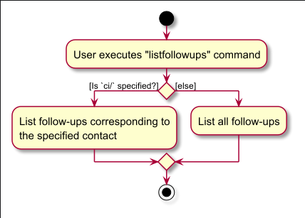

### `shortcut`

- **Objective:** Lists all user-defined command shortcuts, or creates/updates a 1-to-1 shortcut alias for a PressMemo `command word`.

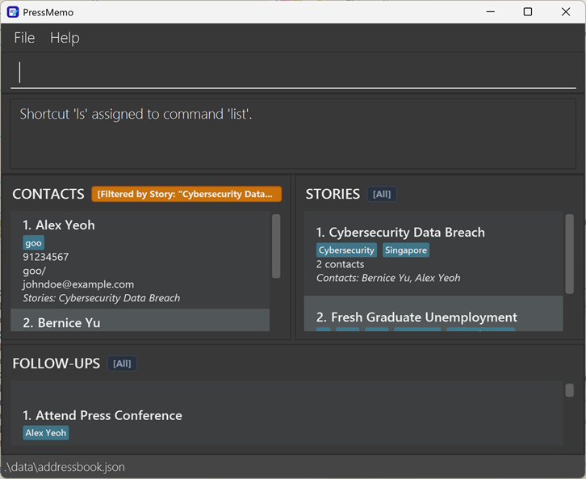

#### API

* **Command:** `shortcut` (to list shortcuts) or `shortcut s/SHORTCUT c/COMMAND` (to assign a shortcut)
* **Parameters:** Refer to the [User Guide](UserGuide.md#managing-command-shortcuts-shortcut).
* **Description:**
	* When invoked without parameters, lists all assigned shortcuts sorted alphabetically by shortcut name.
	* When invoked with `s/` and `c/`, creates or reassigns a 1-to-1 alias mapping between a shortcut token and a built-in `command word`.
* **Preconditions:**
	* For assignment: `SHORTCUT` must not be blank, contain whitespace, or contain forward slashes (`/`), and cannot match a built-in `command word`. `COMMAND` must be an assignable PressMemo `command word`.
* **Postconditions:**
	* For listing: User preferences and model data are unchanged. The sorted list of shortcuts is output to the `message panel`.
	* For assignment: The new shortcut mapping is saved to `UserPrefs` immediately, and any existing shortcut mapped to the same command is replaced.
* **Exceptions:**
	* If extraneous arguments or invalid prefix format: displays error message for `ParseException` (`Invalid command format.`)
	* If `SHORTCUT` matches a built-in `command word`: displays error message for `CommandException` (`The shortcut "%1$s" is a built-in command and cannot be reassigned.`)
	* If `SHORTCUT` contains whitespace or forward slashes: displays error message for `CommandException` (`The shortcut "%1$s" cannot contain whitespace or forward slashes.`)
	* If `COMMAND` is not an assignable command: displays error message for `CommandException` (`Unknown command: %s.`)

#### Implementation details

The sequence diagram below illustrates the interactions when the user executes the `shortcut` command in listing mode:

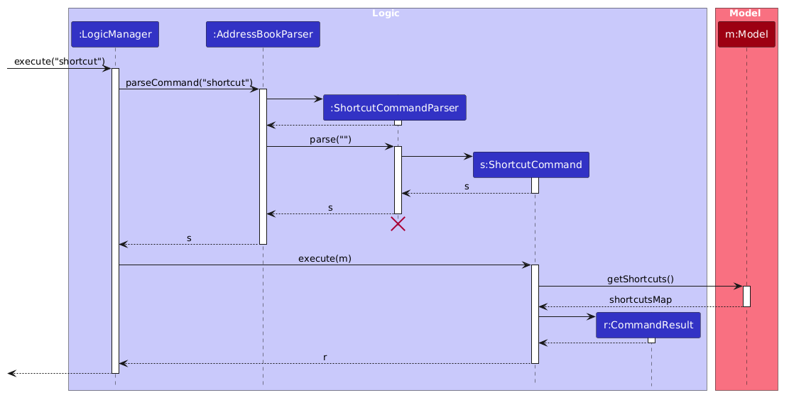

##### Execution flow (listing mode)

1. The user enters `shortcut` into the `command bar` without arguments.
2. `LogicManager` passes the input string to `AddressBookParser`.
3. `AddressBookParser` retrieves the `CommandInfo` from `CommandWords` and calls `CommandInfo#parse("")`, which delegates to the existing `ShortcutCommandParser`.
4. `ShortcutCommandParser` detects no arguments (or only whitespace) and returns `new ShortcutCommand()`.
5. `LogicManager` executes the `ShortcutCommand`.
6. `ShortcutCommand` queries `Model#getShortcuts()`, which returns the current shortcut mappings stored in `UserPrefs`.
7. If the shortcut map is empty, `ShortcutCommand` returns a `CommandResult` with `MESSAGE_NO_SHORTCUTS`.
8. If shortcuts are present, `ShortcutCommand` sorts the entries alphabetically by shortcut name, formats each entry as `shortcut -> commandWord`, and constructs the output message.
9. `UI` displays the formatted list in the `message panel`.

##### Execution flow (adding mode)

1. The user enters `shortcut s/SHORTCUT c/COMMAND` into the `command bar`.
2. `LogicManager` passes the input string to `AddressBookParser`.
3. `AddressBookParser` retrieves the `CommandInfo` from `CommandWords` and calls `CommandInfo#parse("s/SHORTCUT c/COMMAND")`, which delegates to the existing `ShortcutCommandParser`.
4. `ShortcutCommandParser` detects argument `s/SHORTCUT c/COMMAND` and returns `new ShortcutCommand(SHORTCUT, COMMAND)`.
5. `LogicManager` executes the `ShortcutCommand`.
6. `ShortcutCommand` calls `Model#assignShortcut(SHORTCUT, COMMAND)` which assigns the `SHORTCUT` for the `COMMAND`.
7. If the `command word` had not been assigned a shortcut previously, `ShortcutCommand` returns a `CommandResult` with `MESSAGE_SUCCESS`.
8. If the `command word` had been assigned a shortcut previously, `ShortcutCommand` returns a `CommandResult` with `MESSAGE_SUCCESS` and `MESSAGE_SHORTCUT_REPLACED`.
9. `UI` displays the corresponding message in the `message panel`.

#### Design considerations

- **Aspect: Shortcut-to-command mapping relationship (One-to-one vs. Many-to-one)**

|          | Chosen                                                                                                                                                   | Alternative                                         |
| -------- | ------------------------------------------------------------------------------------------------------------------------------------------------------------------------------------- | ------------------------------------------------------------------------------------ |
| **Pros** | **One-to-one mapping** ensures predictable, unambiguous alias lookups: each command has at most one shortcut alias, enabling clean bidirectional lookups in UI panels and help views without stale or conflicting aliases. | **Many-to-one mapping** allows users to define multiple alias variations for the same `command word` based on personal typing habits (e.g., both `c` and `cls` for `clear`). |
| **Cons** | Users cannot assign multiple aliases to the same command (reassigning a command automatically overrides its previous shortcut).                                                       | Increases chance of alias collisions, user confusion, and bloats the shortcut list in small interfaces. |

--------------------------------------------------------------------------------------------------------------------

## **Documentation, logging, testing, dev-ops**

* [Documentation guide](Documentation.md)
* [Testing guide](Testing.md)
* [Logging guide](Logging.md)
* [DevOps guide](DevOps.md)

--------------------------------------------------------------------------------------------------------------------

## **Appendix: Requirements**

### Product scope

**Target user profile**: Breaking news journalist who is constantly chasing and contacting/contacted by sources for information under deadline pressure.
* has to manage multiple correspondences and stories simultaneously
* has a need to manage a significant number of contacts
* prefers desktop apps over other types of applications
* can type fast
* prefers typing to mouse interactions
* is reasonably comfortable using CLI apps

**Value proposition**: Centralised deadline-aware contact manager that helps journalists organize sources, track conversations, and never miss a follow-up.
* PressMemo will manage correspondent contacts and track follow-up actions for journalists.
* PressMemo simplifies the simultaneous management of multiple correspondences at different stages.
* PressMemo serves as a contact command centre:
  * Storage of contact contextual information (E.g. Why do I have the contact?, What story are they related to?)
  * Storage of entity relations: Links between a story and contacts are stored (Role of contact)
  * Task List with Contact: PressMemo stores crucial follow-up information.

### User stories

Priorities: High (must have) - `* * *`, Medium (nice to have) - `* *`, Low (unlikely to have) - `*`

| Priority | As a …                                                        | I want to …                                                 | So that I can…                                                                          |
| -------- | -------------------------------------------------------------- | ------------------------------------------------------------ | ---------------------------------------------------------------------------------------- |
| `* * *`  | investigative journalist                                       | add a new contact with basic details                         | build a database of sources                                                              |
| `* * *`  | investigative journalist                                       | view all active contacts                                     | quickly browse my source network                                                         |
| `* * *`  | investigative journalist                                       | edit a contact's details                                     | keep my database accurate without recreating contacts                                    |
| `* * *`  | investigative journalist                                       | delete a contact                                             | remove obsolete contacts from my database                                                |
| `* * *`  | journalist with frequent story assignments                     | add a story                                                  | record a new story                                                                       |
| `* * *`  | journalist working on different types of stories               | add tags to stories                                          | categorise different types of stories                                                    |
| `* * *`  | journalist working on several assignments                      | view all stories                                             | keep track of stories I have worked on                                                   |
| `* * *`  | journalist covering a developing story                         | edit a story's name                                          | keep the story title current and relevant                                                |
| `* * *`  | journalist with obsolete assignments                           | delete a story                                               | remove cancelled, shelved, or irrelevant stories without deleting their contacts         |
| `* * *`  | journalist working on many stories simultaneously              | find stories by keywords in their names                      | quickly locate relevant stories among a huge list                                        |
| `* * *`  | journalist liaising with several contacts for a story          | assign a contact to a story                                  | record the sources involved in that story                                                |
| `* * *`  | journalist correcting a source assignment                      | unassign a contact from a story                              | remove an irrelevant or incorrect association while retaining the contact                |
| `* * *`  | journalist managing a story                                    | list contacts assigned to a story                            | know which sources are needed for that story                                             |
| `* * *`  | journalist reviewing a source                                  | view the stories associated with a contact                   | track the history of stories for which I have liaised with that source                   |
| `* *`    | investigative journalist covering a breaking story             | search contacts using multiple keywords, locations, and tags | retrieve relevant witnesses and sources quickly                                          |
| `* *`    | journalist seeking a particular source                         | search contacts by role                                      | find relevant witnesses, experts, officials, or other source types                       |
| `* *`    | journalist managing international correspondence               | search contacts by location or region                        | find people who are directly connected to the relevant area                              |
| `* *`    | journalist seeking different perspectives                      | search contacts by profession                                | find sources with relevant expertise                                                     |
| `* *`    | journalist covering stories in various sectors                 | search contacts by industry                                  | find people with direct knowledge of the relevant industry                               |
| `* *`    | journalist covering stories involving stakeholders             | search contacts by organisation                              | find people who directly represent the relevant organisation                             |
| `* *`    | journalist receiving a call                                    | search contacts by phone number                              | identify whether the caller is an existing contact                                       |
| `* *`    | journalist receiving an email                                  | search contacts by email address                             | identify whether the sender is an existing contact                                       |
| `* *`    | journalist communicating across regions                        | search contacts by language                                  | identify people I can communicate with in the required language                          |
| `* *`    | senior journalist                                              | assign a role to a contact                                   | record the type of liaison or source relationship involved                               |
| `* *`    | journalist communicating with different contacts               | record a contact's preferred contact method                  | know the best way to reach each source                                                   |
| `* *`    | journalist managing sources known by different names           | record a contact's alias                                     | identify the same contact when a different name is used                                  |
| `* *`    | journalist managing contacts with evolving classifications     | add new tags to a contact without replacing existing tags    | maintain and expand a contact's classifications incrementally without re-entering all current tags |
| `* *`    | journalist adding a new source                                 | receive a duplicate-contact warning                          | avoid creating records with an existing phone number or email address                    |
| `* *`    | journalist who often contacts certain sources                  | mark a contact as a favourite                                | access frequently used contacts more easily                                              |
| `* *`    | journalist with inactive sources                               | archive and restore contacts                                 | keep inactive records available without cluttering the active list                       |
| `* *`    | journalist managing multiple stories                           | assign and update a story priority                           | identify work that requires attention first                                              |
| `* *`    | reporter speaking to a source                                  | append a timestamped note to a contact                       | keep a chronological record of statements and interactions                               |
| `* *`    | busy reporter managing several leads                           | schedule a follow-up or deadline                             | avoid missing promised callbacks, interviews, or verification work                       |
| `* *`    | busy reporter                                                  | view pending follow-ups and deadlines                        | see upcoming work in chronological order and recognise overdue items                     |
| `* *`    | reporter with multiple to-dos                                  | view all follow-ups                                          | keep track of all my pending follow-up actions                                           |
| `* *`    | busy reporter liaising with multiple contacts                  | view the follow-ups for a particular contact                 | track upcoming tasks involving that specific person                                      |
| `* *`    | busy reporter managing multiple tasks                          | find follow-ups by keywords in their descriptions            | quickly locate specific tasks and reminders without browsing all follow-ups              |
| `*`      | time-pressured reporter using the terminal                     | use command aliases and tab completion                       | query and record information without typing full commands or memorising IDs              |
| `*`      | investigative journalist sharing a screen or working in public | use a redacted display mode                                  | protect confidential identities and contact details from shoulder-surfing                |
| `*`      | journalist handing a story to desk editors                     | export filtered source dossiers as Markdown or plain text    | let editors and fact-checkers verify attribution without access to my command-line setup |

### Use cases

(For all use cases below, the **System** is `PressMemo` and the **Actor** is the `user`, unless specified otherwise)

#### Use Case: UC1 - Add Contact

Actor: User

##### Guarantees:

- At the end of MSS, the contact is saved in PressMemo

##### MSS:

1. User enters contact's details
2. User adds the contact
3. System informs the user in the `console` that the contact has been added successfully

Use case ends.

##### Extensions:

1a. Crucial details are missing

- System will inform the user in the `console` that details are missing

1b.  Another contact with the same name already exists

- System will inform the user in the `console` that an invalid name was used
- Use case ends

#### Use Case: UC2 - List contacts (all or assigned to a story)

Actor: User

##### Guarantees:

- At the end of MSS, the `CONTACTS panel` shows either all saved contacts (if no `story-index` is specified) or only the contacts assigned to the specified story.
- The `STORIES` and `FOLLOW-UPS` panels remain unchanged.

##### MSS:

1. User requests to list contacts, optionally specifying a `story-index`.
2. System displays all contacts or only those assigned to the specified story in the `CONTACTS panel`.
3. System informs the user in the `console` that contacts have been listed.

Use case ends.

##### Extensions:

1a. User specifies an invalid `story-index` (not a positive integer or larger than the number of stories displayed).

- 1a1. System informs the user in the `console` of the invalid index.
- Use case ends.

2a. There are no contacts assigned to the specified story.

- 2a1. System updates the `CONTACTS panel` to display an empty list.
- 2a2. System informs the user in the `console` that 0 contacts are listed.
- Use case ends.

#### Use Case: UC3 - List stories (all or assigned to a contact)

Actor: User

##### Guarantees:

- At the end of MSS and Ext. 2a, the `STORIES panel` shows either all saved stories (if no `contact-index` is specified) or only the stories assigned to the specified contact.
- The `CONTACTS` and `FOLLOW-UPS` panels and all saved data remain unchanged.

##### MSS:

1. User requests to list stories, optionally specifying a `contact-index`.
2. System displays all stories or only those assigned to the specified contact in the `STORIES panel`.
3. System informs the user in the `console` that the stories have been listed successfully.

Use case ends.

##### Extensions:

1a. User specifies an invalid `contact-index` (not a positive integer or larger than the number of contacts displayed).

- 1a1. System informs the user in the `console` of the invalid index.
- Use case ends.

2a. There are no stories assigned to the specified contact.

- 2a1. System updates the `STORIES panel` to display an empty list.
- 2a2. System informs the user in the `console` that no stories are assigned to the specified contact.
- Use case ends.

#### Use Case: UC4 - Assign contact to story

Actor: User

##### Guarantees:

- At the end of MSS, the specified contact is assigned to the specified story.
- The assignment is reflected in the displayed contact and story details.
- Existing assignments remain unchanged.

##### MSS:

1. User identifies an existing contact and an existing story from their respective displayed lists.
2. User requests to assign the contact to the story using their `contact-index` and `story-index`.
3. System assigns the contact to the story.
4. System informs the user that the contact has been successfully assigned to the story.

Use case ends.

##### Extensions:

2a. User provides an invalid command format.

- 2a1. System displays an error message indicating the invalid input.
- Use case ends.

3a. The specified `contact-index` does not refer to a displayed contact.

- 3a1. System displays an error message indicating that the `contact-index` is invalid.
- Use case ends.

3b. The specified `story-index` does not refer to a displayed story.

- 3b1. System displays an error message indicating that the `story-index` is invalid.
- Use case ends.

3c. The contact is already assigned to the story.

- 3c1. System informs the user that the contact is already assigned to the specified story.
- Use case ends.

#### Use Case: UC5 - Add Story

Actor: User

##### Guarantees:

- At the end of MSS, the new story is saved in PressMemo
- The `STORIES panel` includes the new story if it matches the current story filter
- The `CONTACTS` and `FOLLOW-UPS` panels and all other saved data remain unchanged

##### MSS:

1. User requests to add a story by providing the story name and optional tags
2. System saves the new story
3. System updates the `STORIES panel` according to the current story filter
4. System informs the user in the `console` that the story has been added successfully

Use case ends.

##### Extensions:

1a. User does not provide a story name.

- 1a1. System informs the user in the `console` of the invalid command format.
- Use case ends.

1b. User provides an invalid story name (e.g. blank or containing an unescaped forward slash `/`).

- 1b1. System informs the user in the `console` of the story name constraints.
- Use case ends.

1c. User provides an invalid tag (e.g. containing forward slash).

- 1c1. System informs the user in the `console` of the tag constraints.
- Use case ends.

1d. A story with the same name already exists.

- 1d1. System informs the user in the `console` that a story with the specified name already exists.
- Use case ends.

#### Use Case: UC6 - Delete a contact

Actor: User

##### Guarantees:

- At the end of MSS, the specified contact is deleted from PressMemo.
- The deleted contact's assignments are removed from all associated stories, without deleting the stories themselves.
- All follow-ups associated with the deleted contact are deleted.
- The `CONTACTS`, `STORIES` and `FOLLOW-UPS` panels reflect the updated data.

##### MSS:

1. User requests to list contacts.
2. System displays the contact list in the `CONTACTS panel`.
3. User requests to delete a specific contact using its `contact-index`.
4. System deletes the contact and removes its associated story assignments and follow-ups.
5. System displays a success message containing the deleted contact's details.

Use case ends.

##### Extensions:

2a. The displayed contact list is empty.

- 2a1. System displays an empty contact list.
- Use case ends.

3a. User provides an invalid index format.

- 3a1. System displays an error message indicating that the index must be a positive integer.
- Use case ends.

3b. The specified `contact-index` does not refer to a displayed contact.

- 3b1. System displays an error message indicating that the `contact-index` is invalid.
- Use case ends.

#### Use Case: UC7 - Edit a contact

Actor: User

##### Guarantees:

- At the end of MSS, the specified contact's new details are saved.
- Any assigned stories and follow-ups associated with the contact are updated with the new contact name if the name is modified.
- Current filters that refer to this contact continue to refer to it after the edit.

##### MSS:

1. User requests to list contacts.
2. System displays a list of contacts in the `CONTACTS panel`.
3. User requests to edit a specific contact by providing its `contact-index` and one or more field values to update.
4. System updates the contact's details and its linked stories and follow-ups.
5. System refreshes the `CONTACTS panel` to reflect the changes.
6. System informs the user in the `console` that the contact has been successfully edited.

Use case ends.

##### Extensions:

2a. The contact list is empty.

- Use case ends.

3a. User provides an invalid `contact-index` (not a positive integer or larger than the number of contacts displayed).

- 3a1. System informs the user in the `console` of the invalid index.
- Use case ends.

3b. User does not specify any fields to edit.

- 3b1. System informs the user in the `console` that at least one field to edit must be provided.
- Use case ends.

3c. User provides an invalid field value (e.g., invalid phone format, invalid email format, invalid tag name, unescaped forward slash).

- 3c1. System informs the user in the `console` of the specific field constraints.
- Use case ends.

3d. The edited contact's name duplicates another existing contact's name.

- 3d1. System informs the user in the `console` that a contact with this name already exists.
- Use case ends.

#### Use Case: UC8 - Find stories by keywords

Actor: User

##### Guarantees:

- At the end of MSS and Ext. 2a, the `STORIES panel` shows exactly the saved stories whose names contain at least one of the specified keywords (case-insensitive, whole-word match)
- The `CONTACTS` and `FOLLOW-UPS` panels and all saved data remain unchanged

##### MSS:

1. User requests to find stories by providing one or more search keywords
2. System displays the matching stories in the `STORIES panel`
3. System informs the user in the `console` of the number of matching stories listed

Use case ends.

##### Extensions:

1a. User does not provide any keywords (empty search query).

- 1a1. System informs the user in the `console` of the invalid command format.
- Use case ends.

2a. No stories match the specified keywords.

- 2a1. System updates the `STORIES panel` to display an empty list.
- 2a2. System informs the user in the `console` that 0 stories are listed.
- Use case ends.

#### Use Case: UC9 - List follow-ups

Actor: User

##### Guarantees:

- At the end of MSS, System displays all follow-ups or those linked to the specified contact.
- No stored data is modified.

##### MSS:

1. User requests to list follow-ups, optionally specifying a `contact-index`.
2. System displays all follow-ups or only those linked to the specified contact in the `FOLLOW-UPS panel`. The displayed list is empty if there are no matches.
3. System informs the user that the follow-ups have been listed successfully.

Use case ends.

##### Extensions:

2a. The specified `contact-index` is invalid.

- 2a1. System informs the user and leaves the displayed follow-ups unchanged.
- Use case ends.

#### Use Case: UC10 - Find follow-ups by keywords

Actor: User

##### Guarantees:

- At the end of MSS and Ext. 2a, the `FOLLOW-UPS panel` shows exactly the saved follow-ups whose descriptions contain at least one of the specified keywords (case-insensitive, whole-word match)
- The `CONTACTS` and `STORIES` panels and all saved data remain unchanged

##### MSS:

1. User requests to find follow-ups by providing one or more search keywords
2. System displays the matching follow-ups in the `FOLLOW-UPS panel`
3. System informs the user in the `console` of the number of matching follow-ups listed

Use case ends.

##### Extensions:

1a. User does not provide any keywords (empty search query).

- 1a1. System informs the user in the `console` of the invalid command format.
- Use case ends.

2a. No follow-ups match the specified keywords.

- 2a1. System updates the `FOLLOW-UPS panel` to display an empty list.
- 2a2. System informs the user in the `console` that 0 follow-ups are listed.
- Use case ends.

#### Use Case: UC11 - List command shortcuts

Actor: User

##### Guarantees:

- The user's configured command shortcuts are displayed in the `message panel` without modifying any contact, story, or follow-up data.

##### MSS:

1. User requests to list configured command shortcuts.
2. System displays the shortcuts alphabetically in the `message panel`.

Use case ends.

##### Extensions:

2a. No shortcuts have been configured yet.

- 2a1. System informs the user in the `message panel` that no shortcuts are set.
- Use case ends.

### Non-functional requirements

1. PressMemo should work on Windows, Linux, and macOS/OS-X on a computer with Java 25 installed.
2. PressMemo should be able to hold up to 1000 contacts and 100 stories without noticeable sluggishness in performance during typical usage.
3. A user with above-average typing speed for regular English text should be able to accomplish most tasks faster using commands than using the mouse.
4. PressMemo should take at most 5 seconds to launch when there are up to 1000 saved contacts and 100 saved stories.
5. PressMemo should support only one user and should not allow multiple users to share the same application data.
6. PressMemo should store application data locally in human-readable JSON files and should not use a database management system.
7. PressMemo should work without requiring an installer.
8. PressMemo should be packaged as a single JAR file.
9. PressMemo's GUI should work without resolution-related inconveniences at resolutions of 1920x1080 or higher with 100% or 125% display scaling, and all functions should remain usable at resolutions of 1280x720 or higher with 150% display scaling.
10. PressMemo should not depend on its own remote server for its operation.
11. The packaged PressMemo JAR/ZIP file should not exceed 100 MB.

### Glossary

#### UI components

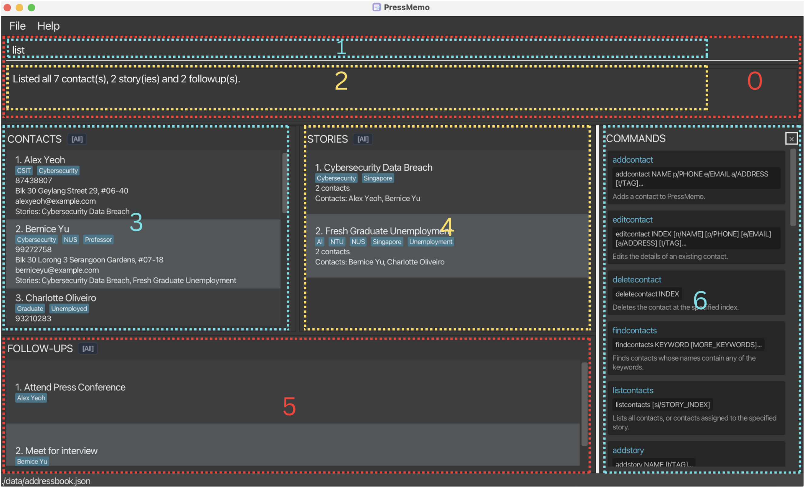

| Number | Component name | Definition                                                                     |
| ------ | -------------- | ------------------------------------------------------------------------------ |
| 0      | `console`        | interface for inputting `command`s and viewing responses                     |
| 1      | `command bar`    | widget for inputting `command`s                                                |
| 2      | `message panel`  | widget that displays the response to the most recently input `command`, if any |
| 3      | `CONTACTS panel`  | widget that displays the `ActiveContactList`                                 |
| 4      | `STORIES panel`    | widget that displays the `ActiveStoryList`                                   |
| 5      | `FOLLOW-UPS panel` | widget that displays the `ActiveFollowupList`                                |
| 6      | `help panel`     | toggle-able widget that displays help information when active                   |

#### Input data types

| Input type       | Definition                                                                                                                                                                                                        | Format/s                                                                                                                                                                                                 | Examples                                         |
| ---------------- | ----------------------------------------------------------------------------------------------------------------------------------------------------------------------------------------------------------------- | -------------------------------------------------------------------------------------------------------------------------------------------------------------------------------------------------------- | ------------------------------------------------ |
| `escape character` | A character that escapes the next character if it is forward slash. An `escape character` used this way will not be part of a `user-string`.  Otherwise, the `escape character` is treated as a normal character. | The `escape character` is backslash.                                                                                                                                                                       | `\`                                                |
| `user-string`      | A typed unit of text input from the user.  Behaviour for invalid `user-string`s is unspecified, and may result in unexpected behaviour such as error messages.                                              | A valid `user-string` contains one or more characters, with at least one non-space character.   Any forward slash must be escaped.  Leading and trailing spaces in a `user-string` are ignored. | wumpus  wumpus farts  `birthday 3\/12` |
| `word`             | A `user-string` that does not contain spaces or forward slashes                                                                                                                                           | Does not contain spaces or forward slashes.                                                                                                                                                      | wumpus  wumpus,farts!                      |
| `contact-index`    | A `word` representing the 1-based position of a `Contact` in the `ActiveContactList`, used to identify that `Contact` in `command`s                                                                               | Integer between and including 1 and the number of `Contact`s in the `ActiveContactList`.  If the `ActiveContactList` is empty, there is no valid `contact-index`                               | 1                                                |
| `story-index`      | A `word` representing the 1-based position of a `Story` in the `ActiveStoryList`, used to identify that `Story` in `command`s                                                                                   | Integer between and including 1 and the number of `Story`s in the `ActiveStoryList`  If the `ActiveStoryList` is empty, there is no valid `story-index`                                        | 2                                                |
| `followup-index`   | A `word` representing the 1-based position of a `Followup` in the `ActiveFollowupList`, used to identify that `Followup` in `command`s                                                                          | Integer between and including 1 and the number of `Followup`s in the `ActiveFollowupList`  If the `ActiveFollowupList` is empty, there is no valid `followup-index`                            | 1                                                |

#### Command format

| Input type    | Definition                                                                                                                                       | Format/s                                                                                                                                                                                                          | Examples                          |
| ------------- | ------------------------------------------------------------------------------------------------------------------------------------------------ | ----------------------------------------------------------------------------------------------------------------------------------------------------------------------------------------------------------------- | --------------------------------- |
| `command`       | A single instruction from the user. A user inputs a `command` using the `command bar`.                                                     | A `command` comprises: a `command word` or `shortcut` followed by a `preamble`, and then an `argument list`.  `command word` is mandatory while the other parts may be optional (depending on the `command`) | editstory  1 n/ find wumpus |
| `command word`  | A `word` specifying the type/ class of a `command`.                                                                                              | Must be space-separated from the `preamble` (or `argument list` if there is no `preamble`)                                                                                                                     | editstory                         |
| `shortcut`      | A `word` alias for a `command word`, defined by the user.  Using a `shortcut` in a `command` is equivalent to using the aliased `command word` | Must be space-separated from the `preamble` (or `argument list` if there is no `preamble`)  A `shortcut` must be defined by the user (using the `shortcut` command) before it can be used                     | ls                                |
| `preamble`      | A `user-string` specifying some behaviour of a `command`.                                                                                          | Must be space-separated from the `command word` (and `argument list`, if any)                                                                                                                                    | 1  smelly wumpus            |
| `argument list` | A list of `argument`s that specifies the behaviour of a `command`.                                                                               | The order of `argument`s does not matter; every permutation of the same `argument`s produces the same outcome                                                                                                     | n/ find wumpus t/ smelly          |
| `argument`      | A specification of an aspect of a `command`                                                                                                      | Comprises a `prefix`, followed by a `field`.  `prefix` is mandatory while `field` may be optional (depending on the `command` and `argument`)                                                               | n/find wumpus  t/           |
| `prefix`        | Identifies the aspect of a `command` specified by an `argument`                                                                                  | Comprises a `word` followed by a forward slash.  Must be space-separated from any previous item.                                                                                                            | n/  ci/                     |
| `field`         | A `user-string` that provides information for an `argument`                                                                                      | Must follow a `prefix`                                                                                                                                                                                            | find wumpus                       |

#### Domain terms

* **`Contact`**: A contact whose information is stored in PressMemo, including a name, phone number, and email address. A contact can optionally include any number of **tags**.
* **`Story`**: A news story or topic managed in PressMemo that may be linked to one or more `Contacts`. A `Story` can optionally include any number of **tags**.
* **`Follow-up`**: An action item, task or upcoming event related to a `Contact`. Each follow-up is described by a **description**.
* **`Assign`**: To create a link between an existing `Contact` and an existing `Story`.
* **`Assigned Contact`**: A `Contact` that has been linked to a particular `Story`.
* **`Assigned Story`**: A `Story` that has been linked to a particular `Contact`.
* **`Unassign`**: To remove the link between a `Contact` and a `Story` without deleting either the `Contact` or the `Story`.

#### Solution-specific terms

* **`Data Files`**: The local JSON files used by PressMemo to store application data between sessions.
* **`ActiveContactList`**: The list of contacts currently displayed in the `CONTACTS panel`. `Contacts` in this list can be referenced using their `contact-index`.
* **`ActiveStoryList`**: The list of stories currently displayed in the `STORIES panel`. `Stories` in this list can be referenced using their `story-index`.
* **`ActiveFollowupList`**: The list of follow-ups currently displayed in the `FOLLOW-UPS panel`. `Follow-ups` in this list can be referenced using their `followup-index`.
* **`ArchiveContactList`**: The list containing all contacts stored in PressMemo, including contacts that are not currently displayed in the `ActiveContactList`.
* **`ArchiveStoryList`**: The list containing all stories stored in PressMemo, including stories that are not currently displayed in the `ActiveStoryList`.
* **`ArchiveFollowupList`**: The list containing all follow-ups stored in PressMemo, including follow-ups that are not currently displayed in the `ActiveFollowupList`.
* **`Filter`**: A condition used to select a subset of `Contacts`, `Stories` or `Follow-ups` displayed to the user.
* **`ActiveContactFilter`**: The currently active filter over the `ArchiveContactList`, which determines the `ActiveContactList`.
* **`ActiveStoryFilter`**: The currently active filter over the `ArchiveStoryList`, which determines the `ActiveStoryList`.
* **`ActiveFollowupFilter`**: The currently active filter over the `ArchiveFollowupList`, which determines the `ActiveFollowupList`.

--------------------------------------------------------------------------------------------------------------------

## Appendix: Instructions for manual testing

Given below are instructions to test PressMemo manually.

> **Note:** These instructions provide a starting point for manual testing. Testers are encouraged to conduct additional exploratory testing.
>
> Unless otherwise specified, begin each numbered test group with the default sample data (7 contacts, 2 stories and 2 follow-ups). Use a separate empty folder for tests that modify or delete records. Run the test cases within each group **in the order shown**, unless stated otherwise. Indices refer to the entries **currently displayed** in their respective panels and may change after filtering or deletion.
>
> For reference, the sample data includes Alex Yeoh (contact 1), Bernice Yu (contact 2), Charlotte Oliveiro (contact 3) and David Li (contact 4), who are referenced in the test cases below. The two stories are *Cybersecurity Data Breach* (story 1) and *Fresh Graduate Unemployment* (story 2). Alex is assigned to story 1; Bernice is assigned to both stories; Charlotte is assigned to story 2. The follow-ups are *Attend Press Conference* (Alex) and *Meet for interview* (Bernice).

### Launch and shutdown

1. Launching PressMemo for the first time
	1. Prerequisites: Copy the released JAR file into an empty folder with write permission.
	2. Test case: Open a terminal in that folder and run `java -jar pressmemo.jar` (replace the filename if necessary).\
	   Expected: PressMemo opens with the `CONTACTS`, `STORIES` and `FOLLOW-UPS` panels, showing 7 sample contacts, 2 sample stories and 2 sample follow-ups.
	3. Test case: Enter `exit`.\
	   Expected: PressMemo closes without an error.

2. Saving window preferences
	1. Prerequisites: Launch PressMemo in a writable test folder.
	2. Test case: Resize and move the application window, close PressMemo, then relaunch it from the same folder.\
	   Expected: The saved window size and position are restored.

### Viewing help

1. Opening and closing the `help panel`
	1. Test case: `help`\
	   Expected: The `help panel` opens and displays the built-in commands and their formats.
	2. Test case: `help`\
	   Expected: The `help panel` closes.
	3. Test case: Open the `help panel` using the Help menu.\
	   Expected: The same `help panel` is shown.
	4. Test case: `help extra`\
	   Expected: An error indicates that the command does not accept parameters. The additional text is not treated as a command.

### Adding contacts

1. Adding valid contacts
	1. Prerequisites: Use the default sample data.
	2. Test case: `addcontact Test User p/91234567 e/test@example.com a/Singapore`\
	   Expected: Test User is added as the eighth contact with the given phone, email and address, without tags.
	3. Test case: `addcontact Jane Smith t/source e/jane@example.com a/1 Kent Ridge Drive p/98765432 t/urgent`\
	   Expected: Jane Smith is added with both `source` and `urgent` tags, despite the prefixed fields being in a different order.
	4. Test case: `addcontact Research\/Reporter p/81234567 e/research@example.com a/Block 1\/2 t/news\/source`\
	   Expected: The contact is added with the name `Research/Reporter`, address `Block 1/2` and tag `news/source`. The escaped forward slashes are treated as literal characters.

2. Rejecting invalid or duplicate contacts
	1. Prerequisites: Use the default sample data.
	2. Test case: `addcontact Alex Yeoh p/11111111 e/another@example.com a/Singapore`\
	   Expected: An error indicates that the contact name already exists; the existing Alex Yeoh record is unchanged.
	3. Test case: `addcontact Missing Address p/91234567 e/missing@example.com`\
	   Expected: An error indicates that the compulsory address is missing. No contact is added.
	4. Test case: `addcontact Blank Phone p/ e/blank@example.com a/Singapore`\
	   Expected: An error indicates that the phone cannot be blank. No contact is added.
	5. Test case: `addcontact Test/User p/91234567 e/test@example.com a/Singapore`\
	   Expected: An error is shown for the unescaped forward slash. No contact is added.
	6. Test case: `addcontact Duplicate Prefix p/91234567 p/98765432 e/test@example.com a/Singapore`\
	   Expected: An error identifies the duplicated `p/` prefix. No contact is added.

3. Adding while the contact list is filtered
	1. Prerequisites: Use the default sample data.
	2. Test case: `findcontacts Alex`, followed by `addcontact Test User p/91234567 e/test@example.com a/Singapore`\
	   Expected: The new contact is saved, but the `CONTACTS panel` remains filtered to Alex; Test User does not appear because the name does not match the active filter.
	3. Test case: `listcontacts`\
	   Expected: All contacts, including Test User, are displayed.

### Editing contacts

1. Editing details and tags
	1. Prerequisites: Use the default sample data.
	2. Test case: `editcontact 1 p/91234567 e/newalex@example.com`\
	   Expected: Alex Yeoh's phone number and email are updated; his name, address, tags and story assignment are preserved.
	3. Test case: `editcontact 1 t/source t/urgent`\
	   Expected: Alex Yeoh's existing tags are replaced with `source` and `urgent`.
	4. Test case: `editcontact 1 t/`\
	   Expected: All tags are removed from Alex Yeoh without changing his other details.
	5. Test case: `editcontact 1 a/Office 1\/2`\
	   Expected: The address becomes `Office 1/2`.

2. Editing a contact linked to other records
	1. Prerequisites: Use the default sample data.
	2. Test case: `editcontact 1 n/Alexander Yeoh`\
	   Expected: Alex Yeoh is renamed to Alexander Yeoh. His assignment to Cybersecurity Data Breach is preserved, and his name is updated in that story and in the *Attend Press Conference* follow-up.

3. Rejecting invalid contact edits
	1. Prerequisites: Use the default sample data.
	2. Test case: `editcontact 1`\
	   Expected: An error indicates that at least one field must be provided.
	3. Test case: `editcontact 1 n/Bernice Yu`\
	   Expected: An error indicates that the new name duplicates an existing contact. Neither contact changes.
	4. Test case: `editcontact 1 n/`\
	   Expected: An error indicates that the contact name cannot be blank.
	5. Test case: `editcontact 0 p/91234567`\
	   Expected: An invalid-index error is shown. No contact is edited.
	6. Test case: `editcontact 8 p/91234567`\
	   Expected: An error indicates that the `contact-index` is outside the displayed list.

### Finding contacts

1. Searching contacts by name
	1. Prerequisites: Use the default sample data.
	2. Test case: `findcontacts Alex`\
	   Expected: Only Alex Yeoh is displayed in `CONTACTS`; the contact filter indicator shows that a filter is active.
	3. Test case: `findcontacts alex`\
	   Expected: Alex Yeoh is still found because search is case-insensitive.
	4. Test case: `findcontacts Alex Bernice`\
	   Expected: Both Alex Yeoh and Bernice Yu are displayed because at least one keyword must match.
	5. Test case: `findcontacts Ale`\
	   Expected: No contacts are displayed because partial words do not match `Alex`.
	6. Test case: `listcontacts`\
	   Expected: All seven sample contacts are displayed and the `CONTACTS` filter is cleared.

2. Rejecting invalid search input
	1. Test case: `findcontacts`\
	   Expected: An error indicates that at least one search keyword is required.

### Adding stories

1. Adding valid stories
	1. Prerequisites: Use the default sample data.
	2. Test case: `addstory Housing Investigation`\
	   Expected: Housing Investigation is added without tags or assigned contacts.
	3. Test case: `addstory Election Coverage t/urgent t/politics`\
	   Expected: Election Coverage is added with both specified tags and no assigned contacts.
	4. Test case: `addstory Research\/Investigation t/news\/analysis`\
	   Expected: A story named `Research/Investigation` with the tag `news/analysis` is added.

2. Rejecting invalid or duplicate stories
	1. Prerequisites: Use the default sample data.
	2. Test case: `addstory Cybersecurity Data Breach`\
	   Expected: An error indicates that a story with this name already exists.
	3. Test case: `addstory t/urgent`\
	   Expected: An error indicates that the required story name is missing.
	4. Test case: `addstory Research/Investigation`\
	   Expected: An error is shown for the unescaped forward slash.

3. Adding a story while filtering
	1. Prerequisites: Use the default sample data.
	2. Test case: `findstories Cybersecurity`, followed by `addstory Housing Investigation`\
	   Expected: The story is saved, but it does not appear in the filtered `STORIES panel` because its name does not match `Cybersecurity`.
	3. Test case: `liststories`\
	   Expected: All three stories, including Housing Investigation, are displayed.

### Editing stories

1. Editing story names and tags
	1. Prerequisites: Use the default sample data.
	2. Test case: `editstory 1 n/Cybersecurity Investigation`\
	   Expected: The first story is renamed and remains assigned to Alex Yeoh and Bernice Yu. The new story name is reflected in their contact cards.
	3. Test case: `editstory 1 t/urgent t/technology`\
	   Expected: The story's existing tags are replaced with `urgent` and `technology`; its assigned contacts remain unchanged.
	4. Test case: `editstory 1 t/`\
	   Expected: All tags are removed from that story without removing its assigned contacts.

2. Rejecting invalid story edits
	1. Prerequisites: Use the default sample data.
	2. Test case: `editstory 1`\
	   Expected: An error indicates that at least one field must be provided.
	3. Test case: `editstory 1 n/Fresh Graduate Unemployment`\
	   Expected: An error indicates that the name is already used by another story.
	4. Test case: `editstory 1 n/`\
	   Expected: An error indicates that the story name cannot be blank.
	5. Test case: `editstory 0 n/Test`\
	   Expected: An invalid-index error is shown.

### Finding stories

1. Searching story names
	1. Prerequisites: Use the default sample data.
	2. Test case: `findstories Cybersecurity`\
	   Expected: Only Cybersecurity Data Breach is displayed.
	3. Test case: `findstories cybersecurity`\
	   Expected: The same story is displayed because search is case-insensitive.
	4. Test case: `findstories Cybersecurity Graduate`\
	   Expected: Both sample stories are displayed because the search matches either keyword.
	5. Test case: `findstories Cyber`\
	   Expected: No stories are displayed because partial words do not match.
	6. Test case: `liststories`\
	   Expected: Both sample stories are displayed again.
	7. Test case: `findstories`\
	   Expected: An error indicates that a keyword is required.

### Listing contacts and stories

1. Listing and resetting individual panels
	1. Prerequisites: Use the default sample data.
	2. Test case: `findcontacts Alex`, followed by `listcontacts`\
	   Expected: All seven contacts are displayed again; the `STORIES panel` is unchanged.
	3. Test case: `findstories Graduate`, followed by `liststories`\
	   Expected: Both sample stories are displayed again; the `CONTACTS panel` is unchanged.

2. Listing contacts assigned to a story
	1. Prerequisites: Use the default sample data.
	2. Test case: `listcontacts si/1`\
	   Expected: Only Alex Yeoh and Bernice Yu are shown, because they are assigned to Cybersecurity Data Breach. `STORIES` remains unchanged.
	3. Test case: `listcontacts si/2`\
	   Expected: Only Bernice Yu and Charlotte Oliveiro are shown, because they are assigned to Fresh Graduate Unemployment.
	4. Test case: `listcontacts`\
	   Expected: All seven contacts are shown again.

3. Listing stories assigned to a contact
	1. Prerequisites: Use the default sample data.
	2. Test case: `liststories ci/2`\
	   Expected: Both sample stories are displayed, because Bernice Yu is assigned to both.
	3. Test case: `liststories ci/4`\
	   Expected: No stories are displayed, because David Li has no assigned stories.
	4. Test case: `liststories`\
	   Expected: Both sample stories are displayed again.

4. Using indices from filtered lists
	1. Prerequisites: Use the default sample data.
	2. Test case: `findstories Graduate`, followed by `listcontacts si/1`\
	   Expected: Only Bernice Yu and Charlotte Oliveiro are shown, because `story-index` 1 now refers to the displayed Fresh Graduate Unemployment story.
	3. Test case: `list`, followed by `findcontacts Bernice`, followed by `liststories ci/1`\
	   Expected: Both stories are shown, because `contact-index` 1 now refers to Bernice Yu in the filtered `CONTACTS panel`.

5. Resetting all three lists
	1. Prerequisites: Use the default sample data.
	2. Test case: `findcontacts Alex`, then `findstories Graduate`, then `findfollowups interview`, then `list`\
	   Expected: `CONTACTS` shows all seven contacts, `STORIES` shows both stories, and `FOLLOW-UPS` shows both sample follow-ups. All three filters are cleared.
	3. Test case: `listfollowups`\
	   Expected: Both sample follow-ups remain displayed.

6. Rejecting invalid list parameters
	1. Prerequisites: Use the default sample data.
	2. Test case: `listcontacts si/0`\
	   Expected: An invalid-index error is shown; the current list is not replaced with unrelated results.
	3. Test case: `liststories ci/99`\
	   Expected: An error indicates that the `contact-index` is outside the displayed list.
	4. Test case: `list extra`\
	   Expected: An error indicates that `list` does not accept parameters.

### Assigning and unassigning contacts and stories

1. Creating and checking assignments
	1. Prerequisites: Use the default sample data. Alex Yeoh is not assigned to Fresh Graduate Unemployment.
	2. Test case: `assign ci/1 si/2`\
	   Expected: Alex Yeoh is assigned to Fresh Graduate Unemployment. The assignment is visible in both Alex's contact card and the story's assigned contacts.
	3. Test case: `assign ci/1 si/2`\
	   Expected: An error indicates that this assignment already exists. No duplicate relationship is created.

2. Reversing prefix order
	1. Prerequisites: Use the default sample data.
	2. Test case: `assign si/2 ci/1`\
	   Expected: Alex Yeoh is successfully assigned to Fresh Graduate Unemployment, showing that prefix order is flexible.

3. Removing an existing assignment
	1. Prerequisites: Use the default sample data. Alex Yeoh is initially assigned to Cybersecurity Data Breach.
	2. Test case: `unassign ci/1 si/1`\
	   Expected: Alex Yeoh is no longer assigned to Cybersecurity Data Breach. Both the contact and the story still exist.
	3. Test case: `unassign ci/1 si/1`\
	   Expected: An error indicates that no such assignment exists; no other assignments change.

4. Assigning using filtered indices
	1. Prerequisites: Use the default sample data.
	2. Test case: `findcontacts Charlotte`, then `findstories Cybersecurity`, then `assign ci/1 si/1`\
	   Expected: Charlotte Oliveiro is assigned to Cybersecurity Data Breach, since the indices refer to the currently displayed contact and story. The assignment remains after running `list`.

5. Rejecting invalid assignment commands
	1. Prerequisites: Use the default sample data.
	2. Test case: `assign ci/0 si/1`\
	   Expected: An invalid `contact-index` error is shown.
	3. Test case: `assign ci/1 si/99`\
	   Expected: An error indicates that the `story-index` is outside the displayed list.
	4. Test case: `assign ci/1`\
	   Expected: An error indicates that the `si/` parameter is missing.
	5. Test case: `unassign ci/1 si/2`\
	   Expected: An error indicates that Alex Yeoh is not assigned to Fresh Graduate Unemployment. No records are deleted.

### Deleting contacts and stories

1. Deleting a contact with linked records
	1. Prerequisites: Use the default sample data.
	2. Test case: `deletecontact 2`\
	   Expected: Bernice Yu is deleted, her assignments are removed from both stories, and her *Meet for interview* follow-up is deleted. Both stories and the other six contacts remain.

2. Deleting a contact from filtered results
	1. Prerequisites: Use the default sample data.
	2. Test case: `findcontacts Bernice`, followed by `deletecontact 1`\
	   Expected: Bernice Yu is deleted, even though her index was 2 in the unfiltered list. Her linked assignments and follow-up are also removed.

3. Rejecting invalid contact deletions
	1. Prerequisites: Use the default sample data.
	2. Test case: `deletecontact 0`\
	   Expected: An invalid-index error is shown, and no contact is deleted.
	3. Test case: `deletecontact 99`\
	   Expected: An out-of-range error is shown, and no contact is deleted.
	4. Test case: `deletecontact abc`\
	   Expected: An error indicates that the index must be a positive integer.

4. Deleting a story with linked contacts
	1. Prerequisites: Use the default sample data.
	2. Test case: `deletestory 1`\
	   Expected: Cybersecurity Data Breach is deleted, and the story is removed from Alex Yeoh's and Bernice Yu's assignments. All seven contacts and both follow-ups remain.
	3. Test case: `deletestory 0`\
	   Expected: An invalid-index error is shown, and the remaining story is unchanged.

### Adding and editing follow-ups

1. Adding valid follow-ups
	1. Prerequisites: Use the default sample data.
	2. Test case: `addfollowup Call editor ci/1`\
	   Expected: A follow-up named Call editor is added for Alex Yeoh.
	3. Test case: `addfollowup Review notes\/sources ci/1`\
	   Expected: A follow-up named `Review notes/sources` is added for Alex Yeoh.
	4. Test case: `addfollowup Call editor ci/2`\
	   Expected: Another follow-up named Call editor is added for Bernice Yu, because different contacts may have follow-ups with the same description.

2. Rejecting duplicate or invalid follow-ups
	1. Prerequisites: Use the default sample data.
	2. Test case: `addfollowup Attend Press Conference ci/1`\
	   Expected: An error indicates that Alex Yeoh already has a follow-up with exactly this description.
	3. Test case: `addfollowup Call editor ci/0`\
	   Expected: An invalid `contact-index` error is shown, and no follow-up is added.
	4. Test case: `addfollowup Call editor`\
	   Expected: An error indicates that `ci/` is required.
	5. Test case: `addfollowup ci/1`\
	   Expected: An error indicates that the description is missing.

3. Editing a follow-up's description or contact
	1. Prerequisites: Use the default sample data and run `listfollowups`.
	2. Test case: `editfollowup 1 d/Call newsroom`\
	   Expected: The first displayed follow-up's description changes to Call newsroom; its linked contact remains unchanged.
	3. Test case: `editfollowup 1 ci/2`\
	   Expected: The same follow-up is relinked to Bernice Yu and is no longer linked to Alex Yeoh.
	4. Test case: `listfollowups ci/2`\
	   Expected: The relinked Call newsroom follow-up is listed under Bernice Yu.

4. Rejecting invalid follow-up edits
	1. Prerequisites: Use the default sample data and run `listfollowups`.
	2. Test case: `editfollowup 1`\
	   Expected: An error indicates that at least one field must be provided.
	3. Test case: `editfollowup 1 d/Meet for interview ci/2`\
	   Expected: An error indicates that Bernice Yu already has a follow-up with this description. The existing follow-ups remain unchanged.
	4. Test case: `editfollowup 0 d/Test`\
	   Expected: An invalid `followup-index` error is shown.

### Finding, listing and deleting follow-ups

1. Finding follow-ups by description
	1. Prerequisites: Use the default sample data.
	2. Test case: `findfollowups interview`\
	   Expected: Only *Meet for interview* is displayed in `FOLLOW-UPS`.
	3. Test case: `findfollowups INTERVIEW`\
	   Expected: The same follow-up is displayed because search is case-insensitive.
	4. Test case: `findfollowups conference interview`\
	   Expected: Both sample follow-ups are displayed because either full keyword may match.
	5. Test case: `findfollowups inter`\
	   Expected: No follow-ups are displayed because partial words do not match.
	6. Test case: `listfollowups`\
	   Expected: Both sample follow-ups are displayed again.
	7. Test case: `findfollowups`\
	   Expected: An error indicates that at least one keyword is required.

2. Listing follow-ups for a contact
	1. Prerequisites: Use the default sample data.
	2. Test case: `listfollowups ci/1`\
	   Expected: Only *Attend Press Conference*, linked to Alex Yeoh, is displayed.
	3. Test case: `listfollowups ci/4`\
	   Expected: The `FOLLOW-UPS panel` is empty because David Li has no follow-ups.
	4. Test case: `listfollowups`\
	   Expected: Both sample follow-ups are displayed again.

3. Deleting a follow-up from a filtered list
	1. Prerequisites: Use the default sample data.
	2. Test case: `findfollowups interview`, followed by `deletefollowup 1`\
	   Expected: Bernice Yu's *Meet for interview* follow-up is deleted. Bernice Yu remains in `CONTACTS` and retains her story assignments.
	3. Test case: `listfollowups`\
	   Expected: Only *Attend Press Conference* remains.

4. Rejecting invalid follow-up deletion
	1. Prerequisites: Use the default sample data.
	2. Test case: `deletefollowup 0`\
	   Expected: An invalid-index error is shown. No follow-up is deleted.
	3. Test case: `deletefollowup 99`\
	   Expected: An out-of-range error is shown. No follow-up is deleted.

### Filter preservation after edits and relationship changes

1. Editing an entry so that it no longer matches a search
	1. Prerequisites: Use the default sample data.
	2. Test case: `findcontacts Alex`, followed by `editcontact 1 n/Alexander Yeoh`\
	   Expected: The `CONTACTS panel` becomes empty because the edited name no longer matches the active `Alex` filter. The contact remains saved and appears after `listcontacts`.
	3. Test case: `liststories`, then `findstories Cybersecurity`, then `editstory 1 n/Technology Investigation`\
	   Expected: The `STORIES panel` becomes empty because the edited name no longer matches the `Cybersecurity` filter. The story remains saved and appears after `liststories`.

2. Editing an entry so that it no longer matches a follow-up search
	1. Prerequisites: Use the default sample data.
	2. Test case: `findfollowups interview`, followed by `editfollowup 1 d/Call newsroom`\
	   Expected: The `FOLLOW-UPS panel` becomes empty because the edited description no longer matches `interview`. The follow-up appears after `listfollowups`.

3. Checking linked names after renaming
	1. Prerequisites: Use the default sample data.
	2. Test case: `liststories ci/1`, followed by `editcontact 1 n/Alexander Yeoh`\
	   Expected: The visible Cybersecurity Data Breach assignment remains associated with Alexander Yeoh, and the displayed relationship reflects the updated name.
	3. Test case: `listfollowups ci/1`\
	   Expected: Alex's existing follow-up remains linked to the renamed contact and displays the updated name.

### Managing shortcuts

1. Creating, using and removing a shortcut
	1. Prerequisites: Launch PressMemo with no custom shortcuts defined.
	2. Test case: `shortcut s/ls c/list`\
	   Expected: The alias `ls` is assigned to the `list` command.
	3. Test case: `ls`\
	   Expected: The `list` command is executed, resetting the `CONTACTS`, `STORIES` and `FOLLOW-UPS` filters.
	4. Test case: `shortcut`\
	   Expected: The configured `ls -> list` mapping is displayed.
	5. Test case: `unshortcut ls`\
	   Expected: The shortcut is removed.
	6. Test case: `ls`\
	   Expected: An unknown-command error is shown because the alias no longer exists.

2. Rejecting invalid shortcuts
	1. Prerequisites: Launch PressMemo with no custom shortcuts defined.
	2. Test case: `shortcut s/list c/addcontact`\
	   Expected: An error indicates that a built-in `command word` cannot be used as a shortcut.
	3. Test case: `shortcut s/ls c/notacommand`\
	   Expected: An error indicates that the target is not a supported command.
	4. Test case: `unshortcut missingalias`\
	   Expected: An error indicates that the shortcut is not defined.

### Clearing data

1. Clearing all entries, including filtered-out entries
	1. Prerequisites: Use a separate folder with the default sample data.
	2. Test case: `findcontacts Alex`, followed by `clear`\
	   Expected: All contacts, stories, assignments and follow-ups are permanently removed, including records that were hidden by the contact filter.
	3. Test case: `list`\
	   Expected: All three panels remain empty; no sample records are restored during the current run.

2. Rejecting extraneous parameters
	1. Prerequisites: Use the default sample data.
	2. Test case: `clear extra`\
	   Expected: An error indicates that `clear` does not accept parameters. None of the saved records are removed.

### Saving data

1. Saving records between launches
	1. Prerequisites: Use a writable test folder containing the default sample data.
	2. Test case: `addstory Persistence Test`\
	   Expected: Persistence Test is added, and the application saves its data to `data/addressbook.json`.
	3. Test case: Close PressMemo and relaunch the JAR file from the same folder.\
	   Expected: Persistence Test remains in the `STORIES panel` along with the two original sample stories.

2. Handling a missing data file
	1. Prerequisites: In a test folder, execute `addstory Temporary Test` to ensure `data/addressbook.json` exists, then close PressMemo.
	2. Test case: Rename `data/addressbook.json` to `data/addressbook-backup.json`, then relaunch PressMemo.\
	   Expected: PressMemo starts with the default sample records because the data file is missing. The temporary story is not shown.

3. Handling a corrupted data file
	1. Prerequisites: Use a separate test folder, ensure `data/addressbook.json` exists, close PressMemo, and save a backup of the file.
	2. Test case: Replace the contents of `data/addressbook.json` with `not valid JSON`, then relaunch PressMemo.\
	   Expected: PressMemo reports that the data file could not be loaded and starts with empty contact, story and follow-up lists without crashing.
	3. Test case: Close PressMemo and restore the backed-up `data/addressbook.json` before making any further changes.\
	   Expected: On the next launch, the original saved records are available again.
