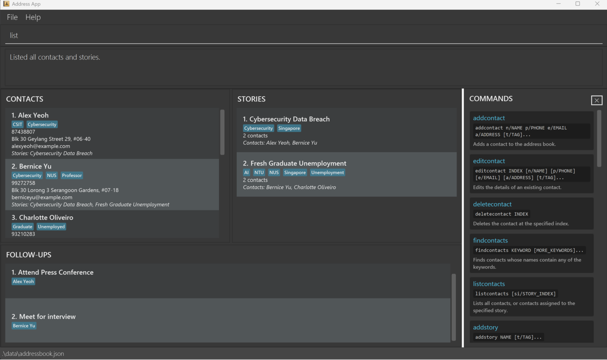
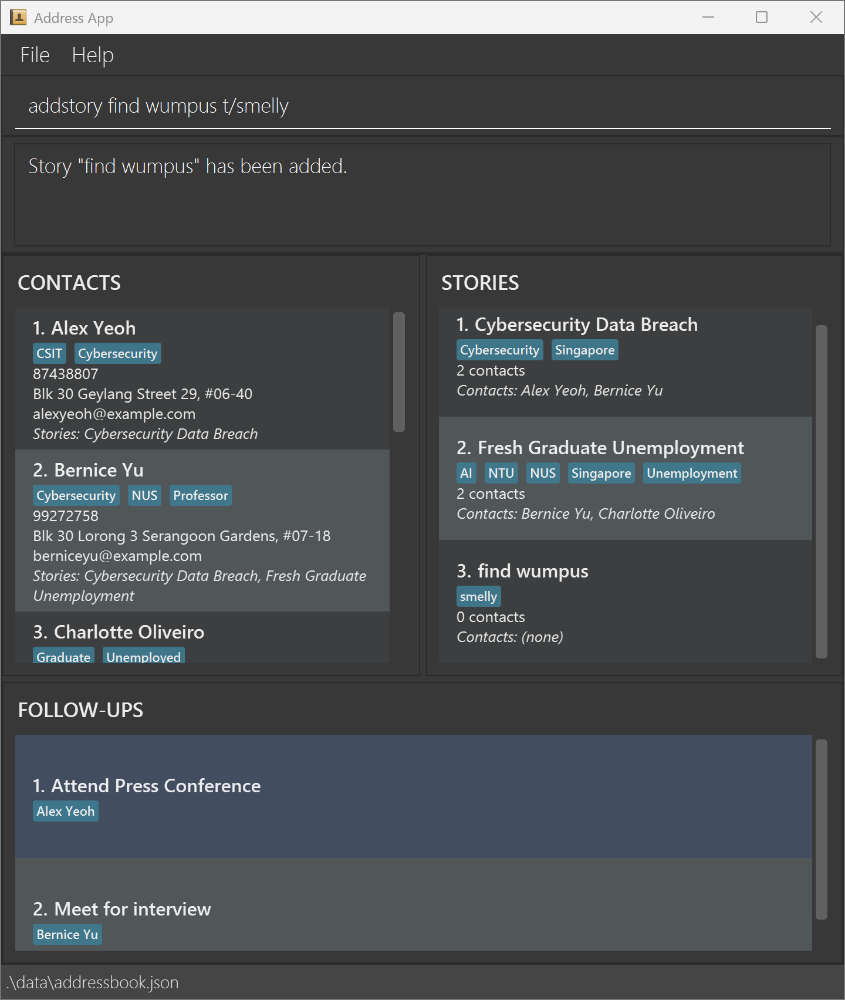
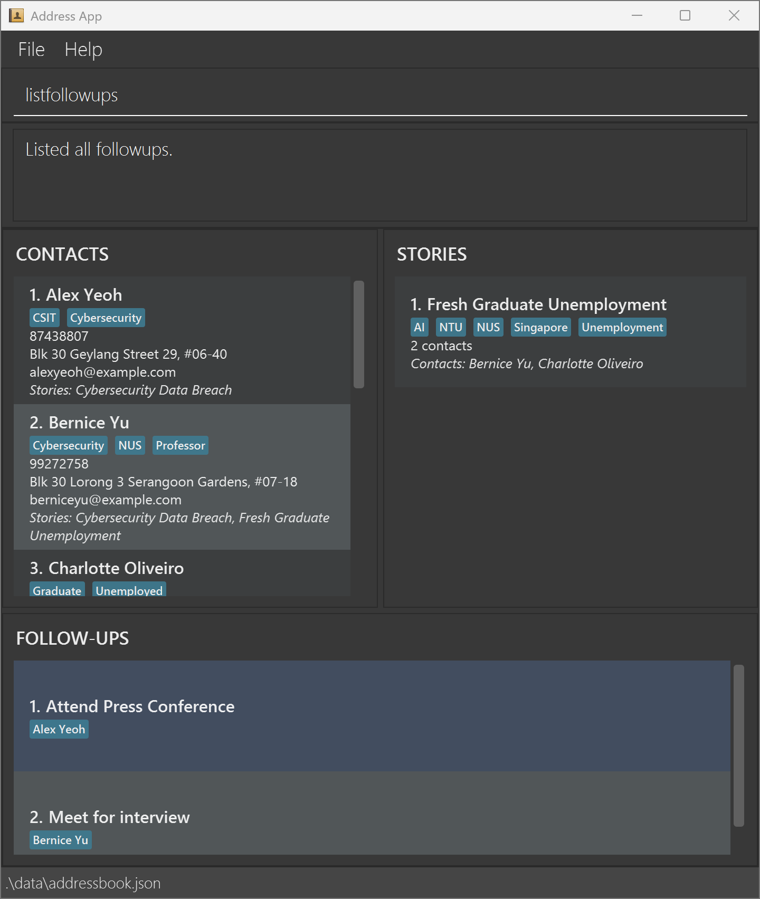

PressMemo is a **desktop application for journalists and reporters to manage contacts, stories, and follow-ups, optimized for use through a Command Line Interface (CLI)** while retaining the benefits of a Graphical User Interface (GUI). If you type quickly, PressMemo can help you organize sources across multiple stories and track follow-up reminders faster than traditional GUI applications.

This guide describes the features implemented for PressMemo v1.4.

* Table of Contents
  {:toc}

--------------------------------------------------------------------------------------------------------------------

## Quick start

1. Ensure that Java `25` or later is installed on your computer. 
   **Mac users:** Ensure you have the precise JDK version prescribed [here](https://se-education.org/guides/tutorials/javaInstallationMac.html).

2. Download the PressMemo `.jar` file from [here](https://github.com/AY2627S1-CS2103T-T13-3/tp/releases).

3. Copy the file to a folder you can write to as the _home folder_ for PressMemo.

4. Open a terminal, `cd` to the folder containing the JAR file, and run `java -jar pressmemo.jar`. 
   A GUI with the **CONTACTS**, **STORIES**, and **FOLLOW-UPS** panels similar to the one below should appear in a few seconds. On the first run, the app contains sample contacts, stories and follow-ups. 
   

5. Type a command in the command box and press Enter to execute it. For example, type **`help`** and press Enter to open the help window. 
   Some example commands you can try:

    * `list` : Displays all contacts, stories and follow-ups.

    * `addcontact n/John Doe p/98765432 e/johnd@example.com a/John street, block 123, #01-01` : Adds a contact named `John Doe` to PressMemo.

    * `assign ci/1 si/1` : Assigns the 1st displayed contact to the 1st displayed story.

    * `deletefollowup 1` : Deletes the follow-up at index 1.

    * `shortcut s/ls c/list` : Defines `ls` as a shortcut for `list`.

    * `clear` : Deletes all contacts, stories and follow-ups.

    * `exit` : Exits the app.

6. Refer to the [Features](#features) section below for details of each command.

--------------------------------------------------------------------------------------------------------------------
## Features

**:information_source: Notes about the command format:** 

* Words in `UPPER_CASE` are the parameters to be supplied by the user. 
  For example, in `addcontact n/NAME`, replace `NAME` with a value such as `John Doe`.
* Items in square brackets are optional. 
  For example, `n/NAME [t/TAG]` can be used as `n/John Doe t/friend` or as `n/John Doe`.
* Items followed by `…`​ can appear zero or more times. 
  For example, `[t/TAG]…​` may be omitted, or written as `t/friend` or `t/friend t/family`.
* Prefixed parameters can be in any order. 
  For example, if the command specifies `n/NAME p/PHONE_NUMBER`, `p/PHONE_NUMBER n/NAME` is also acceptable.
* Each command only accepts its specified prefixes. 
  For example, if the command specifies `ci/CONTACT_INDEX`, `n/NAME` will result in an error.
* The `/` character is reserved for prefixes and cannot be used in command words, preambles and fields.
* Extraneous parameters for commands that take no parameters, such as `help`, `exit`, `clear`, and `list`, are ignored. 
  For example, `help 123` is interpreted as `help`.
* If you are using a PDF version of this document, be careful when copying and pasting commands that span multiple lines as space characters surrounding line-breaks may be omitted when copied over to the application.

### Common input types

| Input type     | Definition                                                                                                                                             | Format/s                                                                                                                                                                                                  | Examples                   |
| -------------- | ------------------------------------------------------------------------------------------------------------------------------------------------------ | --------------------------------------------------------------------------------------------------------------------------------------------------------------------------------------------------------- | -------------------------- |
| user string    | A typed unit of text input.  Behaviour for invalid `user string`s is unspecified, and may result in unexpected behaviour such as error messages. | Valid `user string`s comprise only alphanumeric characters and/or spaces (U+0020). It must contain at least 1 alphanumeric character.  Any spaces at the start or end of`user string`s are ignored. | wumpus  wumpus farts |
| word           | A `user string` that does not contain spaces                                                                                                           | Does not contain spaces.                                                                                                                                                                                  | wumpus  wumpusfarts  |
| Contact Index  | A `word` representing the 1-based position of a `Contact` in the contact panel                                                                         | Integer between and including 1 and the number of `Contact`s in the contact panel  If the contact panel is empty, there is no valid `Contact Index`                                                 | 1                          |
| Story Index    | A `word` representing the 1-based position of a `Story` in the story panel                                                                             | Integer between and including 1 and the number of `Story`s in the story panel  If the story panel is empty, there is no valid `Story Index`                                                         | 2                          |
| Followup Index | A `word` representing the 1-based position of a `Followup` in the followup panel                                                                       | Integer between and including 1 and the number of `Followup`s in the followup panel  If the followup panel is empty, there is no valid `Followup Index`                                             | 1                          |

### Viewing help: `help`

Shows a message explaining how to access the help page.

Format: `help`

You can also open the help window from the **Help** menu or by pressing `F1`. For the latest instructions about story, follow-up, and shortcut commands, refer to this User Guide.

### Adding a contact: `addcontact`

Adds a contact to the address book.

Format: `addcontact n/NAME p/PHONE_NUMBER e/EMAIL a/ADDRESS [t/TAG]…​`

* All four fields (`n/`, `p/`, `e/`, and `a/`) are required and cannot be blank.
* Names contain only letters, digits, and spaces. A contact with exactly the same name already in the address book cannot be added.
* Phone numbers contain at least three digits and no other characters. Emails must have a valid `local-part@domain` format.
* Tag names contain only letters and digits, without spaces.
* Adding a contact shows the full contact list.

:bulb: **Tip:**
A contact can have any number of tags, including zero.

Examples:
* `addcontact n/John Doe p/98765432 e/johnd@example.com a/John street, block 123, #01-01`
* `addcontact n/Betsy Crowe t/friend e/betsycrowe@example.com a/Newgate Prison p/1234567 t/criminal`

### Listing contacts and stories (refactored commands)

PressMemo provides separate commands for displaying both lists, displaying contacts only, or displaying stories only. They also let you filter one list by an entry in the other.

| Command | Effect on CONTACTS | Effect on STORIES |
| --- | --- | --- |
| `list` | Shows all contacts | Shows all stories |
| `listcontacts` | Shows all contacts | Unchanged |
| `listcontacts si/1` | Shows contacts assigned to displayed story 1 | Unchanged |
| `liststories` | Unchanged | Shows all stories |
| `liststories ci/1` | Unchanged | Shows stories assigned to displayed contact 1 |

For the filtered commands, indices are taken from the **currently displayed lists**, not necessarily the full lists. If no contacts or stories match a filter, the relevant panel becomes empty.

### Listing all contacts and stories: `list`

Displays all contacts and stories, removing any active contact and story filters.

Format: `list`

* `list` resets the **CONTACTS** and **STORIES** panels together.
* It does not reset or separately list the follow-ups; those remain visible in the **FOLLOW-UPS** panel.
* `list` has no filtering parameters; extra arguments are ignored. Use `listcontacts` or `liststories` to filter one panel.

Example:
* `findcontact John` followed by `list` restores both lists in full.

### Listing contacts: `listcontacts`

Displays all contacts, or only those assigned to a selected story.

Format: `listcontacts [si/STORY_INDEX]`

* `listcontacts` shows all contacts and removes any active **contact** filter, including a `findcontact` search.
* `listcontacts si/STORY_INDEX` shows only contacts assigned to that story in the **currently displayed story list**.
* The **STORIES** panel remains unchanged. If the selected story has no assigned contacts, the contact list becomes empty.

Examples:
* `liststories` followed by `listcontacts si/1` shows contacts assigned to the first displayed story.
* `listcontacts` shows all contacts again without changing the displayed stories.

### Listing stories: `liststories`

Displays all stories, or only those assigned to a selected contact.

Format: `liststories [ci/CONTACT_INDEX]`

* `liststories` shows all stories and removes any active **story** filter.
* `liststories ci/CONTACT_INDEX` shows only stories assigned to that contact in the **currently displayed contact list**.
* The **CONTACTS** panel remains unchanged. If the selected contact has no assigned stories, the story list becomes empty.

Examples:
* `listcontacts` followed by `liststories ci/1` shows stories assigned to the first displayed contact.
* `findcontact John` followed by `liststories ci/1` uses the first contact in the filtered search results.
* `liststories` shows all stories again without changing the displayed contacts.

### Editing a contact: `editcontact`

Edits an existing contact in the address book.

Format: `editcontact INDEX [n/NAME] [p/PHONE] [e/EMAIL] [a/ADDRESS] [t/TAG]…​`

* Edits the contact at the specified `INDEX`. The index refers to the index number shown in the displayed contact list. The index **must be a positive integer** 1, 2, 3, …​
* At least one of the optional fields must be provided.
* Existing values will be updated to the input values.
* When editing tags, all of the contact's existing tags are removed; adding tags is not cumulative.
* To remove all of a contact's tags, enter `t/` without a tag after it.
* The same field restrictions as `addcontact` apply. You cannot change a contact's name to another existing contact's name.
* Editing shows the full contact list. Editing a contact, including changing their name, preserves their story assignments and updates associated follow-up references.

Examples:
*  `editcontact 1 p/91234567 e/johndoe@example.com` Edits the phone number and email address of the 1st contact to be `91234567` and `johndoe@example.com` respectively.
*  `editcontact 2 n/Betsy Crower t/` Edits the name of the 2nd contact to be `Betsy Crower` and clears all existing tags.

### Locating contacts by name: `findcontact`

Finds contacts whose names contain any of the given keywords.

Format: `findcontact KEYWORD [MORE_KEYWORDS]`

* The search is case-insensitive; for example, `hans` matches `Hans`.
* Keyword order does not matter; for example, `Hans Bo` matches `Bo Hans`.
* The search considers only names.
* Only full words match; for example, `Han` does not match `Hans`.
* Contacts matching at least one keyword are returned (an `OR` search); for example, `Hans Bo` returns `Hans Gruber` and `Bo Yang`.
* The search replaces the current contact filter and searches all contacts. It does not change the story list. Use `listcontacts` to show all contacts again without changing the story list.

Examples:
* `findcontact John` returns `john` and `John Doe`
* `findcontact alex david` returns `Alex Yeoh`, `David Li`

### Deleting a contact: `deletecontact`

Deletes the specified contact from the address book.

Format: `deletecontact INDEX`

* Deletes the contact at the specified `INDEX`.
* The index refers to the index number shown in the displayed contact list.
* The index **must be a positive integer** 1, 2, 3, …​
* Deleting a contact also removes their assignments from stories and deletes all follow-ups linked to them. The stories themselves remain.

Examples:
* `list` followed by `deletecontact 2` deletes the 2nd contact in the address book.
* `findcontact Betsy` followed by `deletecontact 1` deletes the 1st contact in the results of the `findcontact` command.

## Adding a story: `addstory`

- **Objective:** Adds a story to PressMemo

### Usage / Command Format

`addstory STORY_NAME [t/TAG]…`

### Parameters

| Parameter    | Type          | Description              | Examples                  |
| :----------- | :------------ | :----------------------- | :------------------------ |
| `STORY_NAME` | `user string` | name of the story to add | wumpus  find wumpus |
| TAG          | `word`        | a tag for the story      | smelly                    |

> **Tip / Note:**
> * No two stories can have the same name. The provided `STORY_NAME` must not already exist in PressMemo.
> * `addstory` refreshes the story panel to show all stories in PressMemo 
> * The new story starts with no assigned contacts.

### Examples

* **Example 1: valid and unique story name, no tags 
  * **Input / Action:** `addstory find wumpus`
  * **Expected Outcome:** The story named "find wumpus" is added to the stories in PressMemo and displayed in the story panel without tags

* **Example 2: valid and unique story name with 2 tags 
  * **Input / Action:** `addstory find wumpus t/smelly t/at22`
  * **Expected Outcome:** The story named "find wumpus" is added to the stories in PressMemo and displayed in the story panel with the tags "smelly" and "at22"

### Common Errors & Troubleshooting (optional, feature-specific)

| Error Message / Symptom                     | Cause                                                                    | How to Fix                                                                              |
| :------------------------------------------ | :----------------------------------------------------------------------- | :-------------------------------------------------------------------------------------- |
| Error: there is already a story named {xxx} | Trying to add a story named {xxx} when {xxx} already exists in PressMemo | delete the existing story named {xxx} first  OR  use a different story name |

### Locating stories by name: `findstory`

Finds stories whose names contain any of the given keywords.

Format: `findstory STORY_NAME [MORE_KEYWORDS]`

* The search is case-insensitive and considers only story names.
* Only full words match; for example, `House` does not match `Housing`.
* Stories matching at least one keyword are returned (an `OR` search).
* The search replaces the current story filter without changing the contact list. Use `liststories` to show all stories again.

Examples:

* `findstory Housing` returns stories with `Housing` as a word in their name.
* `findstory housing education` returns stories containing either `housing` or `education` in their name.

### Assigning a contact to a story: `assign`

Links an existing contact to an existing story.

Format: `assign ci/CONTACT_INDEX si/STORY_INDEX`

* Both indices are required and refer to the currently displayed contact and story lists respectively.
* Assign one contact to one story per command. Repeat the command with other indices to create more assignments.
* Assigning a contact to a story they already belong to leaves the existing assignment unchanged.
* After the command, both lists show all entries and the cards show the updated assignments.

Examples:

* `list` and then `assign ci/1 si/1` assigns the 1st contact to the 1st story, provided both lists have entries.
* `assign si/2 ci/1` assigns the 1st displayed contact to the 2nd displayed story.

### Unassigning a contact from a story: `unassign`

Removes the link between a contact and a story, keeping both records.

Format: `unassign ci/CONTACT_INDEX si/STORY_INDEX`

* Both indices are required and refer to the currently displayed contact and story lists respectively.
* Other assignments remain unchanged. Unassigning a contact who is not assigned to that story has no effect on assignments.
* After the command, both lists show all entries and the cards show the updated assignments.

Examples:

* `unassign ci/1 si/1` removes the assignment between the 1st displayed contact and the 1st displayed story.

### Deleting a story: `deletestory`

Deletes the specified story from PressMemo.

Format: `deletestory INDEX`

* The index refers to the number in the displayed story list, including a filtered list, and must be a positive integer.
* Deleting a story also removes its assignments from contacts. The contacts themselves remain.

Examples:

* `liststories` followed by `deletestory 2` deletes the 2nd story in the full story list.
* `liststories ci/1` followed by `deletestory 1` deletes the 1st story assigned to the 1st displayed contact, provided there is a result.

### Adding a follow-up: `addfollowup`

Adds a follow-up reminder linked to an existing contact.

Format: `addfollowup DESCRIPTION ci/CONTACT_INDEX`

* Enter the description as plain text **before** `ci/`; do not use a prefix for it.
* The description must begin with an alphanumeric character, contain only letters, numbers and spaces, and must not be blank.
* `ci/CONTACT_INDEX` refers to the contact's number in the currently displayed contact list. The index must be a positive integer within that list.
* An identical description cannot be added twice for the same contact. Description comparison is case-sensitive.
* Follow-ups belong to contacts, not directly to stories; deleting a story does not remove a contact's follow-ups.
* Use `listfollowups` to show all follow-ups or filter follow-ups by assigned contact in the **FOLLOW-UPS** panel.
* Editing a contact's name updates their follow-up references. Deleting a contact also removes their follow-ups.
* New reminders appear in the **FOLLOW-UPS** panel.

Examples:
* `addfollowup Prepare interview questions ci/1`
* `addfollowup Request financial records ci/2`

### Deleting a follow-up: `deletefollowup`

Deletes a follow-up reminder from PressMemo.

Format: `deletefollowup INDEX`

* `INDEX` is a positive integer selecting a follow-up from the follow-up list.
* **Known issue:** The panel sorts follow-ups by contact name, but deletion indexes the underlying model list. If the two orders differ, the numbered item selected by the command may not be the one shown at that number in the panel. See [Known issues](#known-issues).
* Deleting a follow-up does not delete the associated contact.

Examples:
* `deletefollowup 1`
* `deletefollowup 3`

## Listing follow-ups: `listfollowups`

- **Objective:** Displays follow-ups in the follow-ups panel, optionally filtering them by assigned contact.

### Usage / Command Format

`listfollowups [ci/CONTACT_INDEX]`

### Parameters & Constraints

| Parameter          | Type            | Description                                       | Examples |
| :----------------- | :-------------- | :------------------------------------------------ | :------- |
| `ci/CONTACT_INDEX` | `Contact Index` | to display only follow-ups linked to this contact | 1        |

> **Tip / Note:**
> * If `ci/CONTACT_INDEX` is omitted, `listfollowups` displays all follow-ups in PressMemo.
> * If `ci/CONTACT_INDEX` is provided, `listfollowups` displays only follow-ups linked to that contact.
> * `listfollowups` only updates the **FOLLOW-UPS** panel; the **CONTACTS** and **STORIES** panels remain unchanged.

### Examples

* **Example 1: List all follow-ups**
  * **Input / Action:** `listfollowups`
  * **Expected Outcome:** All follow-ups from PressMemo are displayed in the **FOLLOW-UPS** panel.

* **Example 2: List follow-ups for a specific contact**
  * **Input / Action:** `listfollowups ci/1`
  * **Expected Outcome:** Displays only follow-ups linked to the first displayed contact in the **FOLLOW-UPS** panel. 

### Managing command shortcuts: `shortcut`

Creates a custom alias for a command or displays all saved aliases.

Format: `shortcut [s/SHORTCUT c/COMMAND_WORD]`

* `shortcut` without arguments lists the existing shortcuts alphabetically, or reports that none are assigned.
* `shortcut s/SHORTCUT c/COMMAND_WORD` assigns an alias to a command.
* A shortcut must start with a lowercase letter and may contain only lowercase letters and digits (e.g., `ls`, `a1`, `ds`).
* Built-in command words cannot be reused as shortcut names.
* Only the following commands can be assigned shortcuts: `addcontact`, `addstory`, `assign`, `clear`, `deletecontact`, `deletestory`, `editcontact`, `exit`, `findcontact`, `findstory`, `help`, `list`, `liststories`, and `unassign`.
* Other commands, including `listcontacts`, `addfollowup`, `deletefollowup`, `shortcut`, and `unshortcut`, are not supported as shortcut targets in this version.
* Each command can have at most one shortcut, and each shortcut can refer to one command. Reassigning a shortcut or command replaces conflicting mappings.
* Once assigned, type the shortcut in place of the command word and keep any required arguments.
* Shortcuts are saved in `preferences.json` and remain available after restarting the app.

Examples:
* `shortcut` — lists all existing shortcuts.
* `shortcut s/ls c/list` — assigns `ls` to `list`; you can then enter `ls`.
* `shortcut s/a c/addcontact` — assigns `a` to `addcontact`; you can then enter `a n/John Tan p/91234567 e/john@example.com a/Singapore`.
* `shortcut s/ds c/deletestory` — assigns `ds` to `deletestory`.

### Removing a command shortcut: `unshortcut`

Removes an existing custom shortcut without deleting the underlying command.

Format: `unshortcut SHORTCUT`

* `SHORTCUT` must name an existing alias. If it does not exist, an error message is displayed.
* Removing the alias is saved in `preferences.json`.

Examples:
* `unshortcut ls`
* `unshortcut ds`

### Clearing all entries: `clear`

Clears all contacts, stories, assignments, and follow-ups from PressMemo.

Format: `clear`

This affects all records, including those hidden by filters. User preferences and command shortcuts are not removed. There is no confirmation prompt or undo command; back up your data files first if you may need them later.

### Exiting the program: `exit`

Exits the program.

Format: `exit`

### Saving the data

PressMemo automatically saves contact, story, assignment, and follow-up records after every successful command. Custom shortcuts are also saved automatically. You do not need to save manually.

### Editing the data files

PressMemo saves contacts, their story assignments, and follow-up reminders in `data/addressbook.json`. Stories and their contact assignments are saved in `data/stories.json`. User preferences and custom shortcuts are saved in `preferences.json`. These paths are relative to the folder from which you launch the app. If you follow the Quick start instructions, this is the JAR file's folder. The files are loaded on startup.

Advanced users can update records directly by editing these JSON files while the app is closed. Back up all files before editing.

 **Caution:**
If the contact file is invalid or cannot be read, PressMemo starts with an empty contact list. If the story file is invalid or cannot be read, it starts with an empty story list. A missing contact file results in sample contacts; a missing story file results in an empty story list. An invalid file may be overwritten after the next successful command, so restore your backup before running commands. 
Furthermore, certain edits can cause PressMemo to behave in unexpected ways (e.g., if a value entered is outside of the acceptable range). Therefore, edit the data files only if you are confident that you can update them correctly.

--------------------------------------------------------------------------------------------------------------------

## FAQ

**Q**: How do I transfer my data to another computer? 
**A**: Close PressMemo on both computers. Copy `data/addressbook.json` and `data/stories.json` from your old launch folder to the new one. Copy `preferences.json` too if you want to retain custom shortcuts and GUI settings. Back up existing files before replacing them.

--------------------------------------------------------------------------------------------------------------------

## Known issues

1. **When using multiple screens**, if you move the application to a secondary screen, and later switch to using only the primary screen, the GUI will open off-screen. The remedy is to delete the `preferences.json` file created by the application before running the application again.
2. **If you minimize the Help Window** and then run the `help` command (or use the `Help` menu) again, the original Help Window will remain minimized, and no new Help Window will appear. The remedy is to manually restore the minimized Help Window.

--------------------------------------------------------------------------------------------------------------------

## Command summary

| Action                            | Format, Examples                                                                                                                                                                    |
| --------------------------------- | ----------------------------------------------------------------------------------------------------------------------------------------------------------------------------------- |
| **Add**                           | `addcontact n/NAME p/PHONE_NUMBER e/EMAIL a/ADDRESS [t/TAG]…​`   e.g., `addcontact n/James Ho p/22224444 e/jamesho@example.com a/123, Clementi Rd, 1234665 t/friend t/colleague` |
| **Add follow-up**                 | `addfollowup DESCRIPTION ci/CONTACT_INDEX`  e.g., `addfollowup Interview prep ci/1`                                                                                              |
| **Add story**                     | `addstory STORY_NAME`  e.g., `addstory Housing Investigation`                                                                                                                    |
| **Assign**                        | `assign ci/CONTACT_INDEX si/STORY_INDEX`  e.g., `assign ci/1 si/2`                                                                                                               |
| **Clear all entries**             | `clear`                                                                                                                                                                             |
| **Delete**                        | `deletecontact INDEX`  e.g., `deletecontact 3`                                                                                                                                   |
| **Delete follow-up**              | `deletefollowup INDEX`  e.g., `deletefollowup 1`                                                                                                                                 |
| **Delete story**                  | `deletestory INDEX`  e.g., `deletestory 2`                                                                                                                                       |
| **Edit**                          | `editcontact INDEX [n/NAME] [p/PHONE_NUMBER] [e/EMAIL] [a/ADDRESS] [t/TAG]…​`  e.g., `editcontact 2 n/James Lee e/jameslee@example.com`                                          |
| **Find**                          | `findcontact KEYWORD [MORE_KEYWORDS]`  e.g., `findcontact James Jake`                                                                                                            |
| **Find story**                    | `findstory STORY_NAME [MORE_KEYWORDS]`  e.g., `findstory Housing Investigation`                                                                                                  |
| **List all contacts and stories** | `list` (clears both filters)                                                                                                                                                        |
| **List contacts**                 | `listcontacts [si/STORY_INDEX]`  e.g., `listcontacts` (all contacts only) or `listcontacts si/1` (contacts assigned to displayed story 1)                                        |
| **List follow-ups**               | `listfollowups [ci/CONTACT_INDEX]`  e.g., `listfollowups` (all follow-ups) or `listfollowups ci/1` (follow-ups for contact 1)                   |
| **List stories**                  | `liststories [ci/CONTACT_INDEX]`  e.g., `liststories` (all stories only) or `liststories ci/1` (stories assigned to displayed contact 1)                                         |
| **Manage shortcuts**              | `shortcut [s/SHORTCUT c/COMMAND_WORD]`  e.g., `shortcut` or `shortcut s/ls c/list`                                                                                               |
| **Remove shortcut**               | `unshortcut SHORTCUT`  e.g., `unshortcut ls`                                                                                                                                     |
| **Unassign**                      | `unassign ci/CONTACT_INDEX si/STORY_INDEX`  e.g., `unassign ci/1 si/2`                                                                                                           |
| **Help**                          | `help`                                                                                                                                                                              |
| **Exit**                          | `exit`                                                                                                                                                                              |
