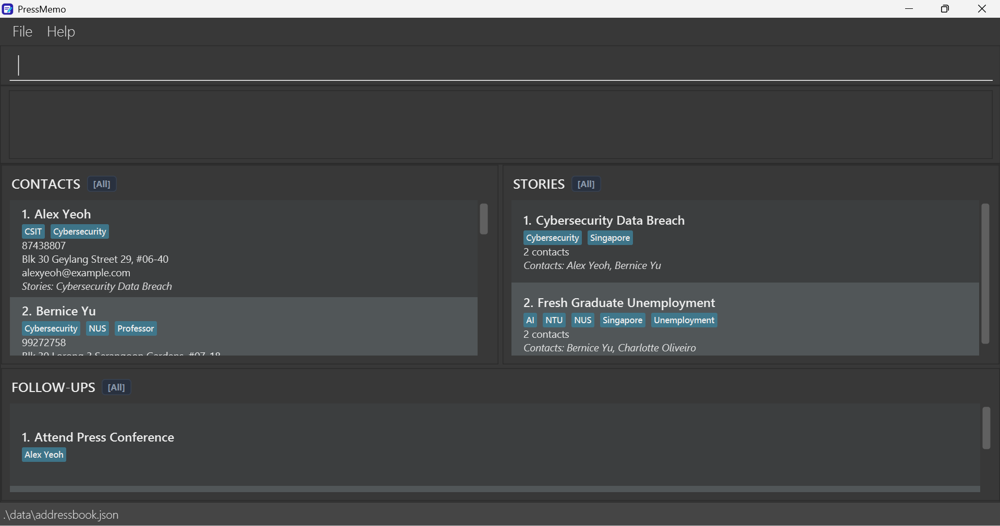
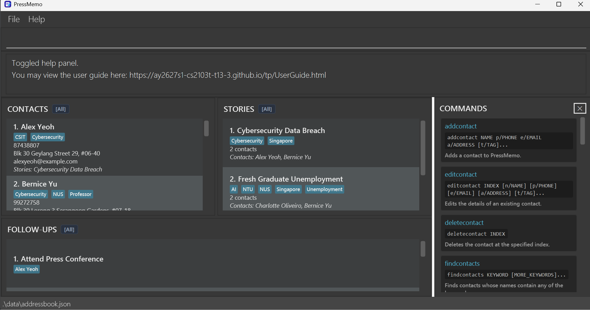
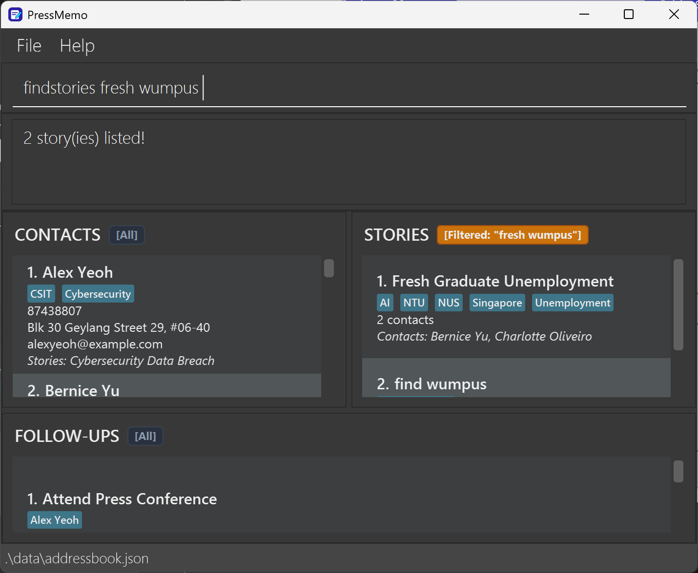
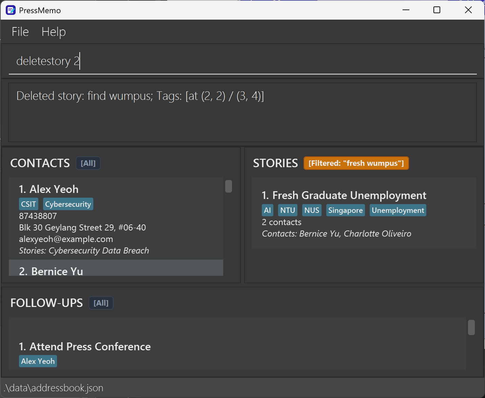
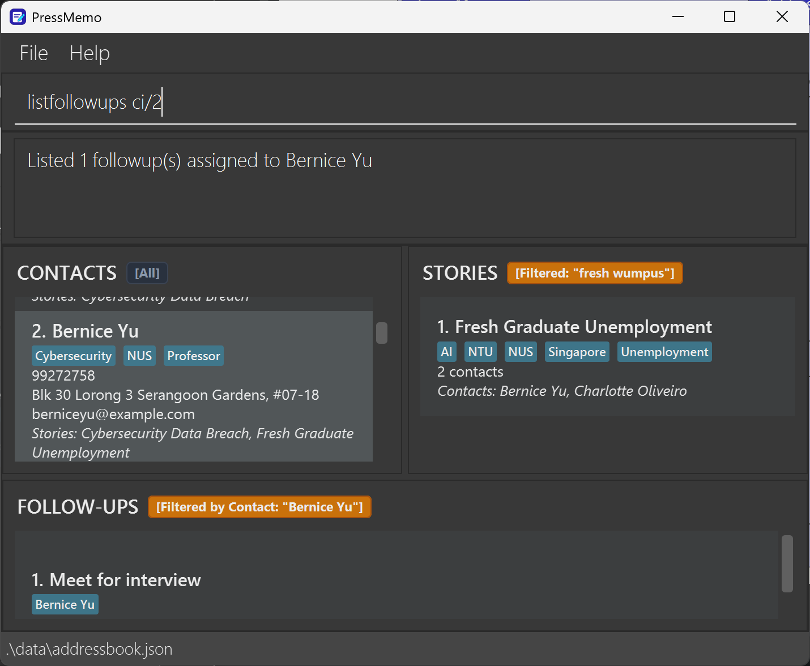

PressMemo is a **desktop application for journalists and reporters to manage contacts, stories, and follow-ups, optimized for use through a Command Line Interface (CLI)** while retaining the benefits of a Graphical User Interface (GUI). If you type quickly, PressMemo can help you organize sources across multiple stories and track follow-up reminders faster than traditional GUI applications.

This guide describes the features implemented for PressMemo v1.4.

* Table of Contents
{:toc}

--------------------------------------------------------------------------------------------------------------------

## Quick start

1. Ensure that Java `25` or later is installed on your computer. 
   **Mac users:** Ensure you have the precise JDK version prescribed [here](https://se-education.org/guides/tutorials/javaInstallationMac.html).

2. Download the PressMemo `.jar` file from [here](https://github.com/AY2627S1-CS2103T-T13-3/tp/releases).

3. Copy the file to a folder you can write to as the _home folder_ for PressMemo.

4. Open a terminal, `cd` to the folder containing the JAR file, and run `java -jar pressmemo.jar`. 
   A GUI with the **CONTACTS**, **STORIES**, and **FOLLOW-UPS** panels similar to the one below should appear in a few seconds. On the first run, the app contains sample contacts, stories and follow-ups. 
   

5. Type a command in the command box and press Enter to execute it. For example, type **`help`** and press Enter to open the help window. 
   Some example commands you can try:

    * `list` : Displays all contacts, stories and follow-ups.

    * `addcontact n/Jane Smith p/91234567 e/janesmith@example.com a/Jane street, block 987, #10-10` : Adds a contact named `Jane Smith` to PressMemo.

    * `assign ci/1 si/2` : Assigns the 1st displayed contact to the 2nd displayed story.

    * `deletefollowup 1` : Deletes the 1st displayed follow-up.

    * `shortcut s/ls c/list` : Defines `ls` as a shortcut for `list`.

    * `clear` : Deletes all contacts, stories and follow-ups.

    * `exit` : Exits the app.

6. Refer to the [Features](#features) section below for details of each command.

--------------------------------------------------------------------------------------------------------------------
## Features

**:information_source: Notes about the command format:** 

* Words in `UPPER_CASE` are the parameters to be supplied by the user. 
  For example, in `addcontact n/NAME`, replace `NAME` with a value such as `John Doe`.
* Items in square brackets are optional. 
  For example, `n/NAME [t/TAG]` can be used as `n/John Doe t/friend` or as `n/John Doe`.
* Items followed by `…`​ can appear zero or more times. 
  For example, `[t/TAG]…​` may be omitted, or written as `t/friend` or `t/friend t/family`.
* Prefixed parameters can be in any order. 
  For example, if the command specifies `n/NAME p/PHONE_NUMBER`, `p/PHONE_NUMBER n/NAME` is also acceptable.
* Extraneous parameters for commands that take no parameters, such as `help`, `exit`, `clear`, and `list`, are not allowed. 
  For example, `help 123` will result in an error.
* If you are using a PDF version of this document, be careful when copying and pasting commands that span multiple lines as space characters surrounding line-breaks may be omitted when copied over to the application.

### Common input types

| Input type        | Definition                                                                | Format/s                                                                                                                                                                                       | Examples                                      |
|-------------------|---------------------------------------------------------------------------|------------------------------------------------------------------------------------------------------------------------------------------------------------------------------------------------|-----------------------------------------------|
| `user-string`     | A sequence of characters.                                                 | Must contain one or more characters, with at least one non-space character.  Any forward slash must be escaped using backslash (\\).  Any spaces at the start and end are ignored. | wumpus  wumpus farts  date 3\\/12 |
| `word`            | A `user-string` that does not contain spaces or forward slashes.          | Must not contain spaces or forward slashes                                                                                                                                                     | wumpus  wumpus,farts!                   |
| `contact-index`   | A number representing the position of a `Contact` in the contact panel.   | Integer between 1 and the number of `Contact`s in the contact panel  If the contact panel is empty, there is no valid `contact-index`                                                    | 1                                             |
| `story-index`     | A number representing the position of a `Story` in the story panel.       | Integer between 1 and the number of `Story`s in the story panel  If the story panel is empty, there is no valid `story-index`                                                            | 2                                             |
| `followup-index`  | A number representing the position of a `Followup` in the followup panel. | Integer between 1 and the number of `Followup`s in the followup panel  If the followup panel is empty, there is no valid `followup-index`                                                | 1                                             |

### Viewing help: `help`

Toggles the help panel which lists all default commands and their formats. 

Format: `help`

* Enter `help` to open or close the help panel. The link to the user guide will also be shown in the message panel. Alternatively, use the **Help** menu at the top. 
* Use the scrollbar or select the command panel and use the up and down arrow keys to view the command list.
* The help panel displays only the default commands and does not include any custom shortcuts you have created. 
* For the latest instructions about contact, story, follow-up, and shortcut commands, refer to this User Guide.

### Adding a contact: `addcontact`

Adds a contact to PressMemo.

Format: `addcontact n/NAME p/PHONE_NUMBER e/EMAIL a/ADDRESS [t/TAG]…​`

* All four fields (`n/`, `p/`, `e/`, and `a/`) are required and cannot be blank.
* Names contain only letters, digits, and spaces. A contact with exactly the same name already in PressMemo cannot be added.
* Phone numbers contain between 3 and 15 digits and no other characters. Emails must have a valid `word@word` format.
* Tag names contain only letters and digits, without spaces.
* Adding a contact preserves any active contact filter. The new contact will appear in the contact list if it matches the active filter.

:bulb: **Tip:**
A contact can have any number of tags, including zero.

Examples:
* `addcontact n/John Doe p/98765432 e/johnd@example.com a/John street, block 123, #01-01`
* `addcontact n/Betsy Crowe t/friend e/betsycrowe@example.com a/Newgate Prison p/1234567 t/criminal`

### Listing contacts and stories (refactored commands)

PressMemo provides separate commands for displaying both lists, displaying contacts only, or displaying stories only. They also let you filter one list by an entry in the other.

| Command | Effect on CONTACTS | Effect on STORIES |
| --- | --- | --- |
| `list` | Shows all contacts | Shows all stories |
| `listcontacts` | Shows all contacts | Unchanged |
| `listcontacts si/1` | Shows contacts assigned to displayed story 1 | Unchanged |
| `liststories` | Unchanged | Shows all stories |
| `liststories ci/1` | Unchanged | Shows stories assigned to displayed contact 1 |

For the filtered commands, indices are taken from the **currently displayed lists**, not necessarily the full lists. If no contacts or stories match a filter, the relevant panel becomes empty.

**:information_source: Visual Filter Status Indicators:** 

Each panel header (**CONTACTS**, **STORIES**, and **FOLLOW-UPS**) displays an active filter indicator badge next to the panel header:
* **`[All]`** (subtle badge): Indicates the panel displays all items without any filter applied.
* **`[Filtered: "..."]`** or **`[Filtered by ...: "..."]`** (vibrant amber badge): Indicates a filter or search query is currently active on that panel (e.g., `[Filtered by story: "Investigation"]` or `[Filtered: "John"]`).
* Hovering your mouse over the badge displays the complete filter description as a tooltip if the text is truncated on narrow windows.

This visual badge ensures you always know whether the displayed index numbers (e.g., `1`, `2`, `3`) correspond to the complete list or a filtered subset, eliminating index ambiguity!

### Listing all contacts and stories: `list`

Displays all contacts and stories, removing any active contact and story filters.

Format: `list`

* `list` resets the **CONTACTS** and **STORIES** panels together.
* It does not reset or separately list the follow-ups; those remain visible in the **FOLLOW-UPS** panel.
* `list` has no filtering parameters; extra arguments will result in an error. Use `listcontacts` or `liststories` to filter one panel.

Example:
* `findcontact John` followed by `list` restores both lists in full.

### Listing contacts: `listcontacts`

Displays all contacts, or only those assigned to a selected story.

Format: `listcontacts [si/STORY_INDEX]`

* `listcontacts` shows all contacts and removes any active **contact** filter, including a `findcontact` search.
* `listcontacts si/STORY_INDEX` shows only contacts assigned to that story in the **currently displayed story list**.
* The **STORIES** panel remains unchanged. If the selected story has no assigned contacts, the contact list becomes empty.

Examples:
* `liststories` followed by `listcontacts si/1` shows contacts assigned to the first displayed story.
* `listcontacts` shows all contacts again without changing the displayed stories.

### Listing stories: `liststories`

Displays all stories, or only those assigned to a selected contact.

Format: `liststories [ci/CONTACT_INDEX]`

* `liststories` shows all stories and removes any active **story** filter.
* `liststories ci/CONTACT_INDEX` shows only stories assigned to that contact in the **currently displayed contact list**.
* The **CONTACTS** panel remains unchanged. If the selected contact has no assigned stories, the story list becomes empty.

Examples:
* `listcontacts` followed by `liststories ci/1` shows stories assigned to the first displayed contact.
* `findcontact John` followed by `liststories ci/1` uses the first contact in the filtered search results.
* `liststories` shows all stories again without changing the displayed contacts.

### Editing a contact: `editcontact`

Edits an existing contact in PressMemo.

Format: `editcontact INDEX [n/NAME] [p/PHONE] [e/EMAIL] [a/ADDRESS] [t/TAG]…​`

* Edits the contact at the specified `INDEX`. The index refers to the index number shown in the displayed contact list. The index **must be a positive integer** 1, 2, 3, …​
* At least one of the optional fields must be provided.
* Existing values will be updated to the input values.
* When editing tags, all of the contact's existing tags are removed; adding tags is not cumulative.
* To remove all of a contact's tags, enter `t/` without a tag after it.
* The same field restrictions as `addcontact` apply. You cannot change a contact's name to another existing contact's name.
* Editing preserves the current contact list filter instead of resetting to all contacts. Editing a contact, including changing their name, preserves their story assignments and updates associated follow-up references.

Examples:
*  `editcontact 1 p/91234567 e/johndoe@example.com` Edits the phone number and email address of the 1st contact to be `91234567` and `johndoe@example.com` respectively.
*  `editcontact 2 n/Betsy Crower t/` Edits the name of the 2nd contact to be `Betsy Crower` and clears all existing tags.

### Locating contacts by name: `findcontact`

Finds contacts whose names contain any of the given keywords.

Format: `findcontact KEYWORD [MORE_KEYWORDS]`

* The search is case-insensitive; for example, `hans` matches `Hans`.
* Keyword order does not matter; for example, `Hans Bo` matches `Bo Hans`.
* The search considers only names.
* Only full words match; for example, `Han` does not match `Hans`.
* Contacts matching at least one keyword are returned (an `OR` search); for example, `Hans Bo` returns `Hans Gruber` and `Bo Yang`.
* The search replaces the current contact filter and searches all contacts. It does not change the story list. Use `listcontacts` to show all contacts again without changing the story list.

Examples:
* `findcontact John` returns `john` and `John Doe`
* `findcontact alex david` returns `Alex Yeoh`, `David Li`

### Deleting a contact: `deletecontact`

Deletes the specified contact from PressMemo.

Format: `deletecontact INDEX`

* Deletes the contact at the specified `INDEX`.
* The index refers to the index number shown in the displayed contact list.
* The index **must be a positive integer** 1, 2, 3, …​
* Deleting a contact also removes their assignments from stories and deletes all follow-ups linked to them. The stories themselves remain.

Examples:
* `list` followed by `deletecontact 2` deletes the 2nd contact in PressMemo.
* `findcontact Betsy` followed by `deletecontact 1` deletes the 1st contact in the results of the `findcontact` command.

### Adding a story: `addstory`

- **Objective:** Adds a story to PressMemo

#### Usage / Command Format

`addstory STORY_NAME [t/TAG]…`

#### Parameters

| Parameter    | Type          | Description              | Examples                  |
| :----------- | :------------ | :----------------------- | :------------------------ |
| `STORY_NAME` | `user-string` | name of the story to add | wumpus  find wumpus |
| TAG          | `user-string` | a tag for the story      | smelly                    |

> **Tip / Note:**
> * No two stories can have the same name. The provided `STORY_NAME` must not already exist in PressMemo.
> * `addstory` preserves any active story filter; the new story will appear in the story panel if it matches the active filter.
> * The new story starts with no assigned contacts.

#### Examples

* **Example 1: valid and unique story name, no tags 
  * **Input / Action:** `addstory find wumpus`
  * **Expected Outcome:** The story named "find wumpus" is added to the stories in PressMemo and displayed in the story panel without tags

* **Example 2: valid and unique story name with 2 tags 
  * **Input / Action:** `addstory find wumpus t/smelly t/at 2, 2`
  * **Expected Outcome:** The story named "find wumpus" is added to the stories in PressMemo and displayed in the story panel with the tags "smelly" and "at 2, 2"

#### Common Errors & Troubleshooting

| Error Message / Symptom                     | Cause                                                                    | How to Fix                                                                              |
| :------------------------------------------ | :----------------------------------------------------------------------- | :-------------------------------------------------------------------------------------- |
| Error: there is already a story named {xxx} | Trying to add a story named {xxx} when {xxx} already exists in PressMemo | delete the existing story named {xxx} first  OR  use a different story name |

### Editing a story: `editstory`

- **Objective:** Updates the name or tags of an existing story.

#### Usage / Command Format

`editstory INDEX [n/STORY_NAME] [t/TAG]…`

#### Parameters & Constraints

| Parameter        | Type          | Description                                                   | Examples              |
| :--------------- | :------------ | :------------------------------------------------------------ | :-------------------- |
| `INDEX`          | `story-index` | Story to edit from the displayed **STORIES** panel            | `1`                   |
| `n/STORY_NAME`   | `user-string` | New story name                                                | Election investigation |
| `t/TAG`          | `user-string` | New tag for the story; repeat to replace the tags with several tags | urgent                |

> **Tip / Note:**
> * Provide at least one of `n/STORY_NAME` or `t/TAG`.
> * Values not supplied are preserved.
> * Supplying one or more `t/TAG` values replaces all existing tags.
>   * Empty `t/` values are ignored. For example, `editstory 2 t/ t/urgent t/politics` replaces the tags with `urgent` and `politics`.
>   * If every supplied `t/` value is empty, such as `t/` or `t/ t/`, all tags are removed.
> * The new name must not duplicate another story's name.
> * Editing a story preserves its assigned contacts and updates the story name shown in those contacts' assignments.
> * The current story filter is preserved. If the edited name no longer matches the filter, the story is no longer displayed but remains saved in PressMemo.

#### Examples

* **Example 1: Rename a story**
  * **Input / Action:** `editstory 1 n/Election investigation`
  * **Expected Outcome:** Changes the first displayed story's name to `Election investigation` while preserving its tags and assigned contacts.

* **Example 2: Replace a story's tags**
  * **Input / Action:** `editstory 2 t/urgent t/politics`
  * **Expected Outcome:** Replaces the second displayed story's tags with `urgent` and `politics` while preserving its name and assigned contacts.

* **Example 3: Include empty and non-empty tag values**
  * **Input / Action:** `editstory 2 t/ t/urgent t/politics`
  * **Expected Outcome:** Replaces the second displayed story's tags with `urgent` and `politics`; the empty `t/` value is ignored.

* **Example 4: Remove all tags**
  * **Input / Action:** `editstory 1 t/`
  * **Expected Outcome:** Removes all tags from the first displayed story while preserving its name and assigned contacts.

#### Common Errors & Troubleshooting

| Error Message / Symptom | Cause | How to Fix |
| :--- | :--- | :--- |
| `At least one field to edit must be provided.` | Neither `n/STORY_NAME` nor `t/TAG` was supplied. | Provide a new name, one or more tags, or `t/` to clear all tags. |
| `Error: there is already a story named "Election investigation"!` | Another story already has the requested name. | Choose a different story name. |
| `Story names should not be blank or start with whitespace` | The supplied story name is blank. | Provide a non-blank story name. |

### Filter stories by name: `findstories`

- **Objective:** Finds stories whose names contain any of the given keywords (case-insensitive) and displays them in the story panel.

#### Usage / Command Format

`findstories STORY_NAME [MORE_KEYWORDS]...`

#### Parameters & Constraints

| Parameter       | Type   | Description                                      | Examples   |
| :-------------- | :----- | :----------------------------------------------- | :--------- |
| `STORY_NAME`    | `word` | First keyword to search for in story names       | wumpus     |
| `MORE_KEYWORDS` | `word` | Additional keywords to search for in story names | the smelly |

> **Tip / Note:**
> * `findstories` is case-insensitive (e.g., `wumpus` matches `WumPuS`).
> * Only full words will be matched (e.g., `wump` will not match `wumpus`).
> * The order of the keywords does not matter.
> * All stories matching at least one keyword are returned (e.g. `wumpus smelly` matches `find wumpus` and `something smelly`) 
> * The **STORIES** panel is updated without changing the **CONTACTS** or **FOLLOW-UPS** panels.
> * To display all stories again, use `liststories` or `list`.

#### Examples

* **Example 1: Single keyword search**
  * **Input / Action:** `findstories wumpus`
  * **Expected Outcome:** Displays all stories with `wummpus` as a word in their name. A message in the console indicates the number of matches found.

* **Example 2: Multiple keywords search**
  * **Input / Action:** `findstories wumpus smelly`
  * **Expected Outcome:** Displays all stories whose names contain either `wumpus` or `smelly`. A message in the console indicates the number of matches found.

* **Example 3: Search with no matches**
  * **Input / Action:** `findstories wompusDoesNotExist` when there is no story whose name contains `wompusDoesNotExist`
  * **Expected Outcome:** The story panel displays no stories. A message in the console indicates that no matches were found.

#### Common Errors & Troubleshooting

| Error Message / Symptom                                    | Cause                                                                           | How to Fix                                                                   |
| :--------------------------------------------------------- | :------------------------------------------------------------------------------ | :--------------------------------------------------------------------------- |
| `0 story(ies) listed!` when matching stories were expected | Search keywords were partial words (e.g., `wump` instead of `wumpus`)           | Ensure full words are used in the search keyword, e.g., `findstories wumpus` |

### Assigning a contact to a story: `assign`

Links an existing contact to an existing story.

Format: `assign ci/CONTACT_INDEX si/STORY_INDEX`

* Both indices are required and refer to the currently displayed contact and story lists respectively.
* Assign one contact to one story per command. Repeat the command with other indices to create more assignments.
* Assigning a contact to a story they already belong to leaves the existing assignment unchanged.
* After the command, both lists show all entries and the cards show the updated assignments.

Examples:

* `list` and then `assign ci/1 si/1` assigns the 1st contact to the 1st story, provided both lists have entries.
* `assign si/2 ci/1` assigns the 1st displayed contact to the 2nd displayed story.

### Unassigning a contact from a story: `unassign`

Removes the link between a contact and a story, keeping both records.

Format: `unassign ci/CONTACT_INDEX si/STORY_INDEX`

* Both indices are required and refer to the currently displayed contact and story lists respectively.
* Other assignments remain unchanged. Unassigning a contact who is not assigned to that story has no effect on assignments.
* After the command, both lists show all entries and the cards show the updated assignments.

Examples:

* `unassign ci/1 si/1` removes the assignment between the 1st displayed contact and the 1st displayed story.

### Deleting a story: `deletestory`

- **Objective:** Deletes the specified story from PressMemo.

#### Usage / Command Format

`deletestory INDEX`

#### Parameters & Constraints

| Parameter | Type          | Description                                        | Examples |
| :-------- | :------------ | :------------------------------------------------ | :------- |
| `INDEX`   | `Story Index` Index of the story to delete from the story panel el | `1`      |

> **Tip / Note:**
> * Deleting a story automatically unassigns it from all contacts originally assigned to it. The contacts themselves remain in PressMemo.
> * Follow-ups are unaffected.
> * Deletion cannot be undone.

#### Examples

* **Example 1: Deleting a story from the full story list**
  * **Input / Action:** `deletestory 2`
  * **Expected Outcome:** Deletes the 2nd story from the story panel. Identifying information about the recently-deleted story is displayed in the console.

### Adding a follow-up: `addfollowup`

- **Objective:** Adds a follow-up reminder and links it to an existing contact.

#### Usage / Command Format

`addfollowup DESCRIPTION ci/CONTACT_INDEX`

#### Parameters & Constraints

| Parameter          | Type            | Description                                                            | Examples                    |
| :----------------- | :-------------- | :--------------------------------------------------------------------- | :-------------------------- |
| `DESCRIPTION`      | `user-string`   | Description of the follow-up                                           | Prepare interview questions |
| `ci/CONTACT_INDEX` | `contact-index` | Contact to link the follow-up to, from the displayed **CONTACTS** panel | `1`                         |

> **Tip / Note:**
> * Enter `DESCRIPTION` as plain text before `ci/`; it does not use a prefix.
> * `DESCRIPTION` cannot be blank. Leading and trailing whitespace is removed.
> * A contact cannot have two follow-ups with exactly the same description.
>   * Description comparison is case-sensitive.
> * Follow-ups belong to contacts, not directly to stories.
>   * Deleting a story does not remove a contact's follow-ups.
>   * Each follow-up belongs to exactly one contact.
> * Editing a contact's name updates the contact name shown on their follow-ups.
> * Deleting a contact also deletes all follow-ups linked to them.
> * Adding a follow-up retains the **FOLLOW-UPS** panel filter. New follow-ups are displayed if they match the existing filter.

#### Examples

* **Example 1: Add a follow-up to the first displayed contact**
  * **Input / Action:** `addfollowup Prepare interview questions ci/1`
  * **Expected Outcome:** Adds the follow-up `Prepare interview questions` and links it to the first contact in the displayed **CONTACTS** panel.

#### Common Errors & Troubleshooting

| Error Message / Symptom                                                                 | Cause                                                                                                   | How to Fix                                                        |
|:----------------------------------------------------------------------------------------|:--------------------------------------------------------------------------------------------------------| :---------------------------------------------------------------- |
| `Error: there is already a followup "Check back for interview" for the contact "Alex"!` | The contact (Alex) already has a follow-up with exactly the same description (Check back for interview) | Use a different description or edit the existing follow-up        |

### Editing a follow-up: `editfollowup`

- **Objective:** Updates the description or linked contact of an existing follow-up.

#### Usage / Command Format

`editfollowup INDEX [d/DESCRIPTION] [ci/CONTACT_INDEX]`

#### Parameters & Constraints

| Parameter          | Type             | Description                                                                     | Examples      |
| :----------------- | :--------------- | :------------------------------------------------------------------------------ | :------------ |
| `INDEX`            | `followup-index` | Follow-up to edit, from the displayed **FOLLOW-UPS** panel                       | `1`           |
| `d/DESCRIPTION`    | `user-string`    | New follow-up description                                                       | Call tomorrow |
| `ci/CONTACT_INDEX` | `contact-index`  | New linked contact, from the displayed **CONTACTS** panel                        | `2`           |

> **Tip / Note:**
> * At least one of `d/DESCRIPTION` or `ci/CONTACT_INDEX` must be provided.
> * A follow-up can be linked to only one contact at a time.
>   * Linking it to a new contact replaces the existing link.
> * Existing values are preserved for fields that are not provided.
> * The same description constraints as `addfollowup` apply.
> * The edited follow-up cannot duplicate another follow-up linked to the same contact.
> * The current follow-up filter on **FOLLOW-UPS** panel is preserved. If the edited follow-up no longer matches that filter, it disappears from the displayed **FOLLOW-UPS** panel but remains saved in PressMemo.

#### Examples

* **Example 1: Edit only the description**
  * **Input / Action:** `editfollowup 1 d/Call tomorrow`
  * **Expected Outcome:** Changes the description of the first displayed follow-up to `Call tomorrow` while preserving its linked contact.

* **Example 2: Edits both the description and linked contact**
  * **Input / Action:** `editfollowup 1 d/Call tomorrow ci/2`
  * **Expected Outcome:** Changes the first displayed follow-up's description to `Call tomorrow` and replaces the linked contact with the second displayed contact.

#### Common Errors & Troubleshooting

| Error Message / Symptom                                                              | Cause                                                                                 | How to Fix                                                  |
|:-------------------------------------------------------------------------------------|:--------------------------------------------------------------------------------------|:------------------------------------------------------------|
| `At least one field to edit must be provided.`                                       | Neither `d/DESCRIPTION` nor `ci/CONTACT_INDEX` was supplied                           | Provide at least one field to update                        |
| `Error: there is already a followup "Test" for the contact "Alex"!`                  | The edited followup is a duplicate of another follow-up for the linked contact (Alex) | Use a different description or contact                      |
| `Follow-up descriptions should not be blank or start with whitespace`                | `DESCRIPTION` is blank                                                                | Enter a non-blank description |

### Deleting a follow-up: `deletefollowup`

- **Objective:** Deletes the specified follow-up reminder from PressMemo.

#### Usage / Command Format

`deletefollowup INDEX`

#### Parameters & Constraints

| Parameter | Type             | Description                                               | Examples |
| :-------- | :--------------- | :-------------------------------------------------------- | :------- |
| `INDEX`   | `followup-index` | Follow-up to delete from the displayed **FOLLOW-UPS** panel | `1`      |

> **Tip / Note:**
> * `INDEX` must be a positive integer within the displayed follow-up list.
> * Deleting a follow-up does not delete its linked contact.
> * Deletion cannot be undone.

#### Examples

* **Example 1: Delete from the full follow-up list**
  * **Input / Action:** `listfollowups`, followed by `deletefollowup 1`
  * **Expected Outcome:** Deletes the first follow-up displayed in the **FOLLOW-UPS** panel.

* **Example 2: Delete from filtered search results**
  * **Input / Action:** `findfollowups interview`, followed by `deletefollowup 1`
  * **Expected Outcome:** Deletes the first follow-up displayed in the filtered **FOLLOW-UPS** panel.

### Finding follow-ups by description: `findfollowups`

- **Objective:** Finds follow-ups whose descriptions contain any of the given keywords and displays them in the **FOLLOW-UPS** panel.

#### Usage / Command Format

`findfollowups KEYWORD [MORE_KEYWORDS]...`

#### Parameters & Constraints

| Parameter       | Type   | Description                                                 | Examples |
| :-------------- | :----- | :---------------------------------------------------------- |:---------|
| `KEYWORD`       | `word` | First keyword to search for in follow-up descriptions       | interview |
| `MORE_KEYWORDS` | `word` | Additional keywords to search for in follow-up descriptions | meeting  |

> **Tip / Note:**
> * The search is case-insensitive; for example, `interview` matches `Interview`.
> * Only complete whitespace-separated words match; for example, `inter` does not match `interview`.
> * Punctuation is treated as part of a word. For example, `interview` does not match `interview,`, but `interview,` does.
> * Keyword order does not matter.
> * Follow-ups matching at least one keyword are returned (an `OR` search).
> * The search considers only follow-up descriptions, not linked contact names.
> * The search replaces the current follow-up filter and searches all saved follow-ups. The **CONTACTS** and **STORIES** panels remain unchanged.
> * Use `listfollowups` to display all follow-ups again.

#### Examples

* **Example 1: Search using one keyword**
  * **Input / Action:** `findfollowups interview`
  * **Expected Outcome:** Displays follow-ups containing the full word `interview` in their descriptions.

* **Example 2: Search using multiple keywords**
  * **Input / Action:** `findfollowups interview meeting`
  * **Expected Outcome:** Displays follow-ups whose descriptions contain either `interview` or `meeting`.

* **Example 3: Search with no matches**
  * **Input / Action:** `findfollowups nonexistentkeyword`
  * **Expected Outcome:** Displays an empty **FOLLOW-UPS** panel and reports `0 followup(s) listed!`.
    * There are no follow-ups whose descriptions contain `nonexistentkeyword`.

#### Common Errors & Troubleshooting

| Error Message / Symptom                                         | Cause                                                | How to Fix                                                        |
| :-------------------------------------------------------------- | :--------------------------------------------------- | :---------------------------------------------------------------- |
| `0 followup(s) listed!` when matches were expected              | The search used a partial word, mismatched punctuation, or the wrong keywords | Use complete whitespace-separated words, including their punctuation, from the follow-up descriptions |
| `Invalid command format.`                                       | No search keyword was supplied                       | Provide at least one keyword, e.g., `findfollowups interview`     |

### Listing follow-ups: `listfollowups`

- **Objective:** Displays follow-ups in the follow-ups panel, optionally filtering them by assigned contact.

#### Usage / Command Format

`listfollowups [ci/CONTACT_INDEX]`

#### Parameters & Constraints

| Parameter          | Type            | Description                                       | Examples |
| :----------------- | :-------------- | :------------------------------------------------ | :------- |
| `ci/CONTACT_INDEX` | `Contact Index` | to display only follow-ups linked to this contact | 1        |

> **Tip / Note:**
> * If `ci/CONTACT_INDEX` is omitted, `listfollowups` displays all follow-ups in PressMemo.
> * If `ci/CONTACT_INDEX` is provided, `listfollowups` displays only follow-ups linked to that contact.
> * `listfollowups` only updates the **FOLLOW-UPS** panel; the **CONTACTS** and **STORIES** panels remain unchanged.

#### Examples

* **Example 1: List all follow-ups**
  * **Input / Action:** `listfollowups`
  * **Expected Outcome:** All follow-ups from PressMemo are displayed in the **FOLLOW-UPS** panel.

* **Example 2: List follow-ups for a specific contact**
  * **Input / Action:** `listfollowups ci/1`
  * **Expected Outcome:** Displays only follow-ups linked to the first displayed contact in the **FOLLOW-UPS** panel. 

#### Managing command shortcuts: `shortcut`

Creates a custom alias for a command or displays all saved aliases.

Format: `shortcut [s/SHORTCUT c/COMMAND_WORD]`

* `shortcut` without arguments lists the existing shortcuts alphabetically, or reports that none are assigned.
* `shortcut s/SHORTCUT c/COMMAND_WORD` assigns an alias to a command.
* A shortcut must start with a lowercase letter and may contain only lowercase letters and digits (e.g., `ls`, `a1`, `ds`).
* Built-in command words cannot be reused as shortcut names.
* Only the following commands can be assigned shortcuts: `addcontact`, `addstory`, `assign`, `clear`, `deletecontact`, `deletestory`, `editcontact`, `exit`, `findcontact`, `findstory`, `help`, `list`, `liststories`, and `unassign`.
* Other commands, including `listcontacts`, `addfollowup`, `deletefollowup`, `shortcut`, and `unshortcut`, are not supported as shortcut targets in this version.
* Each command can have at most one shortcut, and each shortcut can refer to one command. Reassigning a shortcut or command replaces conflicting mappings.
* Once assigned, type the shortcut in place of the command word and keep any required arguments.
* Shortcuts are saved in `preferences.json` and remain available after restarting the app.

Examples:
* `shortcut` — lists all existing shortcuts.
* `shortcut s/ls c/list` — assigns `ls` to `list`; you can then enter `ls`.
* `shortcut s/a c/addcontact` — assigns `a` to `addcontact`; you can then enter `a n/John Tan p/91234567 e/john@example.com a/Singapore`.
* `shortcut s/ds c/deletestory` — assigns `ds` to `deletestory`.

### Removing a command shortcut: `unshortcut`

Removes an existing custom shortcut without deleting the underlying command.

Format: `unshortcut SHORTCUT`

* `SHORTCUT` must name an existing alias. If it does not exist, an error message is displayed.
* Removing the alias is saved in `preferences.json`.

Examples:
* `unshortcut ls`
* `unshortcut ds`

### Clearing all entries: `clear`

Clears all contacts, stories, assignments, and follow-ups from PressMemo.

Format: `clear`

This affects all records, including those hidden by filters. User preferences and command shortcuts are not removed. There is no confirmation prompt or undo command; back up your data files first if you may need them later.

### Exiting the program: `exit`

Exits the program.

Format: `exit`

### Saving the data

PressMemo automatically saves contact, story, assignment, and follow-up records after every successful command. Custom shortcuts are also saved automatically. You do not need to save manually.

### Editing the data files

PressMemo saves contacts, stories, their assignments, and follow-up reminders together in `data/addressbook.json`. User preferences and custom shortcuts are saved in `preferences.json`. These paths are relative to the folder from which you launch the app. If you follow the Quick start instructions, this is the JAR file's folder. The files are loaded on startup.

Advanced users can update records directly by editing these JSON files while the app is closed. Back up all files before editing.

 **Caution:**
If the data file is invalid or cannot be read, PressMemo starts with empty contact, story, and follow-up lists. A missing data file results in sample data. An invalid file may be overwritten after the next successful command, so restore your backup before running commands. 
Furthermore, certain edits can cause PressMemo to behave in unexpected ways (e.g., if a value entered is outside of the acceptable range). Therefore, edit the data files only if you are confident that you can update them correctly.

--------------------------------------------------------------------------------------------------------------------

## Common Issues and Troubleshooting

| Error Messages / Symptoms                                                                                                                                                                        | Causes                                                                                                                                                                 | How to Fix                                                                                                                                                       |
| :----------------------------------------------------------------------------------------------------------------------------------------------------------------------------------------------- | :--------------------------------------------------------------------------------------------------------------------------------------------------------------------- | :--------------------------------------------------------------------------------------------------------------------------------------------------------------- |
|  `The story index 100 is invalid for the displayed list of 9 story(ies).`                                                                                                                  | The Contact Index, Story Index, or Followup Index provided is greater than the number of items currently displayed in the corresponding panel (or the panel is empty). | Check the index numbers displayed in the corresponding panel (Contacts, Stories, or Follow-ups). Run `list`, to show all items, if the item you need is missing. |
| `Index must be a positive integer.`                                                                                                                                                              | The Contact Index, Story Index, or Followup Index is not a positive integer.                                                                                           | Ensure the index is a positive integer with no signs, decimals, or letters.                                                                                      |
| `Unrecognised prefix or unescaped forward slash in "a/b". To use a forward slash as text, escape it with a backslash, e.g. "\/".`  `The following prefix(es) should not be duplicated: n/` | The provided text contains an unrecognised prefix or unescaped forward slash.                                                                                          | Only use supported prefixes, and escape forwad slashes intended to be part of a `user-string` (using \\/)                                                        |
| `This command does not accept parameters.`                                                                                                                                                       | Unexpected text was entered after the command word (and before any prefixes).                                                                                          | Remove the extraneous text after the command word (and before any prefixes).                                                                                     |
| `Missing required input: STORY_NAME.`                                                                                                                                                            | The command expects text input after the command word (and before any prefixes), but none was entered.                                                                 | Provide the required preamble text immediately after the command word (and before any prefixes).                                                                 |
| `The following prefix(es) should not be duplicated: n/`                                                                                                                                          | A prefix was provided multiple times in the same command, even though at most one is supported.                                                                        | Remove duplicate prefixes.                                                                                                                                       |
| `Missing required input: ci/.`                                                                                                             | One or more compulsory prefixes were omitted                                                                                                                           | Include all mandatory prefixes and their values as indicated in the command usage message.                                                                       |
| `Unknown command: womp.`                                                                                                                                                                         | The `command-word` was mistyped, or uses incorrect casing. `command-word`a are case-sensitive.                                                                      | Enter a valid `command-word` or shortcut.  Type `help` to view all available commands.  Type `shortcut` to view all available shortcuts.             |
| `Data file at data\addressbook.json could not be loaded. Will be starting with an empty PressMemo.                                                                                               | The data file's contents are corrupted, or PressMemo does not have permission to read the file.                                                                        | Avoid editing the data file directly unless you know what you are doing.  Make sure you give PressMemo permissions to read and write the data file.     |

--------------------------------------------------------------------------------------------------------------------

## FAQ

**Q**: How do I transfer my data to another computer? 
**A**: Close PressMemo on both computers. Copy `data/addressbook.json` from your old launch folder to the new one. Copy `preferences.json` too if you want to retain custom shortcuts and GUI settings. Back up existing files before replacing them.

--------------------------------------------------------------------------------------------------------------------

## Known issues

1. **When using multiple screens**, if you move the application to a secondary screen, and later switch to using only the primary screen, the GUI will open off-screen. The remedy is to delete the `preferences.json` file created by the application before running the application again.
2. **If you minimize the Help Window** and then run the `help` command (or use the `Help` menu) again, the original Help Window will remain minimized, and no new Help Window will appear. The remedy is to manually restore the minimized Help Window.

--------------------------------------------------------------------------------------------------------------------

## Command summary

| Action                            | Format, Examples                                                                                                                                                                    |
| --------------------------------- | ----------------------------------------------------------------------------------------------------------------------------------------------------------------------------------- |
| **Add**                           | `addcontact n/NAME p/PHONE_NUMBER e/EMAIL a/ADDRESS [t/TAG]…​`   e.g., `addcontact n/James Ho p/22224444 e/jamesho@example.com a/123, Clementi Rd, 1234665 t/friend t/colleague` |
| **Add follow-up**                 | `addfollowup DESCRIPTION ci/CONTACT_INDEX`  e.g., `addfollowup Interview prep ci/1`                                                                                              |
| **Add story**                     | `addstory STORY_NAME`  e.g., `addstory Housing Investigation`                                                                                                                    |
| **Assign**                        | `assign ci/CONTACT_INDEX si/STORY_INDEX`  e.g., `assign ci/1 si/2`                                                                                                               |
| **Clear all entries**             | `clear`                                                                                                                                                                             |
| **Delete**                        | `deletecontact INDEX`  e.g., `deletecontact 3`                                                                                                                                   |
| **Delete follow-up**              | `deletefollowup INDEX`  e.g., `deletefollowup 1`                                                                                                                                 |
| **Delete story**                  | `deletestory INDEX`  e.g., `deletestory 2`                                                                                                                                       |
| **Edit**                          | `editcontact INDEX [n/NAME] [p/PHONE_NUMBER] [e/EMAIL] [a/ADDRESS] [t/TAG]…​`  e.g., `editcontact 2 n/James Lee e/jameslee@example.com`                                          |
| **Edit follow-up**                | `editfollowup INDEX [d/DESCRIPTION] [ci/CONTACT_INDEX]`  e.g., `editfollowup 1 d/Call tomorrow ci/2`                                                                             |
| **Edit story**                    | `editstory INDEX [n/STORY_NAME] [t/TAG]…​`  e.g., `editstory 1 n/Election investigation t/urgent`                                                                            |
| **Find**                          | `findcontact KEYWORD [MORE_KEYWORDS]`  e.g., `findcontact James Jake`                                                                                                            |
| **Find follow-ups**               | `findfollowups KEYWORD [MORE_KEYWORDS]...`  e.g., `findfollowups interview meeting`                                                                                              |
| **Find stories**                  | `findstories STORY_NAME [MORE_KEYWORDS]...`  e.g., `findstories Housing Investigation`                                                                                           |
| **List all contacts and stories** | `list` (clears both filters)                                                                                                                                                        |
| **List contacts**                 | `listcontacts [si/STORY_INDEX]`  e.g., `listcontacts` (all contacts only) or `listcontacts si/1` (contacts assigned to displayed story 1)                                        |
| **List follow-ups**               | `listfollowups [ci/CONTACT_INDEX]`  e.g., `listfollowups` (all follow-ups) or `listfollowups ci/1` (follow-ups for contact 1)                   |
| **List stories**                  | `liststories [ci/CONTACT_INDEX]`  e.g., `liststories` (all stories only) or `liststories ci/1` (stories assigned to displayed contact 1)                                         |
| **Manage shortcuts**              | `shortcut [s/SHORTCUT c/COMMAND_WORD]`  e.g., `shortcut` or `shortcut s/ls c/list`                                                                                               |
| **Remove shortcut**               | `unshortcut SHORTCUT`  e.g., `unshortcut ls`                                                                                                                                     |
| **Unassign**                      | `unassign ci/CONTACT_INDEX si/STORY_INDEX`  e.g., `unassign ci/1 si/2`                                                                                                           |
| **Help**                          | `help`                                                                                                                                                                              |
| **Exit**                          | `exit`                                                                                                                                                                              |
